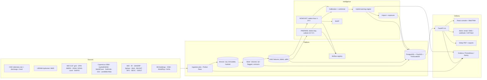
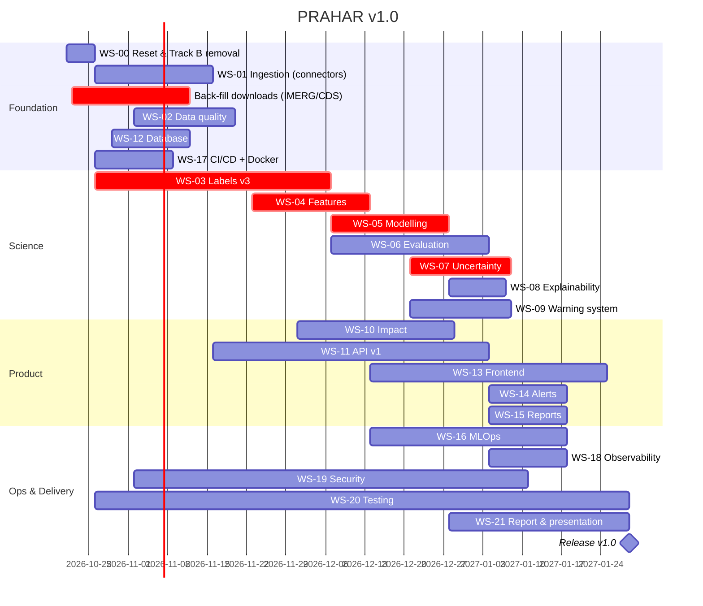

# PRAHAR Master Plan: Uttarakhand Flash-Flood Intelligence, from course project to industry grade

**Predict · Prepare · Protect**

| | |
|---|---|
| Document | `PRAHAR_MASTER_PLAN.md`, version 1.0 |
| Date | 2026-10-20 |
| Scope | The whole PRAHAR system for Uttarakhand: data, labels, features, models, uncertainty, warnings, impact, API, database, frontend, MLOps, infrastructure, security, testing, research report. |
| Out of scope | Track B / "Space mode" (removed, see WS-00); Himachal Pradesh and Sikkim until the stretch phase (WS-23). |
| Status | Plan, approved for execution once the new repository exists. |
| Progress (2026-10-21) | **Done:** WS-00.2 (`src/terrain.py` + 7 tests), 00.3, 00.4, 00.6 (single raw copy + SHA-256 manifest), 00.7, 02.1 (`params.yaml`, values unchanged), 09.1 (one tier table), 13.1, 16.1 (clean registry; test metrics had been labelled validation), 17.3 (GitHub Actions), 19.1 (admin token + CORS allow-list), 11.2 (lifespan), 21.6 (stale comments / report note), 06.2 (base rate + PR-AUC lift on Metrics), 06.7 in the UI (one lead-time number on Forecast and Landing), V-35 (one rain cap). 47 tests pass, audit 0 fail. Repo: github.com/harshgitty58/Flash_Flood_Prediction. **Next:** data downloads without accounts (IMD grid, GLO-30, HydroSHEDS, WorldCover, OSM), then WS-07 calibration fixes. **Round 2 (2026-10-21):** WS-07.2/07.3 study (RQ4: Platt/beta pass, candidate for v1.0), WS-09.6 (hysteresis not needed, 0.41 changes/gauge-day), WS-05.7 monotone study (V-38 found; constraints cost 0.015 PR-AUC, not adopted), WS-20.6 + 08.5 behaviour tests, WS-01.9 / 04.7 terrain at 51 gauges from GLO-30, WS-22.1 licences, WS-06.7 docs/metrics.md, WS-21.4 architecture, WS-21.5 ADRs (ADR-007 committed before tuning), WS-18.6 runbook. 51 tests. |
| Supersedes | `REMAINING_TASKS.md`, `EXECUTION_PLAN.md`, `INDUSTRY_UPGRADE_PLAN.md`, `REMAINING_PHASES_PLAN.md`, `PLATFORM_BUILD_PLAN.md`, `UTTARAKHAND_FOCUS_PLAN.md`. Keep those as history and do new work from this file. |
| Companion docs | `Data Science Course Project (1).md` (the brief), `flood_intelligence_platform.md` (product spec), `LABELS_PLAN.md`, `MODEL_UPGRADE_PLAN.md`, `COVERAGE_PLAN.md` |

---

## Contents

**Part I: Why and where we are**
1. Executive summary
2. Product definition: users, jobs, principles, scope
3. Current-state audit: the system as built
4. Value audit: every number in the repo, checked (38 findings)

**Part II: Target design**
5. Target architecture
6. Repository and code standards

**Part III: Workstreams (each one has features, steps, values and a definition of done)**
- WS-00 Repository reset and Track B removal
- WS-01 Data platform and ingestion
- WS-02 Data quality and contracts
- WS-03 Labels and ground truth
- WS-04 Feature engineering (full feature catalogue)
- WS-05 Modelling
- WS-06 Evaluation and verification
- WS-07 Uncertainty quantification
- WS-08 Explainability
- WS-09 Warning system
- WS-10 Impact and exposure
- WS-11 Backend API
- WS-12 Database
- WS-13 Frontend (page by page)
- WS-14 Alerts and notifications
- WS-15 Reports and exports
- WS-16 MLOps
- WS-17 Infrastructure and DevOps
- WS-18 Observability and SLOs
- WS-19 Security and privacy
- WS-20 Testing strategy
- WS-21 Research report, documentation and presentation
- WS-22 Governance, ethics and licences
- WS-23 Expansion to Himachal Pradesh and Sikkim (stretch)

**Part IV: Delivery**
7. Roadmap, milestones and critical path
8. Metrics scoreboard (complete)
9. Risk register
10. Team, roles and RACI
11. Release checklist (v1.0)

**Appendices**
- A. Glossary and metric formulas
- B. Configuration value register (every constant)
- C. Target directory layout
- D. Data source access cheat-sheet
- E. Architecture decision records
- F. Master backlog index

---

## How to read this plan

- **IDs.** Every task has an ID: `WS-04.12` is workstream 4, task 12. Commits, PRs and the backlog (Appendix F) use these IDs.
- **Priority.**
  - **P0** blocks the course submission or makes a reported number wrong.
  - **P1** is needed to call the system industry grade.
  - **P2** is polish or a showcase item.
- **Effort.**
  - **S** is half a day or less.
  - **M** is 1 to 3 days.
  - **L** is 4 to 10 days.
  - **XL** is more than 2 weeks, so split it.
- **Status marks.**
  - ✅ exists and verified
  - 🟡 exists but partial or flawed
  - ❌ missing
  - 🗑 remove
- **Baselines.** Every baseline number comes from a file in `results/` or `web/public/data/` as of 2026-10-20, and the file is named next to it. Nothing is from memory.
- **Targets.** Every target is a goal judged by a rule written down before the run, not a promise. A missed target is reported honestly, as `results/model_upgrade.md` already does.
- **Definition of done (DoD).** Each workstream ends with checks a reviewer can run.

---

# Part I: Why and where we are

## 1. Executive summary

### 1.1 What PRAHAR is
PRAHAR is a multi-source, uncertainty-aware flash-flood early-warning system for Uttarakhand. It answers four questions for each district and each rain gauge:
1. Will a flood happen in the next 24 hours?
2. How sure are we?
3. Why does the model think so?
4. Who and what is exposed?

It does this by fusing these sources:
- rainfall (CWC telemetry, USDMA state stations, ERA5 reanalysis);
- river discharge (CWC);
- soil moisture (ERA5-Land);
- terrain (DEM);
- flood and landslide history (IMD, GSI, SANDRP, Sphere India, EM-DAT, MHA).

The output is a five-level warning tier (NORMAL, WATCH, ALERT, SEVERE, EXTREME) with a conformal confidence statement and SHAP drivers. On top of that sits a building-level exposure map for about 261,000 buildings.

### 1.2 Where it stands today, in numbers

| Area | Value today | Source |
|---|---|---|
| Hourly dataset | **518,304** station-hours, **44** rain gauges + **7** river gauges, **13** districts, 2022-01-31 → 2026-09-14 | `web/public/data/model.json` |
| Labelled rows | **126,904** (labels end 2023-08-26), **1,951** positive hours | same |
| Training window | 2022-06-21 → 2023-06-30: 94,154 rows, 367 positives, 37 stations | `results/splits.json` |
| Validation / test | Jul 2023 (20,280 rows, 864 positives) / 1–25 Aug 2023 (12,469 rows, 720 positives) | same |
| Documented events | **96** events / **130** district-days for 2022–25, from 5 source families; 22 corroborated | `data/external/labels/labels_summary.json` |
| Deployed model | XGBoost, "Exp G Static history", 23 features | `results/inference_artifacts/feature_columns.json` |
| Hour-level test | ROC-AUC **0.708**, PR-AUC **0.150** (base rate 5.8 %), F1 **0.320**, MCC 0.295 | `results/metrics/metrics_summary.csv` |
| Event-CV pooled (deployed) | ROC-AUC 0.701, PR-AUC 0.186 | `results/event_cv/event_cv_summary.csv` |
| Hybrid tiers ≥ ALERT, station-hour test | precision 0.234, recall 0.650 | `results/warning_levels/warning_thresholds.json` |
| Hybrid ≥ ALERT, district-day test (strict WMO: flood starts on day D) | POD 0.70, FAR 0.90, **CSI 0.095** [0.034–0.165]; baselines: district prior 0.036, persistence 0.053 | `results/verification/verification.json` |
| Same, lenient day (training target: flood on D or D+1) | POD 0.632, FAR 0.812, CSI 0.169 [0.091–0.253], ETS 0.114, HSS 0.205, bias 3.37 | `results/warning_levels/rain_rule.json` (see V-37) |
| External validation (after 2023-08) | **7 of 21** events with gauge data caught (POD 0.333 [0.143–0.524]); 29 events in total | `results/metrics/external_validation.json` |
| Probabilistic skill | Brier 0.0438, **BSS 0.073**, ECE 0.012 | `results/verification/verification.json` |
| Honest lead time | 6 of 18 events warned before the event day; median **3.5 h** | same |
| Conformal (nominal 90 %) | coverage **0.884**; flood-class coverage 1.0; **85 %** of sets "uncertain" | `results/conformal/cp_summary.json` |
| Robustness | flood history removed: ROC 0.716 → **0.500**; 25 % input dropout: → 0.647 | `results/robustness/robustness_summary.csv` |
| District ranking | recall@3 0.345 on external events, against 0.207 for the prior and 0.231 for chance | `web/public/data/district_watch.json` |
| Impact layer | 261,030 buildings around 27 live gauges; 10,297 at MODERATE or above; 1,327 road segments; 228 bridges; 13,752 landmarks | `web/public/data/impact.json` |
| Latency | `/predict` p95 **17.1 ms**; snapshot p95 1.7 ms; one-view building tile 175 ms (was 3,047 ms) | `results/latency/benchmarks.csv` |
| Tests | 37 passing + 1 network test (data contracts, labels, online-vs-batch features, API) | `pytest -q tests` |

### 1.3 Diagnosis in one paragraph
Three model-class upgrades (E1 ensemble, E2 fitted rain thresholds, E3 district-day pooled) did not beat the deployed hybrid, so the bottleneck is not the algorithm. Five facts explain the ceiling:
1. **Too few labels.** There are about 50 IMD flood district-days in training, and each one is copied to every gauge in its district.
2. **Too little history.** Training covers one and a half monsoons.
3. **The gauges miss cloudbursts.** Rainfall alone scores ROC 0.497 in event-CV, and half the documented floods had less than 50 mm/24 h at the district's wettest gauge.
4. **The model is mostly a district prior.** `district_flood_severity_index` carries 66 % of XGBoost gain and a mean |SHAP| of 1.10, against 0.18 for the next feature.
5. **Discharge adds nothing.** Its feature-group importance is 0, because only 7 river gauges exist and they are mostly absent in the training window.

The industry-grade plan is therefore **data-first**:
- more years;
- more and better labels;
- rain seen *between* the gauges;
- physically meaningful terrain and hydrology;
- then models, uncertainty and operations built properly on top.

### 1.4 The six big bets

| # | Bet | Why it moves the numbers | Workstreams |
|---|---|---|---|
| B1 | **25 monsoons, not 1.5.** A district-day "PREPARE" model on 2001–2025 gridded data (IMD 0.25°, GPM IMERG, ERA5/ERA5-Land, GloFAS) | 10–20× more flood events; real temporal and spatial generalisation tests | WS-01, WS-03, WS-05 |
| B2 | **Complete labels.** Back-fill 2001–2021, complete 2024–25 (USDMA SEOC via RTI, GDELT), add severity, hour of onset and non-rainfall exclusions | the biggest single lever on every metric | WS-03 |
| B3 | **See cloudbursts.** IMERG half-hourly max-in-catchment, ERA5 CAPE and water vapour | rainfall-only ROC 0.50 → ≥ 0.65 | WS-01, WS-04 |
| B4 | **Honest uncertainty.** Fix quantised calibration and degenerate conformal sets; use group-conditional and adaptive conformal prediction | coverage within ±2 pts at every level; uncertain sets under 50 % | WS-07 |
| B5 | **An operational warning service.** Hysteresis, district aggregation, IMD colour codes, a CAP feed, subscriptions, sitrep PDF | turns a model into a warning system | WS-09, WS-14, WS-15 |
| B6 | **A production platform.** PostgreSQL/PostGIS, an orchestrated pipeline, model registry, CI/CD, monitoring, auth | reproducible, auditable, deployable | WS-11, WS-12, WS-16–20 |

### 1.5 Headline targets (judged on held-out events or years)

| # | Metric | Baseline | Target v1.0 |
|---|---|---|---|
| T1 | District-day CSI at ≥ ALERT, strict WMO definition (with POD / FAR) | 0.095 (0.70 / 0.90); lenient definition 0.169 | **≥ 0.25** (strict), FAR ≤ 0.70 |
| T2 | Event-CV pooled PR-AUC | 0.186 | **≥ 0.30** |
| T3 | Brier Skill Score vs monthly climatology | 0.073 | **≥ 0.15** |
| T4 | Conformal 90 % coverage gap / share of uncertain sets | −1.6 pts / 85 % | **within ±2 pts for each class / under 50 %** |
| T5 | Events warned ≥ 6 h before onset / median lead | 6 of 18 / 3.5 h | **≥ 50 % / ≥ 12 h** |
| T6 | External POD (events never used in training) | 0.333 | **≥ 0.50** |

### 1.6 Timeline at a glance
**14 weeks** from Monday 26 Oct 2026 to Friday 29 Jan 2027, in 8 milestones (section 7). Section 7.4 has a **6-week course-deadline cut**: what ships if the submission is due in December, and what moves to v1.1.

---

## 2. Product definition

### 2.1 Users and their jobs

| Persona | Organisation (real-world analogue) | Job to be done | What PRAHAR must give them |
|---|---|---|---|
| **State duty officer** | USDMA State Emergency Operations Centre, Dehradun | "Which districts need my attention in the next 24 h, and how sure is that?" | district outlook map, ranked district list, tier with confidence, an auditable reason, a sitrep PDF |
| **District officer** | District Emergency Operations Centre (13 DEOCs) | "Is my district, or a town in it, at risk tonight? What is exposed?" | district page, gauge drill-down, exposed buildings, roads, bridges, schools, hospitals, an alert subscription |
| **Hydromet forecaster** | CWC flood-forecasting division / IMD Met Centre Dehradun | "Do the observations agree with the model? Which gauges are offline?" | source health, source agreement, residuals, a raw-data explorer |
| **Researcher / examiner** | VIT course evaluation, reviewers | "Is the science sound, honest and reproducible?" | metrics with confidence intervals, ablations, model card, datasheets, a one-command rebuild |
| **Public (read-only, later)** | citizens, pilgrims (Char Dham) | "Is it safe to travel on route X today?" | a simplified public page (P2, after v1.0, with a disclaimer) |

### 2.2 Product principles (non-negotiable)
1. **Every number shown comes from the pipeline.** Nothing is hand-typed in the UI. The current rule in `scripts/export_frontend_data.py` is kept and enforced by a test (WS-20.9).
2. **Uncertainty is first-class.** Every probability carries a confidence statement. "Uncertain" is a valid, displayed answer.
3. **Honest evaluation.** Adoption rules are written before the run. Baselines (climatology, persistence, rain rule, district prior) appear next to every model.
4. **No leakage.** Every feature uses only the past. Labels never feed features. Normalisation and calibration are fitted on the training or calibration window only.
5. **Decision support, not decision making.** PRAHAR estimates hazard and exposure. It does not issue evacuation orders or damage estimates, and every page and PDF says so.
6. **Degrade gracefully.** If a source fails, the system says so, widens uncertainty, and keeps serving the rest.
7. **Reproducible.** One command rebuilds every artefact from raw data, and a lineage audit proves nothing is stale.

### 2.3 Scope v1.0
**In scope:**
- Uttarakhand (13 districts), monsoon and off-season.
- District-day outlook (PREPARE, lead time 24–72 h) and station-hour nowcast (NOWCAST, 1–24 h).
- Hybrid warning tiers, conformal uncertainty, SHAP explanations.
- Building, road, bridge, school and hospital exposure.
- API, database, web console, alerts, sitrep PDF, monitoring.

**Out of scope for v1.0:**
- Inundation depth modelling (needs a hydraulic model and high-flood-level maps that aren't public).
- Debris-flow runout and GLOF modelling.
- Satellite damage mapping (Track B, removed).
- Live IoT sensors (simulated through the robustness suite).
- Public mass alerting (needs authority sign-off; WS-14 provides a CAP feed only).

### 2.4 What "industry grade" means here (acceptance definition)

| Dimension | Bar |
|---|---|
| Correctness | data contracts on every source; leakage tests; lineage audit with 0 failures; numbers in the UI equal the numbers in `results/` (snapshot test) |
| Reproducibility | `make all` (or `prahar run all`) rebuilds from raw in under 2 h on a laptop; pinned dependencies; seeded; data versioned by hash |
| Evaluation | WMO-style verification with bootstrap CIs; pre-registered adoption rules; external validation |
| Operations | scheduled ingestion; freshness SLOs; model registry with rollback; health dashboards; alerting on pipeline failure |
| Security | auth on write and admin routes, RBAC, secrets out of git, dependency scanning, restricted CORS |
| Quality | CI on every push: lint, typecheck, unit, data and contract tests, frontend build, E2E smoke |
| Documentation | README, architecture doc, ADRs, API reference (OpenAPI), model card, dataset datasheets, runbook |

---

## 3. Current-state audit: the system as built

### 3.1 Repository inventory (`Project/`, 968 tracked files)

| Area | Contents | Status |
|---|---|---|
| `curated_dataset/` | CWC hourly rainfall 2021–25 and 2026–30 files, CWC discharge (cleaned, hourly, station summary), flood inventory (IMD curated, DFSI, impact, flooded area, 2024–25 supplement), GSI landslides (5,443) | ✅ duplicated in the nested `flash-flood-prediction/curated_dataset/` (V-13) |
| `data/external/` | ERA5 (44 station CSVs: precip, sm_0_7, sm_7_28), USDMA hydromet, Terrarium DEM tiles (z12 `dem12/`, z13 `dem/`), 19 MS building footprint shards, 50+ cached OSM Overpass JSONs, GeoNames, IMD monsoon report, labels (EM-DAT, MHA sitreps + OCR, SANDRP, Sphere SitReps, manual), `emsr927/` (Track B) | 🟡 1.3 GB, unversioned |
| `data/processed/` | cleaned/, features/, final/ (ML dataset 518k rows, API cache) | ✅ |
| `src/` | 41 modules: cleaning, features, target, split, tuning, training, event CV, conformal, warning levels, verification, label audit/experiment, district-day, E1–E3, SHAP, robustness, normalisation, online features, reports; plus `src/space/` (Track B) | ✅ 🗑 space |
| `scripts/` | 30 scripts: fetchers, label builders, impact layer, tiles, exports, audits, benchmarks, run_all (28 stages), notebooks generator | ✅ 🗑 6 Track B scripts |
| `backend/` | FastAPI app (data endpoints, `/predict`, `/predict/scenario`, health, tiles, `/admin/reload`) + low-latency `Engine` | 🟡 no auth, no DB, `/space/*` to remove |
| `web/` | React 19 + Vite 8 + Tailwind 4 + MapLibre 6 + Recharts 3; 11 pages, 9 components; static JSON or API mode | 🟡 149 MB of building tiles in `public/` |
| `models/` | LR, RF, XGBoost joblibs + metadata; `space/` (Track B) | ✅ 🗑 space |
| `notebooks/` | 01–15 (audit → labels/model upgrades), Track B Colab notebook | ✅ 🗑 Track B |
| `results/` | ~180 artefacts (metrics, CV, conformal, SHAP, robustness, verification, labels, impact, latency, reports) | ✅ |
| `tests/` | 4 files, 37 tests (+1 network) | 🟡 |
| deploy | `render.yaml` (API, free 512 MB), `web/vercel.json` (SPA) | 🟡 |
| docs | 16 Markdown plans and reports + `Track B (1).pdf` | 🟡 fragmented, 4 Track B docs |

### 3.2 Pipeline as built (`scripts/run_all.py`, 28 stages)
`data → labels → train → norm → event_cv → conformal → warning → label_audit → label_exp → external → district_day → e1_ensemble → e2_thresholds → e3_pooled → upgrade_report → verification → shap → robustness → metrics → report → label_report → export → impact → tiles → tests → bench → apis → audit`

Strengths:
- linear and resumable (`--from`);
- every stage is a module;
- an end-to-end lineage audit at the end.

Gaps:
- no orchestration, scheduling, retries or caching by input hash;
- no data versioning;
- the stages run serially even where independent (E1/E2/E3, SHAP, robustness);
- no parameters file (constants are spread across 20+ modules; Appendix B).

### 3.3 Data as built

| Source | Granularity | Coverage | Volume | Used in deployed model |
|---|---|---|---|---|
| CWC telemetry rainfall | hourly, 44 gauges | 2022-02 → 2026-09 (valid from 2022-01-31) | 37,410 + 8,969 raw rows (wide) → 518k hourly grid | ✅ 10 features |
| CWC discharge | 15 min → hourly, 7 gauges | 2023-06-07 → 2025-12-31 | 364,868 raw / 90,303 hourly | 🟡 4 features, importance 0 |
| USDMA hydromet | 08:30 and 17:30 IST, ~40 stations | 2022 → 2025 | 9.3 MB | ❌ district-day model only |
| ERA5 / ERA5-Land (Open-Meteo) | hourly at the gauge cell | 2022 → | 44 files | ❌ (Exp H only) |
| Terrain (Terrarium z12, ~38 m) | static per gauge | — | 4 features | ❌ (Exp H only) |
| IMD flood inventory | event list | → 2023-08-26 | 121 events | ✅ labels v1 + 5 static history features |
| DFSI / flooded area / impact | per district | static | 13 rows each | ✅ |
| GSI landslides | points | historical | 5,443 | ✅ 4 features |
| Multi-source events (`labels_2022_2025.csv`) | district-day | 2022–25 | 96 events / 130 dd | ✅ external validation only |
| MS building footprints | polygons | current | 19 shards, ~600 MB | ✅ impact |
| OSM (Overpass) | rivers, roads, bridges, POIs, places | current | 50+ cached queries | ✅ impact |

### 3.4 Models as built

| Model | Hyper-parameters (selected) | Threshold | Test ROC / PR / F1 |
|---|---|---|---|
| Logistic Regression | liblinear, L2, C = 0.01, class_weight balanced | 0.85 | 0.741 / 0.139 / 0.188 |
| Random Forest | 200 trees, max_depth 5, min_samples_leaf 1, min_samples_split 2, balanced_subsample | 0.45 | 0.788 / 0.152 / 0.236 |
| **XGBoost (deployed)** | 100 trees, max_depth 5, learning_rate 0.01, subsample 0.8, colsample_bytree 1.0, scale_pos_weight 255.55 | 0.25 (raw score) | 0.708 / 0.150 / 0.320 |
| District-day LR (E3 / L5) | L2, C = 0.1, balanced, district one-hot | 0.9744 | 0.782 / 0.240 (base rate 0.068) |

Calibration: inductive Venn-Abers on the July 2023 calibration rows (20,280 rows, 864 positives), served as a 400-point look-up grid.
Conformal: Mondrian (class-conditional) at α = 0.20 / 0.10 / 0.05.
Tiers: calibrated probability ≥ 2× / 5× / 10× / 20× the base rate (0.0426), giving 0.0852 / 0.2130 / 0.4260 / 0.8521, combined with the IMD rainfall rule (24 h ≥ 64.5 mm "heavy" → ALERT, adjusted by susceptibility; cloudburst 1 h ≥ 100 mm → EXTREME).

### 3.5 Product surface as built

**Web console** (`/app/*`):

| Page | Kicker | What it shows today |
|---|---|---|
| Landing `/` | — | hero with Sentinel-2 imagery and real 2013 photos, live replay card (top station, tier counts, reporting share), "Three intelligence layers", dataset stats, Track B card (🗑) |
| Overview | 01 | peak-station tier and probability, regional risk trajectory, global drivers, "Districts to watch" ranking, data sources, Track B card (🗑) |
| Forecast | 02 | probability over the replay window, lead-time stats |
| Risk Map | 03 | MapLibre map: Dark / Satellite / Terrain basemaps, 3-D terrain, station markers by tier, station drawer (p, confidence, 90 % set, SHAP drivers) |
| Impact | 04 | building outlines by impact class (quadtree tiles), landmarks, bridges and roads list, object card, place search |
| Uncertainty | 05 | source health, fusion ablation (event-CV ROC per experiment), conformal coverage, inference-time degradation |
| Events | 06 | IMD inventory list, recent events, "event replay" placeholder |
| Data & Model | 07 | model comparison, XGBoost gain, event-CV table, coverage-by-month heat strip, normalisation parameters |
| Metrics | 08 | hour-level metrics, PR / F1 vs threshold slider, confusion matrix, layer contribution, event table, external validation, verification panel (contingency, BSS / ECE, honest lead, relative value), labels panel |
| System | 09 | external services up/down, API status, latency p50 / p95 |
| Space | — | Track B (🗑) |

**API** (`backend/app.py`):
- `GET /health`, `/health/external`, `/data/{name}`, `/stations`, `/risk/snapshot`, `/risk/timeline`, `/model/summary`, `/metrics`, `/events`, `/impact/summary`, `/impact/tiles/index`, `/impact/tiles/{z}/{x}/{y}`, `/landmarks`
- `POST /predict`, `/predict/scenario`, `/admin/reload`
- 9 `/space/*` routes (🗑)

ETag/304 caching and gzip are on.

## 4. Value audit: every number in the repo, checked

I read every configured constant, exported value and reported metric for consistency, meaning and risk. Each finding has a fix ID in Part III. Severity:
- **🔴** makes a reported number wrong or misleading;
- **🟠** design flaw that limits skill;
- **🟡** hygiene.

### 4.1 Calibration, uncertainty and tiers

| ID | Finding | Evidence | Sev | Fix |
|---|---|---|---|---|
| V-01 | **Two different tier tables.** `scripts/export_frontend_data.py` defines `TIERS` cut-offs 0.15 / 0.30 / 0.50 / 0.75, but the real tiers in `src/warning_levels.py` are 0.0852 / 0.2130 / 0.4260 / 0.8521. The export's `tier()` is dead code and `TIERS` only orders `tier_counts`. One edit could silently switch the UI to wrong tiers. | export_frontend_data.py:19, :45; warning_thresholds.json | 🔴 | WS-09.1 |
| V-02 | **Calibrated probabilities are quantised.** Many stations show exactly 0.0182 or 0.2595, because the isotonic (Venn-Abers) step function gives a few plateaus. The ranking inside a plateau is lost and the UI shows identical "probabilities". | impact.json `station_p` | 🔴 | WS-07.2 |
| V-03 | **Conformal sets are degenerate.** Coverage at 80 % and 90 % is identical (0.8841) and the uncertain share barely moves (0.8508 vs 0.8510). The 80 % and 90 % sets are the same sets, a consequence of V-02. | cp_summary.json | 🔴 | WS-07.3 |
| V-04 | **Coverage is below nominal at 90 %** (0.884). Calibration month (Jul 2023) and test month (Aug 2023) are not exchangeable: the base rate goes 4.3 % → 5.8 %. | cp_summary.json, splits.json | 🟠 | WS-07.4 |
| V-05 | **The Venn-Abers interval width (0.0006) is shown as "uncertainty".** It reflects calibration-set size, not predictive uncertainty, and users will read it as "very certain". | snapshot.json `mean_interval_width` | 🟠 | WS-07.6 |
| V-06 | **"1.8 % → EXTREME".** The peak station shows calibrated p = 0.0182 at tier EXTREME because the rainfall layer set the tier. The `trigger` field exists, but the headline pairs a tiny probability with the top tier. | snapshot.json, Landing / Overview | 🟠 | WS-13.2 |
| V-07 | **Several operating points, none labelled.** Metrics-page thresholds are LR 0.85, RF 0.45, XGB 0.25 (raw score, max-F1 on validation). Event-CV lead uses a raw threshold of 0.7117 (5 % hourly FAR). Tiers use calibrated p. Three "thresholds" for one model. | metrics_summary.csv, event_lead_summary.json | 🟠 | WS-06.3 |
| V-08 | **The tier lifts 2× / 5× / 10× / 20× are a convention, not an optimisation.** They were never chosen by cost-loss or CSI. | warning_levels.py:33 | 🟠 | WS-09.4 |
| V-09 | **The rain layer drives false alarms.** Validation district-day hybrid has FAR 0.946 and bias 9.8. The rain tier's station-hour precision is 0.023 against 0.239 for the ML tier. | rain_rule.json, warning_thresholds.json | 🟠 | WS-09.5 |

### 4.2 Model and features

| ID | Finding | Evidence | Sev | Fix |
|---|---|---|---|---|
| V-10 | **The model is mostly a district prior.** DFSI = 66.2 % of gain and mean \|SHAP\| 1.10, against 0.18 for `rain_48h`. Removing flood history → ROC 0.50. | model.json, shap_global_importance.csv, robustness_summary.csv | 🔴 | WS-05.4, WS-04.8 |
| V-11 | **Discharge carries zero importance** (group importance 0.0) with 7 gauges, absent in most of the training window, imputed with the training median. | model.json `importance_groups` | 🟠 | WS-01.7, WS-04.5 |
| V-12 | **API decay 0.85 per hour has a half-life of 4.3 h** (ln 0.5 / ln 0.85). That is a 6-hour memory, not an antecedent-wetness index; the classical API is daily with k ≈ 0.85–0.95. | rainfall_features.py, online_features.py `DECAY` | 🟠 | WS-04.3 |
| V-13 | **XGBoost search is too narrow and likely underfits.** 100 trees × learning rate 0.01, no early stopping, max_depth fixed by a small grid. | xgboost_best_params.json | 🟠 | WS-05.6 |
| V-14 | **scale_pos_weight 255.55 = neg/pos of train.** It inflates raw scores (hence raw threshold 0.25) and makes calibration carry the whole probability scale. | same | 🟡 | WS-05.6 |
| V-38 | **More rain can lower the deployed model's risk.** Adding +20 mm to the 24/48/72 h sums lowers the score in 3.2 % of labelled hours (worst −0.29); +50 mm changes nothing in ~87 % of hours. Monotone constraints remove every violation but cost 0.015 test PR-AUC, so they are not adopted yet (`results/v3/v38_monotone.md`). The coarse probabilities (V-02) come mostly from the model: 109 distinct raw scores, 72 % of test hours share one (`results/v3/rq4_calibration.md`). | v38_monotone.md, rq4_calibration.md | 🟠 | WS-05.6, WS-05.7 |
| V-15 | **Offline-gauge gaps of 7 days (monsoon) and 45 days (dry season)** decide when a silent gauge is "offline". Inside that gap, missing hours must not be read as 0 mm, or a dead gauge looks like a dry one. Check and make explicit. | rainfall_features.py:22–23 | 🔴 (until verified) | WS-02.6 |
| V-16 | **The faulty-gauge quarantine** (more than 20 % of readings over 100 mm/h → whole station dropped) is silent. Which stations were quarantined isn't reported anywhere a user can see. | cleaning.py `FAULTY_SHARE` | 🟡 | WS-02.7 |
| V-17 | **Terrain and soil exist but aren't deployed.** `src/enrich_features.py` builds ERA5, soil moisture, terrain and source-agreement features (Exp H, ROC 0.703), yet the snapshot labels "DEM / terrain" and "Satellite precipitation" as *pending*. Inconsistent wording. | snapshot.json `sources`, event_cv_summary.csv | 🟡 | WS-13.1 |

### 4.3 Evaluation

| ID | Finding | Evidence | Sev | Fix |
|---|---|---|---|---|
| V-18 | **Base rates differ by table and are not printed next to PR-AUC:** 0.0426 (validation / calibration), 0.058 (test), 0.0807 (event-CV), 0.068 (district-day test). PR-AUCs across tables are not comparable. | various | 🟠 | WS-06.2 |
| V-19 | **Event-CV runs on 15,473 rows (1,248 positives)**, not the 126,904 labelled rows, with only 6 merged episodes (MERGE_DAYS = 4). Fold ROC ranges 0.35–0.80, so the variance is huge. | event_cv_summary.csv, event_cv.py:21 | 🟠 | WS-06.5 |
| V-20 | **Two lead-time definitions are both shown:** "median 36 h, 8 of 19" (event-CV, raw threshold at 5 % hourly FAR) and "median 3.5 h, 6 of 18" (honest district-day switch-on). | model.json `lead`, verification.json | 🔴 | WS-06.7 |
| V-21 | **Validation is worse than test** (LR ROC 0.64 → 0.74; hybrid CSI 0.052 → 0.169). With 15–19 flood district-days per split, single-split numbers are noise without CIs. | metrics_summary.csv, rain_rule.json | 🟠 | WS-06.4 |
| V-22 | **Two "event counts" with different meanings:** "Flood history: 121 IMD events" (training inventory, all years) vs "96 events 2022–25" (multi-source validation list). | snapshot.json, labels_summary.json | 🟡 | WS-13.1 |
| V-37 | **Three district-day CSIs for the same warnings:** 0.095 (`verification.py`: flood starting on day D, warning D−1..D, 10 test events), 0.169 (`tier_tuning.py`: calendar day vs the training target "flood on D or D+1", 19 positive days) and 0.150 (`label_experiment.py`: XGBoost alone at raw threshold 0.25, lenient day). The README quoted 0.17 while the Metrics page shows 0.095. | verification.json, rain_rule.json, label_impact.md | 🔴 | WS-06.13 |

### 4.4 Impact

| ID | Finding | Evidence | Sev | Fix |
|---|---|---|---|---|
| V-23 | **Impact class ignores probability.** 2,149 CRITICAL buildings at a replay hour whose peak calibrated p is 1.8 %. Class = tier × setback zone only. | impact.json, build_impact_layer.py | 🟠 | WS-10.4 |
| V-24 | **The HAND-like height comes from 19 m Terrarium z13 tiles** with H_MAX 25 m and D_MAX 500 m, shown "for information only". Real HAND needs a hydrologically conditioned DEM. | build_impact_layer.py:45 | 🟡 | WS-10.2 |
| V-25 | **Setback distances use OSM centrelines**, so wide rivers are under-zoned (stated in the docstring). | same | 🟡 | WS-10.3 |

### 4.5 Data and repository hygiene

| ID | Finding | Evidence | Sev | Fix |
|---|---|---|---|---|
| V-26 | **Only 27 of 44 gauges reported at the replay hour** (39 % offline). Coverage risk is structural. | snapshot.json | 🟠 | WS-01, WS-09.7 |
| V-27 | **The pipeline reads a nested copy:** `src/config.py` reads `flash-flood-prediction/curated_dataset/` (a nested git repo) while `curated_dataset/` holds a byte-identical copy. | config.py:11 | 🟡 | WS-00.6 |
| V-28 | **`results/model_registry.csv` is stale:** 9 rows, empty metrics on the first runs, training end 2024-08-05, features "Exp E" or "Exp F". The deployed model is Exp G. | model_registry.csv | 🟡 | WS-16.1 |
| V-29 | **Stale comments and reports.** `model_config.py` says "Train < 2023-01-01" while the code uses 2023-07-01. `data_preparation_report.md` says "train < 2025, test ≥ 2025". | model_config.py:27–30, data_preparation_report.md | 🟡 | WS-21.6 |
| V-30 | **Docs name a different replay** ("05 Sep 2026", 36,552 buildings) from the exported one (2024-09-12 19:00, 261,030 buildings). | REMAINING_TASKS.md D3, snapshot.json | 🟡 | WS-21.6 |
| V-31 | **Old product name "FloodGuard"** in the Overpass User-Agent and the export docstring. | build_impact_layer.py:60, export_frontend_data.py:1 | 🟡 | WS-00.7 |
| V-32 | **149 MB of building tiles in `web/public/data/bld/`** and a 1.3 GB unversioned `data/`. This doesn't scale and is close to GitHub's limits. | du | 🟠 | WS-10.8, WS-01.12 |

### 4.6 API and security

| ID | Finding | Evidence | Sev | Fix |
|---|---|---|---|---|
| V-33 | **`POST /admin/reload` has no authentication** and CORS is `allow_origins=["*"]`. | backend/app.py:45, :231 | 🔴 | WS-19.1 |
| V-34 | **Deprecated startup hook:** `@app.on_event("startup")` is deprecated in FastAPI (use `lifespan`). | backend/app.py:70 | 🟡 | WS-11.2 |
| V-35 | **Rain limits must match:** API `Reading.rain_mm ≤ 150` and cleaning `MAX_PLAUSIBLE_MM_HR = 150` agree today but are defined twice. Move both to one config. | app.py:197, cleaning.py | 🟡 | WS-02.1 |
| V-36 | **The calibration set is the validation set.** The July 2023 rows tune the thresholds, fit Venn-Abers and score conformal sets. Threshold choice and calibration share data, so coverage is optimistic. | conformal.py, warning_levels.py | 🟠 | WS-07.1 |

**Values checked and kept** (correct as is, recorded in Appendix B):
- IMD 24 h categories 15.6 / 64.5 / 115.6 / 204.5 mm;
- cloudburst 100 mm/h;
- telemetry error code 511.5 mm;
- Uttarakhand bounds 28.5–31.5 N, 77.5–81.1 E;
- 13 canonical districts;
- setback zones 50 / 100 / 200 m (NGT 2017, Jal Shakti 2025, Uttarakhand HC 2013);
- seed 42;
- bootstrap 1,000 block resamples.

---

# Part II: Target design

## 5. Target architecture

### 5.1 Logical view



### 5.2 Two-tier intelligence design (core decision, ADR-003)

| | PREPARE (new) | NOWCAST (upgraded current model) |
|---|---|---|
| Unit | district × day (13 districts) | gauge × hour (44 rain + 7 river) |
| Horizon | today, tomorrow, day after (24 / 48 / 72 h) | next 6 / 12 / 24 h |
| Training years | 2001–2025 (~25 monsoons) | 2022–2025 |
| Inputs | gridded rain (IMD, IMERG), ERA5 atmosphere, ERA5-Land soil / runoff / snow, GloFAS discharge, static terrain / soil / land cover, history | gauge rain, discharge and level, IMERG Early, ERA5 CAPE and humidity, terrain at the gauge, PREPARE prior |
| Role | the duty officer's daily outlook; prior for NOWCAST | timing, intensity, lead time; escalation inside the day |
| Output | p(flood), severity class, conformal set, drivers | p(flood within H h), conformal set, drivers, trigger |
| Combination | tier = max(PREPARE tier, NOWCAST tier, rain-rule tier), with hysteresis and a data-coverage flag (WS-09) | |

### 5.3 Technology choices (course tier vs industry tier)
Each component lists two options:
- **Course tier:** what to build in 14 weeks with a student team and free hosting.
- **Industry tier:** the drop-in upgrade an agency would run.

The interfaces are identical, so moving up is configuration, not a rewrite.

| Component | Course tier (build now) | Industry tier (upgrade path) |
|---|---|---|
| Language / runtime | Python 3.12, Node 22 | same |
| Dataframes | pandas 2.3 + pyarrow; Polars for heavy joins | Polars / DuckDB |
| Lake storage | partitioned Parquet in `data/{bronze,silver,gold}` + DVC (local or Google Drive remote) | S3 / MinIO + DVC or lakeFS |
| Orchestration | Prefect 3 (local server) or `make` targets | Prefect Cloud / Dagster |
| Database | PostgreSQL 16 + PostGIS 3.4 + TimescaleDB (Docker) | managed Postgres (RDS / Cloud SQL) |
| Data contracts | pandera schemas | pandera + Great Expectations docs site |
| ML | scikit-learn 1.7, XGBoost 3.2, Optuna 4, SHAP 0.51, MAPIE (conformal reference) | same |
| Experiment tracking / registry | MLflow 2.x (local file store) | MLflow server + Postgres backend + S3 artefacts |
| API | FastAPI + Uvicorn, pydantic-settings, SQLAlchemy 2 + Alembic | + Gunicorn workers, Redis cache, rate limiting |
| Map tiles | PMTiles (single file) built with tippecanoe, served statically | Martin / pg_tileserv from PostGIS |
| Frontend | React 19, Vite 8, Tailwind 4, MapLibre 6, Recharts 3, TanStack Query | + Sentry, i18n (react-i18next) |
| PDF | WeasyPrint + Jinja2 | same |
| Notifications | SMTP (email), Telegram bot, webhooks; SMS via a provider sandbox | SMS gateway (DLT-registered in India), CAP to SACHET |
| CI/CD | GitHub Actions | + environments, required reviews, CodeQL |
| Hosting | Vercel (web) + Render (API, free 512 MB) + Neon / Supabase (Postgres free tier) | a container platform (Fly / Cloud Run / ECS) |
| Observability | Prometheus client + Grafana Cloud free + Sentry free + structured JSON logs | same, paid tiers |

### 5.4 Data flow and SLAs (operational mode, monsoon 1 Jun – 30 Sep)

| Step | Trigger | Budget |
|---|---|---|
| CWC / USDMA pull | every 15 min | data in Bronze ≤ 20 min after the source publishes it |
| QC → Silver | on arrival | ≤ 2 min |
| Online features (O(1) per gauge) | on arrival | ≤ 1 s for all gauges |
| NOWCAST scoring + calibration + tiers | hourly at HH:20 | ≤ 10 s |
| IMERG Early (≈ 4 h latency) | every 30 min | ≤ 10 min after release |
| PREPARE run | daily 06:00 and 18:00 IST (after ERA5T / IMERG Late) | ≤ 5 min |
| Alert evaluation + dispatch | after each scoring run | ≤ 5 min end to end |
| Sitrep PDF | 07:00 IST daily + on demand | ≤ 30 s |
| Retraining | monthly off-season; frozen in monsoon unless rollback | — |

---

## 6. Repository and code standards

### 6.1 Repository (new remote, ADR-001)
- **A new GitHub repository** with the history starting at the Track-B-free state. The old repository is left untouched as the archive.
- **Monorepo layout**: Appendix C (`prahar/` Python package, `api/`, `web/`, `flows/`, `infra/`, `docs/`).
- **Branching**: trunk-based. `main` is protected; short-lived feature branches `ws04/12-twi-feature`; squash merge; conventional commits (`feat(ws04): …`).
- **Large files**:
  - DVC for data and model binaries;
  - no file over 50 MB in git;
  - building tiles become one PMTiles file in object storage or GitHub Releases.

### 6.2 Python standards

| Rule | Tooling | Gate |
|---|---|---|
| Format and lint | `ruff format`, `ruff check` (E, F, I, B, UP, SIM, PD, NPY) | CI fail |
| Types | `mypy --strict` on `prahar/` core (features, tiers, conformal, API) | CI fail on new errors |
| Config | one `prahar/config/` package: `settings.py` (pydantic-settings, env-driven) + `params.yaml` (every modelling constant from Appendix B) | no magic numbers in modules (ruff `PLR2004` on core) |
| Logging | `structlog` JSON logs with run_id, stage, duration | — |
| Packaging | `pyproject.toml` (uv or pip-tools lock), `prahar` CLI (Typer): `prahar ingest`, `prahar build`, `prahar train`, `prahar evaluate`, `prahar export`, `prahar serve` | — |
| Notebooks | thin drivers over the package only; outputs stripped by `nbstripout` except the frozen report notebooks | pre-commit |

### 6.3 TypeScript standards
- TS `strict`.
- `oxlint` (already used) + `eslint-plugin-react-hooks`.
- Prettier.
- Generated API types from OpenAPI (`openapi-typescript`), so the frontend never hand-types a schema (WS-11.4).
- Components stay under 250 lines. `Space.tsx` was 435 lines and is removed anyway.

### 6.4 Definition of done for any PR
1. Linked backlog ID.
2. Tests added or updated.
3. CI green.
4. Docs updated (README, data dictionary, or ADR when a decision changed).
5. If it changes a reported number: the before/after is in the PR description, and the adoption rule is cited.

---

# Part III: Workstreams

Each workstream has the same shape:
- **Goal**
- **Tasks**, with ID, priority, effort and steps
- **Values**: the numbers it sets or changes
- **DoD**: what a reviewer runs to confirm it's done

---

## WS-00 Repository reset and Track B removal

**Goal.** A new repository containing only the Uttarakhand project. The old repository and its remotes are never modified (ADR-001).

| ID | Task | P | Eff | Steps |
|---|---|---|---|---|
| 00.1 | Create the working copy | P0 | S | Copy `Project/` minus `.git` to the new folder, `git init`, add the new remote. The old repo is not touched: no commit, tag or push. |
| 00.2 | Salvage reusable terrain code | P0 | S | Port into `prahar/terrain/`: Priority-Flood D8 (Barnes et al. 2014) from `scripts/flowdir.py`, `hand()` from `src/space/flood.py`, `slope_percent()` from `src/space/data.py`. Port the numpy algorithms only, not the rasterio I/O. Add unit tests on a synthetic 10×10 DEM (known flow paths). |
| 00.3 | Delete Track B files | P0 | S | `src/space/`; scripts `export_space.py`, `check_emsr.py`, `capture_space.py`, `flowdir.py`, `s2_thumbs.py`, `make_trackb_notebook.py`; `notebooks/trackB_train_floodseg_colab.ipynb`; `models/space/`; `results/space/`; `web/src/pages/Space.tsx`; `web/src/components/TrackBCard.tsx`; `web/public/data/space_*.json`; `web/public/img/space/`; `TRACKB_REPORT.md`, `TRACKB_WIN_PLAN.md`, `TRACK_B_PLAN.md`, `Track B (1).pdf`; `data/external/emsr927/`. Move `prahar_floodseg_v2.zip` to an archive outside the repo. |
| 00.4 | Edit shared files | P0 | S | `backend/app.py` lines 237–374 (Space block and its imports `re`, `subprocess`, `sys`, `threading`, `uuid`); `web/src/main.tsx` (drop the Space route, add a redirect from `/app/space` to `/app`); `AppShell.tsx` (nav group and icon); `Overview.tsx` and `Landing.tsx` (TrackBCard; on Landing, replace it with a "Verified results" card driven by `metrics.json`); `lib/data.ts` (`useData` union); `scripts/capture_screens.py` lines 51–56; `.gitignore` lines 42, 43, 53, 54; `README.md` Track B section; the comment in `scripts/fetch_home_imagery.py`. |
| 00.5 | Submission media | P1 | S | Archive screenshots 14–27 and re-record the demo videos at milestone M7 (they show Space mode). |
| 00.6 | One copy of the raw data | P0 | S | Point `CURATED_DATA_DIR` at `data/bronze/curated/` (WS-01.11). Remove the nested `flash-flood-prediction/` repo. Keep `tests/test_data.py::test_raw_copies_identical` as a hash check against a DVC-tracked manifest instead. |
| 00.7 | Naming | P2 | S | Rename "FloodGuard" to "PRAHAR" everywhere: Overpass User-Agent `PRAHAR/1.0 (+repo URL; contact email)` and the export docstring. |
| 00.8 | Docs consolidation | P1 | S | Move the old plan files to `docs/history/`, keep `README.md`, and add `docs/README.md` as the index. This master plan becomes `docs/PLAN.md`. |

**DoD.**
- `git grep -i -E "space mode|track ?b|trackb|src\.space|emsr|floodseg|kuro"` returns nothing outside `docs/history/`.
- `npm run build` passes.
- `pytest -q` passes.
- `prahar audit` (formerly `scripts/audit_pipeline.py`) reports 0 failures.
- `/docs` lists no `/space` routes.
- The old repository's `git log` is unchanged.

---

## WS-01 Data platform and ingestion

**Goal.** Every source the brief lists (12 parameter groups) is ingested by a connector into an immutable, hashed Bronze layer, then into a cleaned Silver layer, with a catalogue entry and a freshness SLO.

### 01-A Source catalogue (DS-IDs)

| DS | Source | Access | Variables | Resolution | Period | Cadence | Status | Connector |
|---|---|---|---|---|---|---|---|---|
| DS-01 | CWC telemetry rainfall | India-WRIS telemetry export (same route as the curated files) | hourly rain (mm), station metadata | 44 gauges | 2021-10 → present | hourly (live), monthly back-fill | ✅ files / ❌ automation | `ingest/cwc_rain.py` |
| DS-02 | CWC river discharge | India-WRIS / CWC | discharge (m³/s), 15 min | 7 gauges | 2023-06 → 2025-12 | hourly | ✅ files / ❌ automation | `ingest/cwc_discharge.py` |
| DS-03 | CWC flood-forecast stations | ffs.india-water.gov.in, India-WRIS | **water level (m)**, **warning level**, **danger level**, HFL | ~10 Uttarakhand sites (e.g. Rishikesh, Haridwar, Devprayag, Srinagar, Rudraprayag, Joshimath, Tanakpur) | as available | hourly | ❌ | `ingest/cwc_level.py` |
| DS-04 | USDMA hydromet | sfo.usdma.in public CSV | rain since last reading, dry/wet/max/min temperature, sky, weather | ~40 stations | 2022 → | 2× daily (08:30, 17:30 IST) | ✅ `fetch_hydromet.py` | port |
| DS-05 | IMD / USDMA AWS and ARG | IMD (request), USDMA | hourly rain, temperature, RH, wind | ~100+ AWS / ARG | as granted | hourly | ❌ (request) | `ingest/imd_aws.py` |
| DS-06 | ERA5 via Open-Meteo archive | open API, no key | precip, soil moisture 0–7 / 7–28 cm; **add** temperature_2m, relative_humidity_2m, dew_point_2m, surface_pressure, wind_speed_10m, snow_depth | 0.1° (ERA5-Land) / 0.25° | 1950 → (~5-day lag) | daily | ✅ partial | extend `fetch_era5.py` |
| DS-07 | ERA5 single levels (CDS) | Copernicus CDS (free account, API key) | **CAPE, total column water vapour**, total precipitation, convective precipitation, 850 hPa specific humidity, 500 hPa vertical velocity (pressure levels) | 0.25°, hourly | 1940 → | daily (ERA5T) | ❌ | `ingest/era5_cds.py` |
| DS-08 | ERA5-Land (CDS) | Copernicus CDS | swvl1–4 (0–7, 7–28, 28–100, 100–289 cm), runoff (ro), surface runoff (sro), sub-surface runoff (ssro), snow water equivalent (sd), snowmelt (smlt) | 0.1°, hourly | 1950 → | daily | ❌ | `ingest/era5land_cds.py` |
| DS-09 | **GPM IMERG V07** | NASA GES DISC (Earthdata login), OPeNDAP subset to the bbox | precipitation (mm/h), precipitation quality index | 0.1°, 30 min | 2000-06 → | Early (~4 h), Late (~14 h), Final (~3.5 months) | ❌ | `ingest/imerg.py` |
| DS-10 | **IMD gridded rainfall** | `imdlib` (IMD Pune) | daily rain | 0.25°, daily | 1901 → last released year | yearly | ❌ | `ingest/imd_grid.py` |
| DS-11 | IMD gridded temperature | `imdlib` | Tmax, Tmin | 1°, daily | 1951 → | yearly | ❌ (P2) | same |
| DS-12 | **GloFAS v4** | CDS `cems-glofas-historical` (+ `-forecast` for live) | river discharge (m³/s) | 0.05°, daily | 1979 → | daily | ❌ | `ingest/glofas.py` |
| DS-13 | SMAP L4 SPL4SMGP | NSIDC (Earthdata) | surface and root-zone soil moisture | 9 km, 3-hourly | 2015-03 → | daily | ❌ (P1) | `ingest/smap.py` |
| DS-14 | **Copernicus DEM GLO-30** | AWS open data `copernicus-dem-30m` (no key) | elevation | 30 m | static | once | ❌ (Terrarium today) | `ingest/dem.py` |
| DS-15 | HydroSHEDS: HydroBASINS L7–L10, HydroRIVERS | hydrosheds.org (free) | catchment polygons and IDs, river network, Strahler order | 15 arc-sec | static | once | ❌ | `ingest/hydrosheds.py` |
| DS-16 | MERIT Hydro | registration (free, research) | upstream area, flow direction, HAND (90 m) | 3 arc-sec | static | once | ❌ (P2 cross-check) | `ingest/merit.py` |
| DS-17 | ESA WorldCover 2021 | AWS open data | 11 land-cover classes | 10 m | 2021 | once | ❌ | `ingest/worldcover.py` |
| DS-18 | SoilGrids 2.0 | ISRIC WCS | sand, silt, clay %, bulk density, organic carbon (0–30 cm) | 250 m | static | once | ❌ | `ingest/soilgrids.py` |
| DS-19 | GSI landslide inventory | Bhukosh (GSI) | point, type, date where present | points | historical | yearly | ✅ 5,443 | port |
| DS-20 | NRSC Landslide Atlas of India (2023) | NRSC / ISRO (published maps) | landslide density, susceptibility zones | district / map | 1998–2022 | once | ❌ | manual digitise / `ingest/atlas.py` |
| DS-21 | NASA Global Landslide Catalog (COOLR) | NASA open data | dated landslides, trigger, fatalities | points | 2007 → | yearly | ❌ | `ingest/glc.py` |
| DS-22 | IMD monsoon onset / withdrawal | IMD end-of-season reports (on disk, `data/external/imd/`) | onset and withdrawal dates over Uttarakhand | state | 2001 → | yearly | 🟡 PDF | `ingest/monsoon_dates.py` |
| DS-23 | Flood and event labels | WS-03 | events | district-day | 2001 → | weekly in season | 🟡 | `labels/` |
| DS-24 | MS Global ML Building Footprints | Microsoft (ODbL) | building polygons | per building | current | once a year | ✅ 19 shards | port |
| DS-25 | OSM India extract | Geofabrik daily PBF (replaces 50+ ad-hoc Overpass queries) | rivers, roads, bridges, schools, hospitals, places | vector | current | weekly | 🟡 Overpass | `ingest/osm.py` (pyosmium) |
| DS-26 | WorldPop 2020 / GHSL GHS-POP | open | population per cell | 100 m | 2020 / 2025 | once | ❌ | `ingest/population.py` |
| DS-27 | IMD district colour-coded warnings (benchmark) | IMD Met Centre Dehradun bulletins (archive if obtainable) | Green / Yellow / Orange / Red per district per day | district-day | as available | daily | ❌ (P1, benchmark only) | `ingest/imd_warnings.py` |
| DS-28 | GeoNames (place names) | on disk | populated places | points | current | once | ✅ | port |

### 01-B Tasks

| ID | Task | P | Eff | Steps / acceptance |
|---|---|---|---|---|
| 01.1 | Medallion layout | P0 | S | Create `data/bronze/<ds>/<yyyy>/<mm>/`, `data/silver/<entity>/`, `data/gold/<table>/`. Bronze is append-only, and every file gets a `_manifest.json` (source URL, retrieved_at UTC, sha256, bytes, licence). |
| 01.2 | Connector base class | P0 | M | `prahar/ingest/base.py`: `fetch(window) → list[Path]`, retries (3, exponential back-off 2 / 4 / 8 s), timeouts (30 s connect, 300 s read), polite User-Agent, cache by URL hash, idempotent re-runs, structured log line per file. |
| 01.3 | Port the existing fetchers | P0 | M | `fetch_era5.py`, `fetch_hydromet.py`, `fetch_mha_sitreps.py`, `parse_*` and the OSM / MS footprint code all move onto the base class. Behaviour unchanged (a golden-file test compares outputs). |
| 01.4 | IMERG connector (DS-09) | P0 | M | OPeNDAP subset of 77.5–81.1 E, 28.5–31.5 N (≈ 36 × 30 cells). Half-hourly → hourly sums. Store as Parquet (cell_id, ts_utc, precip_mm, quality). Back-fill 2000-06 → present (~25 yr × 365 × 48 files; parallel 8 workers; expect ~1–2 days of download, so start it in week 1). |
| 01.5 | IMD gridded connector (DS-10) | P0 | S | `imdlib.get_data('rain', 2001, 2025)`, clip to the bbox, write cell-day Parquet. |
| 01.6 | ERA5 / ERA5-Land CDS connectors (DS-07, DS-08) | P0 | M | Monthly requests per variable group for the bbox. NetCDF → Parquet (cell, ts, vars). Queue-aware (CDS requests can wait for hours, so submit the full back-fill in week 1). |
| 01.7 | GloFAS connector (DS-12) | P0 | M | Extract discharge at each district's main river outlet points (HydroRIVERS order ≥ 5 crossing the district boundary) and at the 7 CWC discharge gauges (for bias check). |
| 01.8 | CWC level and danger levels (DS-03) | P1 | M | Scrape or download station level series and the static warning / danger / HFL values into the `stations` table. Feature: `level_minus_warning_m`, `level_minus_danger_m`. |
| 01.9 | Static layers (DS-14…18, 20, 26) | P0 | M | Download, mosaic and clip GLO-30, HydroBASINS L7–L10, WorldCover, SoilGrids, population. Write Cloud-Optimised GeoTIFFs to `data/silver/static/`. |
| 01.10 | OSM from Geofabrik (DS-25) | P1 | M | `india-latest.osm.pbf` → clip to Uttarakhand (osmium extract) → GeoParquet layers: waterways, roads, bridges, schools, hospitals, places. This replaces the 50+ Overpass caches: deterministic and versioned. |
| 01.11 | Raw curated files into Bronze | P0 | S | Move `curated_dataset/*` to `data/bronze/curated/`, track with DVC, and add a manifest. |
| 01.12 | DVC + remote | P0 | S | `dvc init`; a remote on Google Drive or S3-compatible storage; `dvc.yaml` stages mirror the Prefect flows; `dvc repro` rebuilds Gold. |
| 01.13 | Station registry | P0 | M | `data/silver/stations.parquet` → DB table `stations`. One row per gauge: id, name, agency, kind (rain / river / level / aws), lat, lon, elevation_m (GLO-30), district, HydroBASINS L8 ID, Garhwal/Kumaon division, elevation zone, commissioning date, status (active / offline / quarantined), quarantine reason. |
| 01.14 | Live mode | P1 | M | Prefect deployment: `cwc_rain` and `hydromet` every 15 min in monsoon (hourly off-season), IMERG Early every 30 min, ERA5T and GloFAS daily. Each run writes freshness metrics (WS-18). |
| 01.15 | Data catalogue | P1 | S | `docs/data/catalogue.md`, generated from the connector registry: DS-ID, owner, licence, refresh, row counts, last success. Rendered on the System page. |
| 01.16 | Spatial units | P0 | S | Canonical polygons for the 13 districts (Survey of India / GADM 4.1 L2, with the licence noted) and HydroBASINS L8 catchments. Every gridded source gets an area-weighted cell → district / catchment weight table (`gold/weights_*.parquet`). |

**Values.**
- Bbox 77.5–81.1 E, 28.5–31.5 N (from `UTTARAKHAND_BOUNDS`).
- Time zone: store UTC, display IST (Asia/Kolkata, +05:30).
- Hourly grid aligned to clock hours (as `test_rain_windows_are_clock_hours` already requires).

**DoD.**
- `prahar ingest all --since 2001-01-01` completes.
- Every DS-ID marked P0 has data in Bronze with a manifest.
- `prahar catalogue` lists row counts.
- The freshness check passes for live sources.

---

## WS-02 Data quality and contracts

**Goal.** No bad value reaches a feature silently. Every rule is a written, tested contract, and every rejected or flagged value is counted and visible.

### 02-A QC flag taxonomy (one column, `qc_flag`, on every observation)
`valid` · `suspect_spike` · `suspect_flatline` · `suspect_spatial` · `invalid_negative` · `invalid_range` · `invalid_code` (511.5) · `missing` · `offline` · `quarantined_station`

### 02-B Rules (values centralised in `params.yaml → qc:`)

| Rule | Applies to | Value | Action |
|---|---|---|---|
| Telemetry error code | CWC rain | == 511.5 mm | `invalid_code` → NaN |
| Negative | rain, discharge, level | < 0 | `invalid_negative` → NaN |
| Hourly plausibility cap | rain | > 150 mm/h | `invalid_range` → NaN (same constant as the API input cap, V-35) |
| Cloudburst-range check | rain | 100–150 mm/h | `valid`, but needs corroboration: a neighbour gauge within 25 km ≥ 20 mm/h, **or** IMERG ≥ 10 mm/h, **or** a USDMA report the same day; otherwise `suspect_spike` (kept, flagged, shown) |
| Flat-line | rain | same non-zero value ≥ 6 consecutive hours | `suspect_flatline` |
| Spatial consistency | rain | r ≥ 50 mm/h while every gauge within 25 km has < 1 mm/h **and** IMERG < 2 mm/h | `suspect_spatial` |
| Faulty-station quarantine | rain | > 20 % of non-code readings > 100 mm/h | whole station `quarantined_station`, **listed** in `qc/quarantine.csv` and on the System page (V-16) |
| Discharge range | discharge | > max(15,000 m³/s, 1.5 × the station's record) | `invalid_range` |
| Discharge step | discharge | \|Δ1h\| > 50 % of the station's 99.9th percentile in a non-monsoon month | `suspect_spike` |
| Level vs danger | level | > HFL + 2 m | `suspect_spike` |
| Offline detection | all gauges | no record for 24 h in monsoon, 7 days off-season | `offline`; missing hours are **NaN, never 0 mm** (V-15) |
| Timestamp | all | parses, monotonic per station, no duplicates per (station, hour), IST → UTC once | reject row + count |
| Coordinates | stations | inside the bbox, inside the stated district polygon (± 2 km) | fail the build |
| District names | all | maps onto the 13 canonical districts through `district_mapping.py` | fail the build |
| Gridded sources | IMERG, IMD, ERA5 | no all-NaN days in the bbox; value ranges per variable | fail the ingest |
| Label rows | events | canonical district, date inside the source's coverage, source and URL present | fail the build (existing tests) |

### 02-C Tasks

| ID | Task | P | Eff | Steps |
|---|---|---|---|---|
| 02.1 | `params.yaml → qc` | P0 | S | Move `SENTINEL_MM`, `MAX_PLAUSIBLE_MM_HR`, `FAULTY_SHARE`, the 15,000 discharge cap and the offline gaps out of the modules into the YAML. Modules read the config. |
| 02.2 | pandera schemas | P0 | M | One schema per Silver entity: `rain_obs`, `discharge_obs`, `level_obs`, `hydromet_obs`, `grid_rain`, `era5`, `glofas`, `stations`, `events`. Validated in the pipeline and in CI on a 1-month sample. |
| 02.3 | Spatial and IMERG cross-checks | P1 | M | Implement the spike, spatial and cloudburst corroboration rules (they need IMERG in Silver first). |
| 02.4 | QC report | P0 | S | `results/qc/qc_summary.json` + `docs/data/qc_report.md`: counts per flag per source per month, quarantined stations, offline hours per gauge. Shown on the System page. |
| 02.5 | Coverage matrix v2 | P0 | S | Extend `src/data_window.py` to every DS-ID. Output a source × month heat-map (the Model page already shows the v1 strip). |
| 02.6 | **Verify offline-gap semantics (V-15)** | P0 | S | Write a test: a gauge with a 48 h gap in July must produce NaN rolling sums (or an `offline` state), not zeros. If the current code fills zeros inside the 7-day gap, fix it and re-run. Report the metric change in `results/qc/offline_fix.md`. |
| 02.7 | Make the quarantine visible (V-16) | P1 | S | Export quarantined stations with their reason to `stations.json` (`status`, `status_reason`) and show them greyed on the map. |
| 02.8 | Freshness contracts | P1 | S | Per live source: maximum allowed age (CWC rain 2 h, hydromet 14 h, IMERG Early 6 h, ERA5T 7 d, GloFAS 2 d). Breach → `source_health = stale` and the uncertainty widens (WS-07.9). |
| 02.9 | Gauge homogeneity | P2 | M | Pettitt / SNHT change-point test on monthly gauge totals vs IMERG. Flag relocated or recalibrated gauges. |

**DoD.**
- CI runs the schema checks.
- `results/qc/qc_summary.json` exists for every source.
- The V-15 test passes.
- The System page lists quarantined and offline gauges.

---

## WS-03 Labels and ground truth

**Goal.** The most complete, auditable Uttarakhand flood-event list ever assembled for this purpose: **2001–2025**, district-day resolution, with source, confidence, severity, type, onset hour where known, and a **coverage mask** that says where "no report" can be read as "no flood".

### 03-A Event schema v3 (`labels/events_v3.parquet`)

| Field | Type | Values / rule |
|---|---|---|
| `event_id` | str | `UK-YYYYMMDD-DIST-nn` |
| `date`, `end_date` | date (IST) | end ≥ date; spell ≤ 7 days, else split |
| `onset_hour_local` | int 0–23 / null | when the source states it (SANDRP and news often do) |
| `district` | enum(13) | canonical names only |
| `place`, `lat`, `lon` | str / float | gazetteer match (GeoNames + OSM places); lat/lon only when the place resolves |
| `type` | enum | `cloudburst`, `flash_flood`, `riverine_flood`, `landslide_dam_outburst`, `glof`, `avalanche_rock_ice`, `urban_waterlogging`, `debris_flow` |
| `trigger_meteorological` | bool | **false** for GLOF / avalanche / rock-ice events (e.g. Chamoli 7 Feb 2021). These are excluded from rainfall-model training but kept for exposure analysis. |
| `deaths`, `missing`, `injured`, `houses_damaged`, `roads_blocked`, `bridges_damaged` | int / null | as reported |
| `severity` | 0–3 | S1 = event reported, no deaths, < 10 houses; S2 = 1–9 deaths **or** ≥ 10 houses **or** a bridge lost; S3 = ≥ 10 deaths **or** ≥ 100 houses |
| `sources` | list | `imd`, `ifi`, `imd_dwe`, `sandrp`, `sphere`, `mha`, `emdat`, `dfo`, `ndem`, `seoc`, `gdelt`, `news` |
| `n_independent_sources` | int | distinct source families |
| `date_confidence` | enum | high = date stated by an official or ≥ 2 independent sources agree within ± 1 day; medium = 1 reputable source states the date; low = a range, or the date is inferred |
| `confidence` | enum | high / medium / low (same rubric, applied to the occurrence itself) |
| `urls` | list | every claim traceable |
| `label_version` | str | `v3.0` |

### 03-B Coverage mask (`labels/coverage_v3.parquet`, district × day)
For each source and day: was the source actively monitoring that district?
- The IMD inventory runs to 2023-08-26.
- SANDRP compilations cover monsoon seasons.
- MHA sitreps cover the days a report was issued.
- SEOC covers the RTI-granted period.

**Negative rule.** A district-day is a usable negative only when **at least one** high-recall source covered it **and** reported nothing. Otherwise it is **unlabelled** (excluded from training and scoring). This generalises today's "no report ≠ no flood" rule (`label_end` 2023-08-26).

### 03-C Sources and periods

| Period | Sources | Expected yield |
|---|---|---|
| 2001–2012 | India Flood Inventory (IFI), IMD *Disastrous Weather Events* annual reports, EM-DAT, Dartmouth Flood Observatory archive, NASA GLC (landslide co-labels), news archives (GDELT starts 2015, so use newspaper archives sparingly) | the sparsest period; mostly S2–S3 events |
| 2013 | Kedarnath and the June 2013 disaster: official reports, NIDM report, IMD DWE | many district-days, S3 |
| 2014–2021 | IMD DWE, IFI, EM-DAT, SANDRP (from ~2016), GDELT (2015 →), MHA sitreps, DFO, NDEM | medium density |
| 2022 – Aug 2023 | existing v1 (IMD) + v2 (SANDRP, Sphere, MHA, EM-DAT, curated) | ✅ 68 events |
| Sep 2023 – 2025 | existing (28 events) + **USDMA SEOC daily reports (RTI)** + GDELT + MHA OCR | completes Window C for training |
| 2026 season | live: MHA daily sitreps (connector exists), SANDRP, GDELT; SEOC on request | operational verification |

**Target:** ≥ 300 high or medium-confidence flood district-days for 2001–2025 (today: 130 for 2022–25), with an onset hour for ≥ 30 % of the events from 2015 on.

### 03-D Tasks

| ID | Task | P | Eff | Steps |
|---|---|---|---|---|
| 03.1 | File the RTI to USDMA | P0 | S | Week 0. Ask for SEOC daily disaster reports, 1 Jun 2023 → 31 Dec 2025, district-wise (date, place, type, deaths, damages), in machine-readable form where available. Follow up at 30 days (RTI Act s.7: reply within 30 days). Track in `docs/data/rti_log.md`. |
| 03.2 | Schema v3 + migration | P0 | S | Upgrade `scripts/build_labels.py` to schema v3. Migrate the 96 events and add the new fields (type, trigger_meteorological, severity, onset hour). |
| 03.3 | IFI + IMD DWE parsers | P0 | L | Parsers for IFI (CSV / shapefile) and the IMD DWE PDFs (pypdf; OCR via the existing RapidOCR route for scans). District / place resolution through the existing `ALIASES` and `PLACES` tables, extended. |
| 03.4 | GDELT miner | P1 | M | Query the GDELT 2.0 events and GKG tables (BigQuery free tier or the raw CSV) for Uttarakhand plus keywords (cloudburst, flash flood, बादल फटा, landslide, "SDRF rescue") from 2015 →. Cluster articles by (district, date ± 1). Accept a candidate only with ≥ 2 distinct outlets. Output candidates for human review, **never auto-accepted**. |
| 03.5 | DFO / EM-DAT / NDEM / GLC merge | P1 | M | Parse, then expand to district-days only when the district is named and the event lasts ≤ 7 days (existing EM-DAT rule `MAX_EVENT_DAYS`). |
| 03.6 | Merge and dedupe | P0 | M | Same district, dates within ± 1 day, and the same place or no place → one event. Union the sources. Recompute `n_independent_sources` and confidence. |
| 03.7 | Annotation guideline + double coding | P1 | M | `docs/data/labelling_guide.md` with rules and 20 worked examples. Two people code the same 60 random reports. Target **Cohen's κ ≥ 0.80** on (is event, district, date ± 1, type, severity). Resolve disagreements and record them in `labels/adjudication.csv`. |
| 03.8 | Coverage mask | P0 | M | Build 03-B from each source's documented coverage. Tests: no negative outside coverage; every positive inside the coverage of at least one source. |
| 03.9 | Label audit v3 | P0 | S | Extend `src/label_audit.py`: per source pair, matched / only-A / only-B at ± 1 day, by year, with recall estimates (capture-recapture, Lincoln–Petersen, for total event-count uncertainty). |
| 03.10 | Label versions | P0 | S | v1 (IMD), v2 (2022–23 multi-source), v3 (2001–2025 full). Every experiment records the label version, and the reports compare v1 / v2 / v3 on identical rows (LABELS_PLAN reporting rule). |
| 03.11 | Hour-level target | P1 | M | Where `onset_hour_local` is known: `y_H(t) = 1` if onset ∈ (t, t + H] for H ∈ {6, 12, 24}. Elsewhere keep the current day-level rule (flood on day D or D+1). Mixed-resolution training uses sample weights (WS-05.9). |
| 03.12 | Tests | P0 | S | Extend `tests/test_labels.py`: schema, canonical districts, date order, URL presence, no duplicate district-days, every non-meteorological event excluded from rainfall training rows, κ report present. |

**DoD.**
- `labels/events_v3.parquet` and `coverage_v3.parquet` are built by `prahar labels build`.
- The audit report exists.
- κ ≥ 0.80 is documented.
- The ≥ 300-district-day target is met or the shortfall is explained.
- The RTI is filed, with its status logged.

---

## WS-04 Feature engineering: the full feature catalogue

**Goal.** Every parameter in the brief's 12 groups becomes either a computed feature with a definition, window, source, leakage rule and normalisation, or a documented "not used, because …". The catalogue lives in code (`prahar/features/registry.py`). This table is generated from it, and becomes `results/data_dictionary.csv`.

**Legend.**
- Layer: **N** = NOWCAST (gauge-hour), **P** = PREPARE (district-day), **N/P** = both.
- Status: ✅ in the deployed model · 🟡 built but not deployed, or flawed · ❌ to build.
- Normalisation: `log_robust` (log1p, then (x − median) / IQR), `signed_log`, `zscore`, `passthrough`, `cyclic` (sin/cos), fitted on the training window only (as `src/normalization.py` does today).

### 04-A Precipitation (brief group 1)

| Brief parameter | Feature(s) | Definition | Source | Layer | Status |
|---|---|---|---|---|---|
| Rainfall 1 h | `rain_1h` | gauge rain in hour (t−1, t] | DS-01 | N | ✅ |
| | `imerg_1h_pt`, `imerg_1h_catch_max` | IMERG at the gauge cell; max over the gauge's L8 catchment | DS-09 | N | ❌ |
| Rainfall 3 / 6 / 12 / 24 / 48 / 72 h | `rain_3h` … `rain_72h` | rolling sums over clock hours, NaN if > 20 % of the window is missing | DS-01 | N | ✅ |
| | `imerg_{3,6,24,72}h_catch_max` | catchment-max rolling sums | DS-09 | N | ❌ |
| | `rain_d0_{mean,max}`, `rain_d1`, `rain_3d`, `rain_7d` | district daily mean / max from the IMD grid (area-weighted) and IMERG | DS-09, DS-10 | P | ❌ |
| Maximum rainfall intensity | `rain_max_intensity_24h` | max hourly rain in the last 24 h | DS-01 | N | ✅ |
| | `imerg_max30m_24h` | max 30-minute IMERG rate (mm/h) in 24 h, catchment max | DS-09 | N/P | ❌ |
| Rainfall intensity change | `rain_intensity_change_1h` | r_t − r_{t−1} | DS-01 | N | ✅ |
| Antecedent Precipitation Index | `api_decay_85` | API_t = 0.85·API_{t−1} + P_t (hourly; half-life 4.3 h, V-12) | DS-01 | N | ✅ (rename `api_h085`) |
| | `api_d090`, `api_d095` | daily API, k = 0.90 / 0.95, over 30 days | DS-01, DS-10 | N/P | ❌ |
| Hours since rainfall started | `hrs_since_rain_start` | hours since the current wet spell began (≥ 0.5 mm/h, gaps ≤ 2 h allowed), 0 if dry | DS-01 | N | ❌ |
| Hours since heavy rainfall started | `hrs_since_heavy_start` | same, with threshold ≥ 10 mm/h | DS-01 | N | ❌ |
| (added) station-relative rain | `pct_rain_24h`, `pct_rain_72h`, `z_rain_24h_month` | percentile in the station's training distribution; seasonal z-score | DS-01 | N | 🟡 Exp H |
| (added) source agreement | `agree_log_ratio`, `agree_both_wet` | log1p(gauge 24 h) − log1p(ERA5 24 h); both wet if gauge ≥ 35.5 mm **and** ERA5 ≥ 15 mm | DS-01, DS-06 | N | 🟡 Exp H |
| (added) neighbourhood rain | `nbr_max_24h_25km`, `wet_frac_25km` | max 24 h rain among gauges within 25 km; share of those gauges ≥ 35.5 mm | DS-01 | N | ❌ |
| (added) reanalysis rain | `era5_{1,3,6,24,72}h`, `era5_max_1h_24h` | ERA5 at the gauge cell | DS-06 | N | 🟡 Exp H |

### 04-B Soil moisture (group 2)

| Brief parameter | Feature(s) | Definition | Source | Layer | Status |
|---|---|---|---|---|---|
| Surface soil moisture | `sm_0_7` | ERA5-Land 0–7 cm (m³/m³) | DS-06 | N/P | 🟡 |
| | `smap_surf` | SMAP L4 surface | DS-13 | N/P | ❌ (P1) |
| Root-zone soil moisture | `sm_7_28`, `sm_28_100`, `sm_root` | ERA5-Land layers; `sm_root` = depth-weighted 0–100 cm | DS-08 | N/P | 🟡 / ❌ |
| Soil moisture anomaly | `sm_anom` | value − station-month training mean | DS-06 | N/P | 🟡 |
| Soil moisture percentile | `sm_pct` | percentile vs 2001–2020 day-of-year ± 15 d climatology | DS-08 | N/P | ❌ |
| Change 24 h / 72 h | `sm_d24`, `sm_d72` | differences | DS-08 | N/P | ❌ |

### 04-C Terrain (group 3), from GLO-30 via `prahar/terrain` (salvaged D8 + HAND)
Each terrain feature is computed at the gauge (point and 1 km buffer) and for the gauge's L8 catchment and each district (area-weighted mean and 90th percentile).

| Brief parameter | Feature | Definition | Status |
|---|---|---|---|
| Elevation | `elev_m` | GLO-30 elevation (replaces Terrarium `terrain_elev_m`) | 🟡 → ❌ |
| Slope | `slope_deg` | Horn (1981) 3×3 | 🟡 → ❌ |
| Aspect | `aspect_sin`, `aspect_cos` | cyclic encoding | ❌ |
| Profile curvature | `curv_prof` | Zevenbergen & Thorne (1987) | ❌ |
| Plan curvature | `curv_plan` | same | ❌ |
| TRI | `tri_m` | Riley et al. (1999) terrain ruggedness | ❌ |
| TWI | `twi` | ln(a / tan β), a = specific catchment area from D8 (Priority-Flood) | ❌ |
| Flow accumulation | `upstream_km2` | D8 contributing area | ❌ |
| SPI | `spi` | ln(a · tan β) | ❌ |
| Drainage density | `drain_density_km_km2` | stream length (HydroRIVERS + OSM waterways) / catchment area | ❌ |
| Distance to river / stream | `dist_stream_m` | to the nearest HydroRIVERS or OSM waterway | ❌ |
| (added) HAND | `hand_m` | height above nearest drainage, along the flow path (proper HAND, not the nearest-pixel approximation) | ❌ |
| (added) relief, TPI | `relief_2km_m`, `tpi_1km_m` | kept from `enrich_features.py`, recomputed on GLO-30 | 🟡 |
| (added) catchment shape | `catch_area_km2`, `melton_ratio` | Melton ruggedness = relief / √area (a debris-flow / flash-flood proneness index) | ❌ |

### 04-D Hydrology (group 4)

| Brief parameter | Feature | Definition | Source | Layer | Status |
|---|---|---|---|---|---|
| River discharge | `q` (was `discharge_clean`) | cleaned hourly discharge | DS-02 | N | ✅ (importance 0, V-11) |
| Δ 1 h / 3 h / 6 h | `q_d1h`, `q_d3h`, `q_d6h` | differences | DS-02 | N | ✅ / ✅ / ❌ |
| Rolling mean / max | `q_mean24h`, `q_max24h` | 24 h rolling | DS-02 | N | ❌ |
| Discharge anomaly | `q_anom` | vs the station-month median | DS-02 | N | ✅ |
| River water level | `lvl_m` | stage | DS-03 | N | ❌ |
| Water-level change | `lvl_d1h`, `lvl_d3h` | differences | DS-03 | N | ❌ |
| Level vs warning / danger | `lvl_minus_warn_m`, `lvl_minus_danger_m` | stage − official level | DS-03 | N | ❌ |
| (added) GloFAS discharge | `glofas_q`, `glofas_q_pct`, `glofas_rp2_exceed`, `glofas_rp5_exceed` | discharge at district outlets; percentile vs 1979–2020; return-period exceedance flags | DS-12 | P (N via daily join) | ❌ |
| (added) gauge availability | `q_available` | 1 if a discharge gauge in the catchment reported within 3 h | DS-02 | N | ❌ (makes missingness explicit) |

### 04-E Flood history (group 5): past-only, from labels v3 (fixes the drift in A8)

| Brief parameter | Feature | Definition | Status |
|---|---|---|---|
| Historical flood count | `flood_count_prior` | v3 events in the district before day D (capped window: since 2001) | 🟡 (drifting) → ❌ |
| Flood frequency 5 y / 10 y | `flood_freq_5y`, `flood_freq_10y` | events per year in the trailing 5 / 10 years | ❌ |
| Days since last flood | `log_days_since_flood` | log1p(days), capped at 3,650 | 🟡 → ❌ |
| Historical flood severity | `sev_mean_prior`, `sev_max_10y` | mean / max severity of prior events | ❌ |
| Historical flooded area | `district_flooded_area_pct` | static | ✅ |
| District Flood Severity Index | `district_flood_severity_index` | static (66 % of gain today, V-10) | ✅ (test as an offset, WS-05.4) |
| Historical flood hotspot | `flood_hotspot_gi` | Getis-Ord Gi* z-score of catchment event density (2001 – training end) | ❌ |
| (kept) fatalities, duration, population | `district_historical_fatalities`, `district_mean_flood_duration_days`, `district_population` | static | ✅ |

### 04-F Landslide history (group 6)

| Brief parameter | Feature | Definition | Status |
|---|---|---|---|
| Historical landslide count | `ls_count_district`, `ls_count_catch` | GSI + GLC points | 🟡 / ❌ |
| Density 5 km / 10 km | `landslide_count_5km`, `landslide_count_10km` | points within the radius | ✅ |
| Distance to nearest | `dist_to_nearest_landslide_km` | haversine | ✅ |
| Hotspot | `is_landslide_hotspot` | existing rule | ✅ |
| Landslide-prone zone | `ls_susceptibility_class` | NRSC Landslide Atlas class at the gauge / catchment share | ❌ |
| (added) dated landslides | `ls_events_prior_5y` | GLC dated events in the trailing 5 years | ❌ |

### 04-G Meteorology (group 7)

| Brief parameter | Feature | Source | Status |
|---|---|---|---|
| Temperature | `t2m_c`, `t2m_d24` | DS-06 / DS-07 | ❌ |
| Relative humidity | `rh2m`, `rh2m_max24h` | DS-06 | ❌ |
| Wind speed | `ws10m`, `ws10m_max24h` | DS-06 | ❌ |
| Surface pressure | `sp_hpa`, `sp_tend3h` | DS-06 | ❌ |
| (added) instability | `cape_max24h` (J/kg) | DS-07 | ❌ |
| (added) moisture | `tcwv_mm`, `tcwv_anom` | DS-07 | ❌ |
| (added) ascent | `w500_min24h` (Pa/s) | DS-07 | ❌ (P2) |
| (added) freezing level | `zero_deg_level_m` (rain vs snow at high gauges) | DS-07 | ❌ (P2) |

### 04-H Temporal (group 8)

| Brief parameter | Decision | Feature |
|---|---|---|
| Hour of day | keep, cyclic (convective diurnal cycle) | `hod_sin`, `hod_cos` |
| Day of week | **excluded**: no physical mechanism; tested once in ablation and reported | — |
| Day of year / month | ablation only (risk of season memorisation); include if it helps in rolling-origin CV | `doy_sin`, `doy_cos` |
| Season / monsoon indicator | keep | `is_monsoon` |
| Monsoon phase | keep, physical regime | `monsoon_phase` ∈ {pre-onset, active, withdrawal, post}, `days_since_onset` (DS-22) |

### 04-I Spatial (group 9)

| Brief parameter | Decision |
|---|---|
| Latitude / longitude | **excluded as features** (location leakage, A2); used only for maps and joins |
| Station ID | grouping key for CV and online state; not a feature |
| District | grouping key; PREPARE uses shrunk district intercepts (L2, as E3 does) |
| Catchment / watershed ID | grouping key (HydroBASINS L8) for spatial CV; catchment attributes as features |
| Elevation zone | feature: `elev_zone` ∈ {< 1,000, 1,000–2,000, > 2,000 m} |
| (added) division | Garhwal (Chamoli, Dehradun, Haridwar, Pauri Garhwal, Rudraprayag, Tehri Garhwal, Uttarkashi) / Kumaon (Almora, Bageshwar, Champawat, Nainital, Pithoragarh, Udham Singh Nagar). Grouping key for RQ5. |

### 04-J Real-time IoT (group 10)
No IoT network exists. The six parameters (local rainfall, local intensity, local soil moisture, local water level, level change, velocity) map one-to-one onto gauge or level features when such a sensor exists. The robustness suite (WS-07.7) simulates their noise and outages. **Documented as out of scope for v1.0.**

### 04-K Optional hydrological / remote sensing (group 11)

| Brief parameter | Feature | Source | Status |
|---|---|---|---|
| Surface runoff | `sro_24h` | ERA5-Land | ❌ |
| Sub-surface runoff | `ssro_24h` | ERA5-Land | ❌ |
| Total runoff | `ro_24h`, `ro_72h` | ERA5-Land | ❌ |
| Snow water equivalent | `swe_mm`, `snowmelt_24h` | ERA5-Land | ❌ |
| Vegetation / land cover | `lc_forest_frac`, `lc_bare_frac`, `lc_built_frac`, `lc_crop_frac`, `lc_snow_frac` (catchment) | WorldCover | ❌ |
| Land use | covered by the land-cover fractions | WorldCover | ❌ |
| Soil type | `soil_clay_pct`, `soil_sand_pct`, `soil_bd`, `hsg` (hydrologic soil group approximated from texture) | SoilGrids | ❌ |

### 04-L Targets (group 12)

| Brief target | Implementation |
|---|---|
| Flood event within the next 24 h (primary) | NOWCAST: `y24` = flood in the station's district on day D or D+1 (current rule), or onset ∈ (t, t+24 h] when the onset hour is known. PREPARE: `y_dd_k` for k = 0, 1, 2. |
| Flood severity (secondary) | `severity` 0–3 (WS-03), ordinal model (WS-05.8) |
| Flood probability (output) | calibrated p (WS-07) |
| Warning lead time (evaluation / output) | WS-06.7, one definition |
| Prediction uncertainty / interval (output) | conformal set + Venn-Abers interval + explanation (WS-07) |

### 04-M Tasks

| ID | Task | P | Eff | Steps |
|---|---|---|---|---|
| 04.1 | Feature registry | P0 | M | `FeatureSpec(name, group, layer, source, window, compute_fn, online_fn, normalisation, leakage_rule, status)`. The data dictionary CSV and the docs table are generated from it, and a test fails if a model uses an unregistered feature. |
| 04.2 | Online / batch parity | P0 | M | Every dynamic N-layer feature gets an O(1) online implementation (extend `src/online_features.py`, `WINDOWS = (3, 6, 12, 24, 48, 72)`) and a parity test (exists for rain, `test_online_matches_batch`). Tolerance 1e-6. |
| 04.3 | API fix (V-12) | P0 | S | Add daily API (k 0.90 / 0.95) and rename the hourly one. Ablate. |
| 04.4 | Missingness as signal | P0 | S | Explicit `*_available` flags. Tree models use NaN natively. Remove the median imputer for XGBoost: XGBoost handles NaN, and the median imputer erases outage information. LR keeps imputation + indicator. |
| 04.5 | Discharge rescue (V-11) | P1 | M | Join GloFAS + CWC level; test the discharge group with explicit availability. Report why it did or didn't help. |
| 04.6 | Gridded-rain features | P0 | M | Catchment and district aggregation via the weight tables (WS-01.16): mean, max, p90 cell. |
| 04.7 | Terrain features | P0 | M | Run `prahar/terrain` on GLO-30 for the whole state once (~ 55,000 km²; tile and buffer by 2 km to avoid edge effects). Cache COGs. |
| 04.8 | History features from v3 | P0 | S | Recompute with continuing labels: no drift past 2023 (fixes A8). |
| 04.9 | Leakage tests | P0 | S | For every feature: value at t is unchanged when all data after t is deleted (truncation test, generalising `verify_zero_future_leakage`). |
| 04.10 | Normalisation export | P0 | S | Keep the parameterised `src/normalization.py` methods; export every fitted parameter to `normalization_params.json` (exists) and register it with the model version. |
| 04.11 | Collinearity and stability | P1 | S | \|Spearman ρ\| > 0.95 → keep one (existing threshold 0.95); VIF for LR; record dropped features. |

**DoD.**
- `results/data_dictionary.csv` has one row for each of the 84 brief input parameters plus one per added feature, each with a status and reason.
- The parity and leakage tests pass.
- The Gold tables are built: `gold/nowcast_features`, `gold/prepare_features`.

---

## WS-05 Modelling

**Goal.** The model ladder the brief requires (LR → RF → XGBoost → XGBoost + conformal → SHAP), trained properly on both layers, with honest selection and challengers adopted only by pre-registered rules.

### 05-A Problem framing

| Layer | Rows (expected) | Positives (expected) | Target | Groups for CV |
|---|---|---|---|---|
| PREPARE | 13 districts × ~9,100 days (2001–2025) ≈ 118,000 district-days; usable after the coverage mask ≈ 60–90k | ≥ 300 | `y_dd_k`, k ∈ {0, 1, 2} | event cluster, year, district, division |
| NOWCAST | 44 gauges × ~33,000 h (2022–2025) ≈ 1.4 M gauge-hours; labelled ≈ 0.6–0.9 M after v3 | ≥ 150 events × the gauges in each district | `y6`, `y12`, `y24` | event cluster, station, district |

### 05-B Model ladder

| Rung | Model | Role | Key settings |
|---|---|---|---|
| M0 | Baselines | floor for every metric | monthly climatology (training base rate per month), persistence (flood yesterday → warn), district prior (always warn in the top-k prone districts), IMD rain rule (24 h ≥ 64.5 mm), **IMD district colour warnings** (DS-27, if obtained) |
| M1 | Logistic Regression | interpretable baseline (brief) | L2 / elastic-net, `class_weight="balanced"`, imputation + missing indicators, normalisation per 04-A..K, C ∈ [1e-4, 10] log-uniform |
| M2 | Random Forest | non-linear baseline (brief) | `balanced_subsample`, n_estimators 300–1,500, max_depth 3–20 or None, min_samples_leaf 5–300, max_features {sqrt, 0.3, 0.5} |
| M3 | **XGBoost** | main model (brief) | `hist`, NaN-native, n_estimators ≤ 3,000 with early stopping (100 rounds on an inner event-blocked validation fold), learning_rate 0.005–0.1, max_depth 2–6, min_child_weight 1–100, subsample 0.5–1, colsample_bytree 0.4–1, reg_lambda 0.1–100, reg_alpha 0–10, gamma 0–5, `scale_pos_weight` ∈ {1, √(neg/pos), neg/pos}, max_delta_step ∈ {0, 1}, **monotone constraints** +1 on rain, API, soil moisture, runoff, discharge, level, CAPE and TCWV features |
| M4 | XGBoost + conformal | uncertainty (brief, main research component) | WS-07 |
| M5 | SHAP | interpretability (brief) | WS-08 |
| C1 | LightGBM | challenger | same search budget |
| C2 | Explainable Boosting Machine (InterpretML) | glass-box challenger | interactions ≤ 10 |
| C3 | Logistic GAM (splines on rain, SM, CAPE) | physically smooth challenger | 5 knots per term |
| C4 | Equal-weight percentile ensemble | challenger (E1 exists) | no tuned weights |

### 05-C Tasks

| ID | Task | P | Eff | Steps |
|---|---|---|---|---|
| 05.1 | Training framework | P0 | M | `prahar/models/train.py`: one entry point `train(layer, model, label_version, feature_set, cv_protocol)`. Logs to MLflow (params, metrics per fold, artefacts, git SHA, data hash). Replaces `src/train_pipeline.py` (429 lines) and `src/tune_models.py`. |
| 05.2 | Baselines M0 | P0 | S | Implement all five; every report table carries them. |
| 05.3 | Tuning | P0 | M | Optuna TPE, 150 trials per model per layer, median pruner. **Objective = mean fold PR-AUC − 0.5 × std** (penalises unstable configs), on the event-grouped protocol P-1 (WS-06). Seeds fixed (42). Search spaces as in 05-B, stored in `params.yaml → search:`. |
| 05.4 | Prior-dominance control (V-10) | P0 | M | Three variants: (a) all features; (b) **dynamic-only** (no static history); (c) static priors as a fixed offset (logit of the district prior from PREPARE, `base_margin` in XGBoost), so the trees learn the *departure* from the prior. Report **skill over prior** = BSS relative to the district-prior model. Adoption: the variant with the best P-2 rolling-origin PR-AUC whose robustness drop on "flood history removed" is ≤ 0.10. |
| 05.5 | Imbalance strategy | P0 | S | Compare `scale_pos_weight` ∈ {1, √ratio, ratio} + calibration. **No resampling** (SMOTE breaks temporal structure). Choose by log-loss after calibration. |
| 05.6 | XGBoost search fix (V-13, V-14) | P0 | S | Early stopping, the wider space, spw options. Today's (100 trees, lr 0.01) is the starting point for comparison. |
| 05.7 | Monotonicity | P1 | S | Constraint on/off ablation. Also a directional test (WS-20.6): more rain never lowers p. |
| 05.8 | Severity model | P1 | M | Ordinal as two binary models P(sev ≥ 2), P(sev ≥ 3) on flood rows, or cumulative-logit LR. Metrics: ranked probability score (RPS), macro-F1. Output `p_severe`. |
| 05.9 | Sample weights | P1 | S | Label-confidence weights (high 1.0 / medium 0.7 / low 0.3) and day-to-hour propagation weight 1 / (hours in the label window). Ablate each. |
| 05.10 | Multi-horizon | P1 | M | Separate NOWCAST models for H ∈ {6, 12, 24} vs one model with H as a feature; pick by P-1 PR-AUC averaged over H. |
| 05.11 | Coupling | P1 | M | NOWCAST gets `prepare_p` (out-of-fold PREPARE predictions only, to avoid stacking leakage). Adopt only if P-1 PR-AUC improves and the bootstrap CI excludes 0. |
| 05.12 | Challengers C1–C4 | P2 | M | Same folds, same budget. Adoption rule below. |
| 05.13 | Final selection rule (pre-registered) | P0 | S | Written in `docs/adr/ADR-007-model-selection.md` **before** the tuning runs: choose the candidate with the highest P-2 (rolling-origin) pooled PR-AUC. Tie-break (within the bootstrap CI): fewer features, then monotone, then lower latency. The frozen 2025 test season is scored **once**, at M6. |
| 05.14 | Model card | P0 | S | `docs/model_card_{prepare,nowcast}.md` (Mitchell et al. 2019 format): intended use, data, metrics with CIs by district / division / season, limitations (cloudbursts between gauges, label completeness), ethical considerations. |
| 05.15 | Retraining policy | P1 | S | Retrain after each monsoon (Oct–Nov) with new labels. Champion / challenger shadow-scoring for ≥ 4 weeks before promotion. Frozen during the monsoon except for rollback. |

**Values set here.** Seed 42; trials 150; early-stopping rounds 100; CV protocol P-1 for tuning, P-2 for selection; label-confidence weights 1.0 / 0.7 / 0.3.

**DoD.**
- MLflow shows every run with git SHA and data hash.
- `results/v3/model_comparison.csv` has M0–M5 + C1–C4 on P-1, P-2 and P-3 with CIs.
- Both model cards are written.
- The selection ADR was committed before the tuning runs (git timestamps prove it).

---

## WS-06 Evaluation and verification

**Goal.** Numbers that a hydrometeorologist, an ML reviewer and an examiner would all accept: WMO-style verification, the right unit of analysis, confidence intervals, baselines, and leakage-proof protocols.

### 06-A Protocols

| ID | Protocol | Design | Used for |
|---|---|---|---|
| P-1 | Event-grouped CV | flood events clustered (merge if ≤ 4 days apart, as today); K = 10 folds of clusters; train excludes ± 7 days around test events (`BUFFER_DAYS = 7`); test window ± 3 days (`WINDOW_DAYS = 3`) plus random non-event blocks so the base rate stays realistic | tuning, ablations |
| P-2 | Rolling origin (temporal generalisation, RQ6) | PREPARE: for Y = 2016 … 2024, train ≤ Y−1, test Y. NOWCAST: train 2022–23 → test 2024; train 2022–24 → test 2025 | model selection, headline temporal numbers |
| P-3 | Spatial (RQ5) | (a) Garhwal → Kumaon and Kumaon → Garhwal; (b) leave-one-district-out (13 folds); (c) leave-one-catchment-group-out | generalisation claims |
| P-4 | Frozen test | **2025 monsoon** (1 Jun – 30 Sep 2025), untouched until M6, scored once | final reported numbers |
| P-5 | External validation | documented events never used in training (today: 29 events after 2023-08, 21 with gauge data) | POD on independent events |
| P-6 | Operational replay | the 2026 season, replayed hour by hour exactly as live (online features, offline gauges, IMERG Early latency) | the real-world check |

### 06-B Metric definitions (formulas in Appendix A)
- **Ranking:** ROC-AUC, **PR-AUC (always printed with the base rate)**, PR-AUC lift = PR-AUC / base rate.
- **Probabilistic:** Brier, **BSS vs monthly climatology**, log-loss, reliability diagram, ECE (10 bins, equal-mass).
- **Categorical (per tier level ≥ ALERT, ≥ SEVERE):** POD, FAR, POFD, **CSI**, **ETS**, HSS, frequency bias; at both units: **station-hour** and **district-day** (the operational unit).
- **Uncertainty:** empirical coverage per class / division / season, set size distribution, share uncertain, Venn-Abers interval width.
- **Lead time:** WS-06.7.
- **Economic:** relative economic value curve (cost-loss ratio 0.01–0.5), as `src/verification.py` does today.
- **Ranking for operations:** recall@k (k = 3) of flooded districts.
- **Burden:** alert district-days per season, false alarms per district-month.
- **CIs:** 95 % block bootstrap over days (1,000 resamples, `N_BOOT = 1000`). Paired bootstrap for Δ between models. DeLong for ROC-AUC differences. McNemar for alert-decision differences.

### 06-C Tasks

| ID | Task | P | Eff | Steps |
|---|---|---|---|---|
| 06.1 | `prahar/eval/` package | P0 | M | Merge `src/evaluate.py`, `verification.py`, `metrics_report.py`, `external_validation.py`, `event_cv.py`: one `evaluate(predictions, labels, unit, protocol)` → a standard JSON (schema-validated) consumed by reports and the UI. |
| 06.2 | Base rate everywhere (V-18) | P0 | S | Every PR-AUC cell carries `base_rate` and `lift`. A UI test asserts it. |
| 06.3 | One operating-point policy (V-07) | P0 | S | Remove the max-F1 raw-score thresholds from headline tables. Alerts are judged at the **tier** cut-offs only. Raw-threshold curves stay on the threshold-slider panel, labelled "exploration". |
| 06.4 | CIs everywhere (V-21) | P0 | S | No single-split number without its CI. The validation-vs-test inversion becomes explainable by the CI width. |
| 06.5 | More folds (V-19) | P0 | S | P-1 with K = 10 on v3 labels (vs 6 episodes today). Report the per-fold distribution (box plot), not just pooled. |
| 06.6 | Baseline columns | P0 | S | Every table: climatology, persistence, district prior, rain rule, (IMD warnings), then models. |
| 06.7 | **Lead-time definition (V-20)** | P0 | S | One definition in `docs/metrics.md`: **lead time = onset time − the first time the district's tier reached ≥ ALERT and stayed there (≥ 3 consecutive hours, no gap) before onset**, within a 72 h look-back. An "already on" event (≥ ALERT for > 72 h, the "baseline" case) is reported separately. Without an onset hour, onset = 00:00 of the event day (conservative). Report: the share of events with lead ≥ 0, ≥ 6, ≥ 12, ≥ 24 h, and the median. The event-CV "36 h" number is retired. |
| 06.8 | Stratified reporting | P1 | S | By district, division, season month, elevation zone, event type, severity, gauge density (gauges per 1,000 km²). |
| 06.9 | Verification JSON → UI | P0 | S | The Metrics page reads only this JSON (already true for v1). |
| 06.10 | IMD warning benchmark | P1 | M | If DS-27 is obtained: POD / FAR / CSI of IMD district colour warnings (Orange/Red as ≥ ALERT) on the same district-days. The fairest external baseline. |
| 06.11 | Significance and multiple comparisons | P1 | S | With 10+ candidates, use Holm–Bonferroni on the adoption tests, or pre-register a single primary comparison per experiment (preferred). |
| 06.12 | Research-question register | P0 | S | Table 06-D, each RQ with its output file. |
| 06.13 | **One district-day definition (V-37)** | P0 | S | The strict WMO definition (flood starts on day D; warning max over D−1..D) is the only headline. Lenient numbers appear only labelled as "training-target day". `tier_tuning.py` and `label_experiment.py` call `prahar.eval` instead of their own `dd_scores`. README and presentation fixed on 2026-10-20 (both definitions labelled). |

### 06-D Research questions (from the brief) → experiments

| RQ | Question | Experiment | Protocol | Output |
|---|---|---|---|---|
| RQ1 | Contribution of each source (data fusion) | add-one-group and leave-one-group-out over **11 groups** (precip-gauge, precip-grid, soil, terrain, hydrology, flood history, landslide, met, temporal, RS, spatial attrs) | P-1, P-2 | `results/v3/rq1_fusion.csv` + waterfall chart |
| RQ2 | Model complexity | M1 vs M2 vs M3 (+ C1–C3) on identical folds | P-1, P-2 | `rq2_models.csv` |
| RQ3 | Observation degradation | R1 noise (5 / 10 / 20 / 50 % of σ), R2 random gauge outage (10 / 25 / 50 % of gauges), R3 discharge offline, R3b rain gauge offline, R3c history unavailable, R3d landslide unavailable, R4 random input dropout (10 / 25 / 50 %), R5 combined, **R6 IMERG latency** (Early vs Final), **R7 stale gauge** (last value frozen) | P-4 rows | `rq3_robustness.csv` |
| RQ4 | Uncertainty quantification | XGBoost raw vs Platt / isotonic / Venn-Abers vs + Mondrian conformal vs + group-conditional and adaptive conformal | P-2, P-4 | `rq4_uncertainty.csv` |
| RQ5 | Spatial generalisation | P-3 (a), (b), (c) | P-3 | `rq5_spatial.csv` + map of per-district skill |
| RQ6 | Temporal generalisation | P-2 year by year; drift analysis (PSI of inputs by year) | P-2 | `rq6_temporal.csv` |
| RQ7 | Feature attribution and its stability | SHAP global per season, division and year; Kendall τ of the top-10 ranking across folds | P-2 | `rq7_shap_stability.csv` |
| RQ8 | Warning thresholds (false alarm vs miss) | POD–FAR curves; CSI-optimal and cost-loss-optimal tier cut-offs; burden constraints | P-2 (tune on ≤ Y−1) | `rq8_thresholds.csv` |
| RQ9 | Lead time / useful horizon | skill (CSI, BSS) vs horizon 6 / 12 / 24 / 48 / 72 h | P-2 | `rq9_lead.csv` |
| RQ10 | Robustness × uncertainty | do coverage and set efficiency hold under R1–R7? | P-4 rows | `rq10_cov_under_degradation.csv` |

**DoD.**
- All ten RQ files exist with CIs and baselines.
- `docs/metrics.md` defines every metric and the lead time.
- The Metrics page renders entirely from the evaluation JSON.

---

## WS-07 Uncertainty quantification

**Goal.** The uncertainty statement is *valid* (coverage holds at every nominal level, for each class and region), *useful* (most sets are decisive) and *honest under failure* (it widens when data degrades). This is the brief's main research component.

| ID | Task | P | Eff | Steps / values |
|---|---|---|---|---|
| 07.1 | **Separate the calibration data (V-36)** | P0 | M | Four disjoint roles: train / tune (hyper-parameters, thresholds) / calibrate (Venn-Abers, conformal) / test. With P-2, use **cross-Venn-Abers** (CVAP, Vovk et al. 2015) on out-of-fold predictions, so every training-year row serves as calibration once without being reused for tuning. |
| 07.2 | **Fix quantised probabilities (V-02)** | P0 | M | Compare Platt, isotonic, beta calibration (Kull et al. 2017), IVAP and CVAP on P-2. Choose by log-loss, then ECE. For display and tiers, require **≥ 100 distinct calibrated values** on the test year (today a handful of plateaus, e.g. 0.0182, 0.2595), using a monotone smoothing of the isotonic map (PCHIP through the block midpoints). The grid look-up (`GRID_POINTS = 400`) stays for latency. |
| 07.3 | **Non-degenerate conformal sets (V-03)** | P0 | M | Mondrian by class (as today). Assert **nesting** (80 % set ⊆ 90 % ⊆ 95 %) and **distinct coverage** at each α ∈ {0.20, 0.10, 0.05}. The set vocabulary is `{NO_FLOOD}`, `{FLOOD}`, `{FLOOD, NO_FLOOD}` = UNCERTAIN, `{}` = ANOMALY (flag for the forecaster). |
| 07.4 | **Shift-robust coverage (V-04)** | P0 | M | Evaluation: per-year recalibration under P-2. Live: **Adaptive Conformal Inference** (Gibbs & Candès 2021) on the district-day stream: α_{t+1} = α_t + γ(α − err_t), γ = 0.005, with the realised errors confirmed when labels arrive (weekly in season). Report long-run coverage. |
| 07.5 | Group-conditional coverage | P1 | M | Mondrian strata: class × division (Garhwal / Kumaon) × data-availability pattern (07.9). Minimum 30 calibration positives per stratum, else merge up. |
| 07.6 | **Communicating uncertainty (V-05)** | P0 | S | Replace "interval width 0.0006" in the UI with a **confidence class**. **High**: singleton set, every source healthy, p more than 1.5× away from the nearest tier cut-off. **Low**: UNCERTAIN set or a degraded source. **Medium**: anything else. Each class has a plain sentence, e.g. "Medium confidence: 2 of 4 gauges in the catchment are offline; the model is relying on satellite rain." |
| 07.7 | Robustness suite (RQ3) | P0 | M | Port `src/robustness.py` and add R2 (gauge outage share), R6 (IMERG Early vs Final), R7 (frozen gauge). Inference-time masking only (no retraining). Missing → NaN (native), never median-filled for XGBoost (WS-04.4). |
| 07.8 | Robustness × uncertainty (RQ10) | P0 | S | For each scenario: coverage, set efficiency, Brier, CSI. **Target:** 90 % coverage stays ≥ 0.88 under R1 20 %, R3 and R4 25 %. |
| 07.9 | Data-health-aware conformal | P1 | M | Calibration strata by availability pattern: full / no discharge / gauge-offline-grid-only / rain-only. At serve time the matching stratum's quantiles are used, so uncertainty grows automatically when inputs drop. |
| 07.10 | PREPARE conformal | P0 | S | The same machinery at district-day. |
| 07.11 | Uncertainty report | P0 | S | `results/v3/uncertainty_report.md`: reliability diagrams, coverage tables (overall, per class, per stratum), set-size distribution, ACI trace. |

**Targets.**
- |coverage − nominal| ≤ 0.02 for each class at 80 / 90 / 95 %.
- Singleton (decisive) share ≥ 50 % at 90 % (today 15 %).
- ECE ≤ 0.02.
- ≥ 100 distinct p values.

**DoD.** The targets are met on P-2 or the shortfall is explained, the uncertainty report is written, and the UI shows the confidence classes.

---

## WS-08 Explainability

| ID | Task | P | Eff | Steps / values |
|---|---|---|---|---|
| 08.1 | TreeSHAP for the deployed models | P0 | S | Interventional TreeSHAP with a 1,000-row stratified background from training. Global mean \|SHAP\| (`results/shap/`), per district, per season. |
| 08.2 | Plain-language drivers | P0 | M | Top-3 signed drivers per prediction (`TOP_K = 3`), rendered from templates with the value and its station percentile: "48-hour rain 92 mm (top 2 % for Joshimath) ↑ risk"; "soil already saturated (94th percentile) ↑"; "no discharge data (gauge offline): not used". Templates live in `prahar/explain/templates.yaml`. Hindi translations (WS-13.14). |
| 08.3 | Group attribution | P0 | S | SHAP summed by feature group (the 11 groups of RQ1), for the UI "what drives this" bar. This replaces the gain-based `importance_groups`, which reported discharge at 0. |
| 08.4 | Stability (RQ7) | P0 | S | Kendall τ of the top-10 ranking across P-2 folds, divisions and seasons. Report the features whose rank is unstable. |
| 08.5 | Consistency tests | P0 | S | Per row, Σ SHAP + base value = model margin (tolerance 1e-4). For monotone features, SHAP is non-negative for above-median values in ≥ 95 % of rows. |
| 08.6 | Counterfactuals | P1 | M | "What would make this ALERT?": the minimal rain_24h (or rain_6h) increase that crosses the ALERT cut-off, found by bisection on `/predict/scenario`. Shown in the station drawer. |
| 08.7 | PREPARE explanations | P0 | S | Same machinery at district-day. |
| 08.8 | Report figures | P1 | S | SHAP beeswarm, dependence plots for the top 6 features, ALE plots (robust to correlated features) for rain_24h, CAPE, sm_root and DFSI. |
| 08.9 | Latency | P1 | S | Precompute the snapshot's SHAP in the scoring job. On-demand `/predict` SHAP ≤ 20 ms p95 for one row (TreeSHAP on ≤ 3,000 trees × depth 6 is well within that). |

**DoD.** The consistency tests pass, the RQ7 file exists, and the UI drivers are plain language and translated.

---

## WS-09 Warning system

**Goal.** Turn probabilities into a stable, explainable, auditable warning service aligned with Indian practice (IMD colour codes), which never flickers and always says why.

### 09-A Tier definitions (single source: `prahar/warning/tiers.py` + `params.yaml → tiers:`)

| Tier | IMD colour | Meaning | Indicative language (decision support only) |
|---|---|---|---|
| NORMAL | Green | no significant flood signal | no action |
| WATCH | Yellow | elevated; conditions developing | stay updated |
| ALERT | Orange | a flood is plausible in the next 24 h | be prepared; check vulnerable sites |
| SEVERE | Red | a flood is likely; high-consequence conditions | take action per the district plan |
| EXTREME | Red + "extreme" badge | cloudburst-intensity rain or level above HFL observed | immediate attention |

### 09-B Layers and their values (current → v1.0)

| Layer | Current rule (value) | v1.0 |
|---|---|---|
| ML (NOWCAST) | calibrated p ≥ 2× / 5× / 10× / 20× base rate 0.0426 → 0.0852 / 0.2130 / 0.4260 / 0.8521 | cut-offs optimised by 09.4; lifts kept as the documented fallback |
| ML (PREPARE) | — | the same procedure at district-day |
| Rain rule | IMD 24 h heavy ≥ 64.5 mm → ALERT, adjusted ± 1 by susceptibility (landslide hotspot, DFSI > median 14.17); moderate ≥ 15.6 → WATCH; very heavy ≥ 115.6; extremely heavy ≥ 204.5 | re-tuned on v3 (09.5); **fresh-rain condition** candidate (fresh_6h ≥ 10 mm, best in L8 but not adopted) re-tested |
| Cloudburst override | rain_1h ≥ 100 mm → EXTREME | requires corroboration (WS-02 rule) or 2 consecutive hours ≥ 50 mm |
| Conformal lift | FLOOD singleton at 90 % → at least ALERT | kept, using the fixed conformal (WS-07) |
| Level rule | — | level ≥ warning → ALERT; ≥ danger → SEVERE; ≥ HFL → EXTREME (DS-03) |
| Combination | max(ML, rain); `trigger` recorded | max over layers + hysteresis (09.6) + district aggregation (09.7); every contributing layer recorded |

### 09-C Tasks

| ID | Task | P | Eff | Steps / values |
|---|---|---|---|---|
| 09.1 | **One tier table (V-01)** | P0 | S | Delete `TIERS` / `tier()` in `export_frontend_data.py`. The export imports `prahar.warning.TIERS`. A test asserts the UI's tier colours and order equal the backend's. |
| 09.2 | Warning-state object | P0 | S | Per district and per gauge: `tier`, `colour`, `layers{ml, prepare, rain, level, conformal}`, `trigger[]`, `confidence_class`, `drivers[]`, `valid_from`, `valid_to`, `issued_at`, `model_version`, `data_health`. JSON schema in `schemas/warning_state.json`. |
| 09.3 | Engine | P0 | M | `prahar/warning/engine.py`: pure function (inputs → warning state), fully unit-tested with table-driven cases (≥ 40 cases covering every layer and the edges). |
| 09.4 | **Cut-off optimisation (V-08)** | P0 | M | On P-2 training years only. ALERT cut-off maximises district-day CSI subject to FAR ≤ 0.70 and burden ≤ 1.5× the observed flood district-days per season. SEVERE maximises relative economic value at cost-loss 0.1. WATCH = ALERT / 2.5. EXTREME = max(SEVERE × 2, the 0.99 quantile). Pre-registered. If the optimisation doesn't beat the lifts by its CI, keep the lifts. |
| 09.5 | **Rain-layer false alarms (V-09)** | P0 | M | Candidates (declared up front): fresh rain in 6 h ≥ {5, 10} mm; grid corroboration (IMERG catchment-max 24 h ≥ 35.5 mm); district thresholds by hills / plains (E2 groups). Adoption: validation-years CSI CI lower bound > the deployed rule's CSI (the existing L8 rule, kept). |
| 09.6 | **Hysteresis** | P0 | S | Escalation is immediate. De-escalation by one level only after **6 consecutive hours** below (lower cut-off × 0.9). Minimum ALERT duration **6 h**. **Flicker rate** (tier changes per gauge-day) target ≤ 1.0; report before and after. |
| 09.7 | District aggregation and coverage | P0 | M | District tier = max over gauges, but **ALERT from a single gauge needs either a second gauge ≥ WATCH or PREPARE ≥ WATCH** (the cloudburst and level rules are exempt). When fewer than 50 % of the district's gauges are reporting, add a "Low coverage" badge and set a PREPARE floor (district tier ≥ PREPARE tier). Values in `params.yaml`. |
| 09.8 | Bulletin text | P1 | S | A generated one-paragraph bulletin per district in English and Hindi from the warning state, e.g. "ORANGE (ALERT) for Chamoli, valid 18:00–18:00. Trigger: 48-hour rain 110 mm at Joshimath and Gopeshwar; soils saturated. Confidence: medium (1 gauge offline)." |
| 09.9 | CAP 1.2 feed | P1 | M | OASIS CAP 1.2 XML per active warning (`/v1/alerts/cap.xml`, Atom index). Fields: identifier, sender, sent, status=`Exercise` (never `Actual` without authority sign-off), msgType, scope, info{category=Met, event, urgency, severity, certainty mapped from tier and confidence}, area{areaDesc, polygon}. Validated against the CAP XSD in CI. Ready for an agency feed such as NDMA SACHET, but **not** connected to it. |
| 09.10 | Audit log | P0 | S | Every warning-state change goes into an append-only table (`warning_log`) with inputs hash, model version and diff. It can never be updated or deleted (DB permissions). |
| 09.11 | Service verification | P0 | S | RQ8, plus flicker rate, burden per district-season, time-at-ALERT, and lead (WS-06.7) on the P-6 replay. |

**DoD.**
- Engine tests (≥ 40 cases) pass.
- One tier table exists.
- The flicker-rate target is met on replay.
- The CAP feed validates.
- The audit log is append-only (permission test).

---

## WS-10 Impact and exposure

**Goal.** "Who and what is exposed?", answered transparently, inside the official legal frame (river-setback zones), weighted by hazard probability, with population and critical facilities, served efficiently.

| ID | Task | P | Eff | Steps / values |
|---|---|---|---|---|
| 10.1 | Keep the official frame | P0 | S | Zones as today: A ≤ 50 m (NGT Dec 2017), B 50–100 m (NGT / Jal Shakti 2025 interim), C 100–200 m (Uttarakhand HC Aug 2013), MINIMAL beyond 200 m. Class = tier level in A, −1 in B, −2 in C. Keep `scripts/audit_impact.py` checks C1 and C2. |
| 10.2 | **Real HAND (V-24)** | P0 | M | GLO-30 → Priority-Flood conditioning → D8 → HAND along the flow path (`prahar/terrain`). Replaces the Terrarium z13 "HAND-like" (H_MAX 25 m, D_MAX 500 m). Store `hand_m` per building. |
| 10.3 | **Bank-aware setbacks (V-25)** | P1 | M | Distance to OSM water polygons (`natural=water`, `waterway=riverbank`) where they exist; otherwise centreline distance minus an estimated half-width by Strahler order (order ≤ 3: 5 m · 4: 10 m · 5: 20 m · 6: 40 m · ≥ 7: 75 m; documented as an approximation). |
| 10.4 | **Probability-aware score (V-23)** | P0 | M | Keep the **official zone class** and add a **risk score** 0–100 = 100 × p_eff × w_zone × w_hand, with p_eff = the governing centre's calibrated p (PREPARE for district-estimate centres), w_zone A 1.0 / B 0.7 / C 0.4 / outside 0.1, w_hand = exp(−HAND / 10 m). Classes keep the cut-offs 20 / 40 / 60 / 80. The UI shows both: "zone class" (legal) and "risk score" (model). Labelled **exposure proxy, not inundation**. |
| 10.5 | Population exposure | P1 | M | WorldPop / GHSL dasymetric: each cell's population is allocated to its buildings by footprint area. Report exposed people by class with an uncertainty range (± 30 % stated, from typical dasymetric error). |
| 10.6 | Critical facilities | P1 | S | From OSM (Geofabrik): schools, hospitals and clinics, police, fire, power substations, water works, telecom towers, fuel, helipads (listed only), bridges, road length (km by class). OSM gaps are stated (e.g. "0 schools mapped here" is an OSM gap, not an absence). |
| 10.7 | District priority list | P1 | S | Rank districts by (tier, exposed population, critical facilities in zone A/B, bridges at risk). Transparent, with no hidden weights; shown as a sortable table. |
| 10.8 | **Vector tiles (V-32)** | P0 | M | tippecanoe → `buildings.pmtiles` (z10–z16, with class and score properties). Host on GitHub Releases or object storage; MapLibre `pmtiles://` protocol. Delete the 149 MB of JSON tiles from git. Budget: one view ≤ 300 KB, ≤ 150 ms (today 740 KB, 156 ms). |
| 10.9 | Coverage gaps | P1 | S | Keep the `COVERAGE_PLAN.md` logic: offline gauge → last report ≤ 7 days (`STALE_DAYS`); no gauge within 5 km → district estimate. Upgrade: the district estimate uses the PREPARE p instead of "top 3 → ALERT, 4–6 → WATCH". |
| 10.10 | Exposure validation | P1 | M | For 2022–25 events with geolocated places: the share of event places inside ALERT+ exposure zones at the event time (hit rate), and the median distance to the nearest zone-A building. Where public flood-extent maps exist for past events (NRSC Bhuvan), the overlap of zone A/B with the mapped extent. |
| 10.11 | Impact run as a job | P1 | S | `prahar impact run --at <ts>` for any replay hour; idempotent; ~1 min (vectorised today). |

**Values kept:** radius 5 km (`RADIUS_KM`), `TOWN_KM` 3, `STALE_DAYS` 7, class cut-offs 20 / 40 / 60 / 80, `LEVEL_SCORE` 5 / 25 / 45 / 65 / 85 (zone-class representative scores), 24 named `SITES` (city, pilgrimage and event centres).

**DoD.**
- HAND per building.
- PMTiles in use, with no tile JSON in git.
- Both the class and the score are shown.
- The audit checks pass.
- The validation hit rate is reported.

---

## WS-11 Backend API

**Goal.** A versioned, documented, typed, secure, observable API. The frontend, alerts and reports all use it. Static mode stays for demos.

### 11-A Endpoint catalogue (`/v1`)

| Method | Path | Purpose | Auth | Cache | p95 budget | Status |
|---|---|---|---|---|---|---|
| GET | `/v1/health/live`, `/v1/health/ready` | liveness / readiness (DB, model loaded, data fresh) | none | no | 5 ms | 🟡 (`/health`) |
| GET | `/v1/health/data` | freshness per source, QC counts, quarantined gauges | none | 60 s | 20 ms | ❌ |
| GET | `/v1/health/external` | upstream services (10 checked today) | none | 300 s | 2 s | ✅ |
| GET | `/v1/stations` | registry with status | none | ETag | 10 ms | ✅ |
| GET | `/v1/stations/{id}/observations?from&to` | raw + QC-flagged series | none | ETag | 50 ms | ❌ |
| GET | `/v1/risk/snapshot?at=` | NOWCAST warning state for all gauges | none | ETag | 10 ms | ✅ (no `at`) |
| GET | `/v1/risk/timeline?station&from&to` | p, tier and confidence over time | none | ETag | 30 ms | 🟡 |
| GET | `/v1/districts/outlook?date=` | PREPARE outlook, 13 districts × 3 days | none | ETag | 10 ms | ❌ |
| GET | `/v1/districts/{name}` | district page payload | none | ETag | 20 ms | ❌ |
| POST | `/v1/predict` | score a station with new readings | API key | no | 50 ms | ✅ (17 ms) |
| POST | `/v1/predict/scenario` | what-if overrides | API key | no | 50 ms | ✅ |
| GET | `/v1/events?from&to&district` | label set v3 (public fields) | none | ETag | 20 ms | 🟡 |
| GET | `/v1/impact/summary?at=` | exposure counts | none | ETag | 20 ms | ✅ |
| GET | `/v1/impact/tiles/{z}/{x}/{y}.pbf` | vector tiles (or a static PMTiles URL) | none | 1 day | 50 ms | 🟡 JSON tiles |
| GET | `/v1/landmarks?bbox=` | POIs | none | ETag | 30 ms | 🟡 (no bbox) |
| GET | `/v1/alerts/active` | current warning states ≥ WATCH | none | 60 s | 10 ms | ❌ |
| GET | `/v1/alerts/cap.xml`, `/v1/alerts/cap/{id}.xml` | CAP 1.2 feed (Exercise) | none | 60 s | 20 ms | ❌ |
| CRUD | `/v1/subscriptions` | alert subscriptions | user | no | 50 ms | ❌ |
| GET | `/v1/reports/sitrep?at=&lang=` | situation report PDF | user | 5 min | 3 s | ❌ |
| GET | `/v1/exports/{kind}?…` | CSV / GeoJSON exports | user | 5 min | 2 s | ❌ |
| GET | `/v1/model/summary`, `/v1/model/metrics`, `/v1/model/card` | model info, evaluation JSON, model card | none | ETag | 10 ms | 🟡 (`/metrics` → renamed, see 11.3) |
| POST | `/v1/auth/token` | login (JWT) | — | no | 100 ms | ❌ |
| POST | `/v1/admin/reload`, `/v1/admin/model/promote` | ops | **admin** | no | — | 🔴 unauthenticated (V-33) |
| GET | `/internal/metrics` | Prometheus scrape | network-restricted | no | 10 ms | ❌ |

### 11-B Tasks

| ID | Task | P | Eff | Steps |
|---|---|---|---|---|
| 11.1 | Restructure | P0 | M | `api/` package: `routers/` (health, stations, risk, districts, predict, events, impact, alerts, reports, model, auth, admin), `deps.py`, `schemas/` (pydantic v2), `services/` (Engine, DB). `backend/app.py` (374 → ~120 lines after the split). |
| 11.2 | Lifespan + settings (V-34) | P0 | S | `lifespan` context manager; `pydantic-settings` (`PRAHAR_DB_URL`, `PRAHAR_CORS_ORIGINS`, `PRAHAR_API_KEYS`, `PRAHAR_JWT_SECRET`, `PRAHAR_DATA_MODE=static\|db`). |
| 11.3 | Versioning and naming | P0 | S | `/v1` prefix. The old paths 301 to `/v1` for one release. **Rename the model-metrics endpoint** `/metrics` → `/v1/model/metrics`, freeing `/metrics`-style paths for Prometheus at `/internal/metrics`. |
| 11.4 | OpenAPI → TypeScript | P0 | S | CI generates `web/src/api/types.ts` with `openapi-typescript`; the build fails on drift. |
| 11.5 | Errors | P0 | S | RFC 9457 `application/problem+json` (type, title, status, detail, instance); a consistent 404 for an unknown station (exists) or district; 422 for validation. |
| 11.6 | Caching | P0 | S | Keep the ETag/304 blobs (fast today: snapshot p50 1.2 ms). Add `Cache-Control` per route as in 11-A. Optional Redis for the multi-worker tier. |
| 11.7 | Rate limiting | P1 | S | `slowapi`: 120 req/min per IP anonymous, 600 with an API key; `/v1/predict` 60 per minute per key. |
| 11.8 | DB mode | P1 | M | Read endpoints serve from Postgres (WS-12) when `DATA_MODE=db`, else from the exported JSON (static mode is kept for Vercel-only demos). Contract tests run against both modes. |
| 11.9 | Engine upgrade | P0 | M | Load models from the MLflow registry by stage ("Production"), with both layers, the fixed calibration (WS-07) and the warning engine (WS-09). Keep the O(1) online features and the `api_engine_cache.parquet` pattern (512 MB limit). |
| 11.10 | Scoring job | P0 | M | `flows/score.py` (Prefect) every hour at HH:20: pull → QC → features → score → warning engine → DB → alert dispatch. The API reads results and doesn't compute them, except `/predict`. |
| 11.11 | Request logging and tracing | P1 | S | JSON access log (route, status, latency, request_id); `X-Request-ID` propagated; OpenTelemetry optional. Today's `X-Process-Time` timing header is kept. |
| 11.12 | API docs | P0 | S | `/docs` + `docs/api.md` with examples (curl) for every route. |

**DoD.**
- Contract tests for every route in both modes.
- OpenAPI types are generated.
- Admin routes return 401 without a token.
- The p95 budgets are met in the benchmark (`scripts/bench_latency.py` extended).

---

## WS-12 Database (PostgreSQL 16 + PostGIS 3.4 + TimescaleDB)

### 12-A Schema

| Table | Key columns | Indexes / notes |
|---|---|---|
| `stations` | id PK, name, agency, kind, geom Point(4326), elevation_m, district, basin_l8, division, elev_zone, status, status_reason, warning_level_m, danger_level_m, hfl_m | GIST(geom) |
| `observations` | station_id FK, ts timestamptz, variable (rain_mm, q_m3s, level_m, t2m…), value, qc_flag, source_ds, ingest_run_id | **hypertable** on ts (7-day chunks); PK (station_id, variable, ts) |
| `grid_values` | source_ds, cell_id, ts, variable, value | hypertable; compressed after 30 days |
| `spatial_units` | id, kind (district / catchment / cell), name, geom MultiPolygon | GIST |
| `unit_weights` | unit_id, cell_id, source_ds, weight | PK (unit_id, cell_id, source_ds) |
| `features` | entity_id, entity_kind (station / district), ts, feature_set_version, values JSONB | hypertable; for audit and debugging (training reads Gold Parquet) |
| `model_versions` | id, layer, name, mlflow_run_id, git_sha, data_hash, label_version, metrics JSONB, thresholds JSONB, stage, created_at | unique (layer, name, version) |
| `predictions` | entity_id, entity_kind, ts, horizon_h, model_version_id, p_raw, p_cal, p_lo, p_hi, cp_set_80/90/95, confidence_class, drivers JSONB | hypertable |
| `warning_states` | entity_id, entity_kind, ts, tier, colour, layers JSONB, trigger[], confidence_class, valid_from, valid_to, issued_at | hypertable |
| `warning_log` | id, entity_id, ts, old_tier, new_tier, diff JSONB, inputs_hash, model_version_id | **append-only** (INSERT only for the app role) |
| `events` | event_id PK, schema v3 fields, geom Point nullable | GIST, (district, date) |
| `coverage_mask` | district, day, sources_covering[] | PK (district, day) |
| `landslides` | id, source, date, geom, type | GIST |
| `buildings` | id, source, geom Polygon, area_m2, hand_m, dist_river_m, zone, pop_est | GIST; ~600k+ rows |
| `impact_runs` / `building_impact` | run_id, at_ts, method_version / run_id, building_id, class, score | PK (run_id, building_id) |
| `landmarks` | osm_id, name, kind, geom | GIST |
| `users`, `roles`, `user_roles` | id, email, name, hashed_pw (argon2), created_at / role ∈ {viewer, district_officer, state_officer, analyst, admin} | |
| `subscriptions` | id, user_id, scope (district / station / bbox), min_tier, channels[], quiet_hours, lang | |
| `notifications` | id, subscription_id, warning_log_id, channel, status, sent_at, error | |
| `reports` | id, kind, params JSONB, file_uri, created_by, created_at | |
| `audit_log` | id, actor, action, entity, before JSONB, after JSONB, at | append-only |
| `ingest_runs` | id, ds_id, started, finished, files, rows, status, error | |

### 12-B Tasks

| ID | Task | P | Eff | Steps |
|---|---|---|---|---|
| 12.1 | Docker Postgres + extensions | P0 | S | `timescale/timescaledb-ha:pg16` image (bundles PostGIS). `docker compose up db`. |
| 12.2 | SQLAlchemy 2 models + Alembic | P0 | M | Migration `0001_initial` holds all of 12-A. CI runs `alembic upgrade head` on an empty DB. |
| 12.3 | Seed | P0 | M | `prahar db seed`: stations, observations 2022 → (Silver), events v3, landslides, buildings + impact, landmarks, model versions, predictions from P-6 replay. Idempotent (upserts). |
| 12.4 | Spatial SQL | P1 | M | Move the impact radius and zone queries to `ST_DWithin` / `ST_Distance` (geography), which replaces the Python STRtree loops for live runs. Keep the Python path for offline builds. |
| 12.5 | Retention and compression | P1 | S | Timescale compression after 30 days on `observations`, `grid_values`, `predictions`. Keep the raw data for ever (it is small: ~0.4 M gauge-hours a year). |
| 12.6 | Roles and permissions | P0 | S | DB roles `prahar_app` (no UPDATE / DELETE on `warning_log`, `audit_log`), `prahar_ro`, `prahar_admin`. |
| 12.7 | Backups | P1 | S | Nightly `pg_dump` to object storage, 14-day retention. Restore drill once per milestone (documented in the runbook). |
| 12.8 | Hosted DB | P1 | S | Neon or Supabase free tier for the deployed demo (PostGIS supported; Timescale optional, falling back to native partitioning). |

**DoD.** Migrations apply cleanly, the seed reproduces the static JSON numbers exactly (snapshot test: the API in DB mode equals static mode), and the permission tests pass.

---

## WS-13 Frontend (page by page)

**Goal.** An operations console that a duty officer can use at 2 a.m. in a monsoon: fast, legible, honest about uncertainty, in English and Hindi, usable on a phone in the field.

### 13-A Information architecture v1.0

| Group | Pages |
|---|---|
| Situation | Overview · **District Outlook (new)** · Forecast · Risk Map · Impact |
| Analysis | Uncertainty · Events (with replay) |
| Validation | Data & Model · Metrics · **Research (new, RQ1–RQ10)** |
| Operations | **Alerts (new)** · **Reports (new)** · System · **Admin (new)** |
| Field | **`/field` mobile PWA (new)** |
| Public | Landing `/` |

### 13-B Page-by-page plan

| Page | Keep | Fix | Add |
|---|---|---|---|
| **Landing** | hero imagery (Sentinel-2 + Wikimedia CC BY-SA photos with credits), live replay card, "Three intelligence layers", dataset stats from `model.json` | replace the TrackBCard with "Verified results": T1–T6 with CIs from the evaluation JSON (WS-00.4); V-06 headline (show the tier and its trigger, e.g. "ORANGE: rain rule", with p shown separately as "model probability 1.8 %") | a one-line honest-limits strip ("decision support, not evacuation orders"); language toggle |
| **Overview (01)** | peak tier, regional trajectory, global drivers, Districts to watch, data sources | V-17 / V-22 source wording ("Terrain: in research model, not in deployed model"; "121 IMD inventory events (training) · 96 multi-source events 2022–25 (validation)") | PREPARE outlook strip (13 districts × 3 days, coloured); active-alerts list; data-health badge (gauges reporting n/N, IMERG latency) |
| **District Outlook (new)** | — | — | choropleth of 13 districts for today / tomorrow / day after; per-district card: tier, p, confidence class, drivers, exposed population, gauges up/down, last-event history; a sortable priority table (WS-10.7) |
| **Forecast (02)** | p over the replay window, lead stats | the lead-time definition shown once, as in WS-06.7 (V-20) | **conformal band** (90 % set state per hour as a colour ribbon); multi-horizon toggle 6 / 12 / 24 h; observed rain bars under the probability line |
| **Risk Map (03)** | basemaps (Dark / Satellite / Terrain), 3-D terrain, station markers, station drawer (p, confidence, 90 % set, SHAP drivers), place search | quarantined and offline gauges greyed with a reason (V-16) | **time scrubber** (C4): step through hours with keyboard ← →; IMERG rain overlay (raster tiles from the scoring job); district outline layer; catchment layer; legend with the IMD colours; counterfactual "what would make this ALERT" in the drawer (WS-08.6) |
| **Impact (04)** | building outlines by class, landmarks, bridges and roads, object card, place search | PMTiles (WS-10.8); show the zone class **and** the risk score (V-23); "exposure proxy, not inundation" stamp | population exposed; critical facilities filter; zone A/B/C toggle; road segments coloured by exposure (D3c); export the selection as GeoJSON / CSV |
| **Uncertainty (05)** | source health, fusion ablation, conformal coverage, degradation table | fixed coverage numbers (nesting asserted); confidence-class explanation | reliability diagram (calibration curve) with CIs; set-size distribution; coverage by stratum; RQ10 chart (coverage vs degradation); ACI coverage trace |
| **Events (06)** | inventory list, recent events | the "event replay" placeholder becomes real | **event replay** (C5): pick an event → T−72 h → T+24 h animation of gauge tiers, district tier, rain; marks the lead time, hit / miss / false alarm; the event's sources and URLs; filters (year 2001–2025, type, severity, district) |
| **Data & Model (07)** | model comparison, top features, event-CV table, coverage strip, normalisation table | importance by SHAP group, not gain (V-11) | data catalogue (DS-IDs, freshness, licence); data dictionary browser (WS-04.1); model card viewer; label-version selector |
| **Metrics (08)** | hour-level metrics, threshold slider, confusion matrix, layer contribution, event table, external validation, verification panel, labels panel | base rate and lift beside every PR-AUC (V-18); CIs everywhere (V-21); slider labelled "exploration" (V-07) | baselines column in every table; district-day vs station-hour toggle; per-district skill map; IMD-warning benchmark row (if DS-27) |
| **Research (new)** | — | — | one card per RQ1–RQ10: question, design, headline result with CI, chart, link to the CSV; this doubles as the viva / demo walkthrough |
| **Alerts (new)** | — | — | active warnings list; warning-log timeline (who / what / when / why); CAP feed link; "my subscriptions" (auth) |
| **Reports (new)** | — | — | generate a sitrep for any time (EN / HI) → PDF; past reports list; exports |
| **System (09)** | external services, API status, latency table | — | data freshness per DS-ID with SLO status; QC counts; quarantined gauges; pipeline run history; model version in production; SLO burn-down (WS-18) |
| **Admin (new)** | — | — | users and roles; promote / rollback a model (calls `/v1/admin/model/promote`, audit-logged); reload; feature flags |
| **/field (new)** | — | — | mobile PWA: "my location" → nearest gauge and district tier, the bulletin text, offline cache of the last snapshot, large touch targets, Hindi default option |

### 13-C Tasks

| ID | Task | P | Eff | Steps / values |
|---|---|---|---|---|
| 13.1 | Wording fixes (V-17, V-22) | P0 | S | Source-health labels and event-count labels as above. |
| 13.2 | Headline fix (V-06) | P0 | S | Tier, colour and trigger first; p labelled "model probability" second. Never pair a tiny p with a top tier without the trigger shown. |
| 13.3 | Data layer | P0 | M | TanStack Query on top of the generated API types (WS-11.4). One `useApi()` hook replaces `useData()`; static mode is kept through a fetcher adapter. |
| 13.4 | District Outlook page | P0 | M | As 13-B. |
| 13.5 | Time scrubber | P1 | M | `/v1/risk/snapshot?at=` + a prefetch of ±6 h. |
| 13.6 | Event replay | P1 | L | As 13-B. Driven by `/v1/risk/timeline` + `/v1/events`. |
| 13.7 | Research page | P0 | M | Reads `results/v3/rq*.json` (exported). |
| 13.8 | Alerts / Reports / Admin pages | P1 | M | After WS-14 / WS-15 / WS-19. |
| 13.9 | `/field` PWA | P2 | M | Vite PWA plugin, manifest, service worker (stale-while-revalidate for the snapshot). |
| 13.10 | PMTiles | P0 | S | `pmtiles` protocol for MapLibre (WS-10.8). |
| 13.11 | Accessibility (WCAG 2.1 AA) | P0 | M | Tiers never conveyed by colour alone (text + icon on every badge); contrast ≥ 4.5:1 (check `--color-watch #f5d547` and `--color-alert #ff9f1c` on `--color-bg #09170f`; both pass, verify with axe); keyboard navigation for the map controls and scrubber; ARIA labels; `prefers-reduced-motion` respected (3-D orbit and loader). axe-core in E2E (WS-20). |
| 13.12 | Performance budgets | P0 | S | Landing initial JS ≤ 250 KB gzipped (MapLibre lazy-loaded; C8: split the 1.3 MB MapLibre chunk into a vendor chunk loaded only on map pages); LCP ≤ 2.5 s on a mid phone over 4G; map pan ≥ 50 fps with tiles; Lighthouse ≥ 90 on performance, accessibility and best practices. Checked in CI (Lighthouse CI). |
| 13.13 | Design-token hygiene | P1 | S | The tier colours exist in `index.css` (`--color-normal` … `--color-extreme`) and `TIER_COLOR` in `lib/data.ts`. Generate both from one `tokens.json` along with the backend tier table (09.1). |
| 13.14 | i18n | P1 | M | `react-i18next`; English and Hindi; numerals and dates via `Intl` (`en-IN`, `hi-IN`); bulletin and driver templates translated (WS-08.2, WS-09.8). Reviewed by a native speaker. |
| 13.15 | Error and empty states | P1 | S | Every panel has loading, error ("API unreachable: showing the last static snapshot from …") and empty states. The existing river loader (> 200 ms) is kept. |
| 13.16 | Component limits | P2 | S | Split `FloodMap.tsx` (256 lines) into map core, layers and controls; ≤ 250 lines per component. |

**DoD.**
- Every page renders in static and API mode.
- The E2E suite passes, including axe with 0 serious violations.
- The Lighthouse budgets are met.
- The Hindi toggle works end to end.

---

## WS-14 Alerts and notifications

| ID | Task | P | Eff | Steps / values |
|---|---|---|---|---|
| 14.1 | Subscription model | P1 | S | Scope (district / station / bbox), minimum tier (default ALERT), channels, language, quiet hours (default 23:00–06:00, **overridden at ≥ SEVERE**). |
| 14.2 | Dispatcher | P1 | M | `flows/dispatch.py` runs after each scoring run: reads new `warning_log` rows → matches subscriptions → renders the template → sends → records `notifications`. Idempotency key = (subscription, warning_log_id). |
| 14.3 | Throttling and dedupe | P1 | S | One message per (subscription, entity) per tier change. De-escalation messages are batched. Maximum 1 message per 3 h per entity unless escalating. |
| 14.4 | Channels | P1 | M | Email (SMTP, e.g. a Gmail app password in dev); Telegram bot (free, instant, good for the demo); generic webhook (JSON = warning state); SMS through a provider sandbox (production SMS in India needs TRAI DLT template registration, documented and not done). |
| 14.5 | Templates | P1 | S | EN / HI from the bulletin generator (09.8). Every message carries "EXERCISE: decision-support prototype" until authorised. |
| 14.6 | Delivery monitoring | P1 | S | Success rate; latency from warning to send. **SLO p95 ≤ 5 min** (WS-18). |
| 14.7 | Acknowledgement and escalation | P2 | M | "ACK" link; if a SEVERE warning isn't acknowledged in 30 min, notify the supervisor's subscription. |

**DoD.** A Telegram and email demo for a replayed event, with delivery logs and throttling tests.

---

## WS-15 Reports and exports

| ID | Task | P | Eff | Steps / values |
|---|---|---|---|---|
| 15.1 | Sitrep PDF | P1 | M | Jinja2 → HTML → WeasyPrint. Sections: header (logo, issue time IST, validity window, model version); state map (static render via Playwright of a print-styled map page); district table (tier, colour, p, confidence, trigger, exposed people / buildings); top-10 gauges; exposure counts by class; top exposed facilities (zone A / B schools and hospitals, bridges); data-source health; changes since the last report; disclaimer. A4, ≤ 3 pages. |
| 15.2 | Schedule | P1 | S | Daily 07:00 IST in monsoon, plus on demand (`/v1/reports/sitrep?at=`). |
| 15.3 | Languages | P1 | S | EN and HI (Devanagari font embedded: Noto Sans Devanagari). |
| 15.4 | Exports | P1 | S | CSV (district outlook, gauge snapshot, events), GeoJSON (exposed buildings in the view, warnings polygons), with licence and attribution in the file header or properties. |
| 15.5 | Research exports | P0 | S | `prahar report research` → every RQ table and figure into `docs/report/figures/` for the course report (WS-21). |

---

## WS-16 MLOps

| ID | Task | P | Eff | Steps / values |
|---|---|---|---|---|
| 16.1 | **MLflow registry (V-28)** | P0 | M | Every training run is logged (params, metrics per fold with CIs, artefacts: model, calibration map, conformal quantiles, normalisation params, feature list, SHAP background). Registry stages: None → Staging → Production → Archived. Delete `results/model_registry.csv` and generate a registry table from MLflow for the report. |
| 16.2 | Model signature | P0 | S | MLflow signature (input schema = the feature registry names and types). The API refuses to load a model whose signature doesn't match the live feature set. |
| 16.3 | Promotion gate | P0 | S | Staging → Production only if, on the fixed evaluation set (P-2 last 3 years + P-5): PR-AUC ≥ the champion's − 0.01, district-day CSI ≥ the champion's − 0.01, coverage gap ≤ 0.02, flicker ≤ 1.0, latency p95 ≤ 50 ms. The checklist is auto-generated in the PR. |
| 16.4 | Shadow mode | P1 | M | The challenger scores alongside the champion for ≥ 4 weeks (or a full replayed season). Both are stored in `predictions` with `model_version_id`; a comparison dashboard. |
| 16.5 | Rollback | P0 | S | `prahar model rollback --layer nowcast` restores the previous Production version in ≤ 15 min (runbook). Tested once per milestone. |
| 16.6 | Data drift | P1 | M | Weekly PSI per feature vs training (0.10 = watch, 0.25 = action), per gauge for rain features; missing-rate drift; a Grafana panel. |
| 16.7 | Prediction drift | P1 | S | Daily mean p vs the climatological base rate for that month; tier frequency vs the expected burden. |
| 16.8 | Performance monitoring | P1 | M | When labels arrive (weekly in season): rolling 30-day district-day POD / FAR / CSI, Brier, ECE, and ACI coverage. Alert the team if CSI falls below the baseline rain-rule CSI for 2 consecutive weeks. |
| 16.9 | Retraining | P1 | S | Scheduled after each monsoon (Oct–Nov) with new labels, or triggered by 16.8. Always through the gate (16.3). |
| 16.10 | Reproducible training | P0 | S | A training Docker image (pinned); `prahar train --config configs/nowcast_v1.yaml` reproduces the registered model bit-for-bit on the same data hash (tolerance 1e-9 on predictions). |

---

## WS-17 Infrastructure and DevOps

### 17-A Services (`infra/docker-compose.yml`)

| Service | Image | Port | Notes |
|---|---|---|---|
| `db` | timescale/timescaledb-ha:pg16 | 5432 | PostGIS included; volume `pgdata` |
| `api` | `prahar-api` (python:3.12-slim + uv) | 8000 | Gunicorn + Uvicorn workers (2) |
| `worker` | `prahar-worker` | — | Prefect worker: ingest, score, dispatch, reports |
| `prefect` | prefecthq/prefect:3 | 4200 | flow UI |
| `mlflow` | ghcr.io/mlflow/mlflow | 5000 | file store → Postgres backend in the industry tier |
| `web` | nginx:alpine serving `web/dist` | 8080 | SPA fallback, security headers |
| `grafana` + `prometheus` | official | 3000 / 9090 | optional profile `obs` |

### 17-B Tasks

| ID | Task | P | Eff | Steps / values |
|---|---|---|---|---|
| 17.1 | Dockerfiles | P0 | M | Multi-stage, non-root user, healthchecks, pinned digests. The API image stays ≤ 400 MB (no torch). |
| 17.2 | Compose | P0 | S | `make up` brings the whole stack up locally; `make seed` loads the DB. |
| 17.3 | **CI (GitHub Actions)** | P0 | M | On every PR: ruff → mypy → pytest unit + data contracts (sample fixtures) → web lint, typecheck and build → API contract tests against compose `db` → Playwright smoke (6 pages) + axe → Lighthouse CI (budgets) → OpenAPI type drift check. Target time ≤ 15 min. Caching for uv and npm. |
| 17.4 | CD | P1 | M | On tag `v*`: build and push images (GHCR), deploy the API (Render, or Fly / Cloud Run in the industry tier), deploy the web (Vercel), run migrations, smoke-test production, then release notes from conventional commits. |
| 17.5 | Environments | P1 | S | `local`, `preview` (Vercel PR previews in static mode), `demo` (production-like). Config via env only. |
| 17.6 | Secrets | P0 | S | GitHub Actions secrets, Render / Vercel env. No `.env` in git (keep `web/.env.api`, non-secret, renamed `.env.api.example`). gitleaks in pre-commit and CI. |
| 17.7 | Hosting limits | P1 | S | Render free: 512 MB RAM, cold start ~30–60 s after idle. Keep the per-station cache (commit c185454). For demo week use a paid instance or Fly.io. Document the cold start on the System page. |
| 17.8 | Make targets | P0 | S | `make setup, data, labels, features, train, evaluate, export, impact, up, seed, test, e2e, lint, report, all`. |
| 17.9 | Cost note | P2 | S | Course tier ≈ ₹0 (free tiers) plus an optional ~$7 / month during the demo. The industry-tier estimate goes in `docs/ops/cost.md`. |

---

## WS-18 Observability and SLOs

### 18-A Service-level objectives (monsoon 1 Jun – 30 Sep; relaxed off-season)

| SLI | SLO | Measurement |
|---|---|---|
| API availability (`/v1/health/ready` = 200) | **99.5 %** monthly | external uptime check every 1 min |
| Snapshot latency | p95 ≤ **10 ms** server time (today 1.7 ms) | Prometheus histogram |
| `/v1/predict` latency | p95 ≤ **50 ms** (today 17.1 ms) | same |
| Data freshness, CWC rain | ≥ **95 %** of hours ingested ≤ 2 h after the hour | ingest metrics |
| Scoring job success | ≥ **99 %** of hourly runs | Prefect state |
| Alert dispatch latency | p95 ≤ **5 min** from warning state to send | notifications table |
| Sitrep generation | ≤ **30 s**, daily by 07:05 IST | job metrics |

### 18-B Tasks

| ID | Task | P | Eff | Steps |
|---|---|---|---|---|
| 18.1 | Metrics | P1 | M | `prometheus-fastapi-instrumentator` on the API; custom gauges: gauges reporting, last-ingest age per DS-ID, scoring duration, tier counts, alerts sent. |
| 18.2 | Dashboards | P1 | M | Grafana boards: Service (latency, errors, availability), Data (freshness, QC flags, quarantines), Model (drift, PSI, tier frequency, ACI coverage), Alerts (sent, failed, latency). |
| 18.3 | Alerting | P1 | S | To a team Telegram channel: scoring job failed twice; freshness SLO breach for > 2 h; API 5xx > 1 % for 10 min; drift PSI > 0.25. |
| 18.4 | Error tracking | P1 | S | Sentry (free tier) for API and web; source maps uploaded in CD. |
| 18.5 | Logs | P1 | S | JSON logs; 14-day retention on the host; request_id correlation. |
| 18.6 | Runbook | P0 | M | `docs/ops/runbook.md`: start / stop, deploy, rollback (16.5), restore the DB (12.7), a source down (what the UI shows, how to backfill), a stuck CDS queue, rotating secrets, on-call checklist for an active SEVERE warning. |

---

## WS-19 Security and privacy

| ID | Task | P | Eff | Steps / values |
|---|---|---|---|---|
| 19.1 | **Lock admin and CORS (V-33)** | P0 | S | `/v1/admin/*` requires role `admin` (JWT). CORS allow-list = the deployed web origin(s) + localhost dev; credentials not allowed for `*`. |
| 19.2 | AuthN | P1 | M | Email + password (argon2id), JWT access token 30 min + refresh 7 days, rotation; or an OIDC provider (GitHub / Google) in the industry tier. |
| 19.3 | RBAC | P1 | S | Roles × permissions matrix: viewer (read), district_officer (read + subscribe for own district + reports), state_officer (all districts), analyst (+ exports, research), admin (+ users, models, reload). |
| 19.4 | API keys | P1 | S | For `/v1/predict` and the integration webhooks; hashed at rest; per-key rate limits (11.7). |
| 19.5 | Input hardening | P0 | S | Pydantic bounds everywhere (rain 0–150 mm/h from the one config; bbox area cap; date ranges ≤ 366 days per request); no raw SQL built from strings (SQLAlchemy only); path parameters sanitised. |
| 19.6 | Headers | P0 | S | CSP (self + the tile hosts listed in `EXTERNAL`: CARTO, Esri, AWS terrain, OpenTopoMap, Google Fonts), HSTS, X-Content-Type-Options, Referrer-Policy, frame-ancestors none. Set in `vercel.json` and nginx. |
| 19.7 | Supply chain | P0 | S | Dependabot (pip, npm, actions); `pip-audit` and `npm audit --omit=dev` in CI (fail on high); CodeQL (Python, JS); `bandit` on the Python core. |
| 19.8 | Secrets hygiene | P0 | S | gitleaks; rotate anything ever committed. |
| 19.9 | Privacy | P1 | S | Personal data = subscriber email / phone / Telegram ID only. Consent at sign-up, a delete-my-data endpoint, no third-party analytics, data stored in India-region hosting where possible (DPDP Act 2023 alignment, documented). |
| 19.10 | Threat model | P1 | S | STRIDE table in `docs/security.md`: spoofed alert sender (mitigated by the CAP sender ID and EXERCISE status), tampered warning log (append-only plus hash chain), DoS on `/predict` (rate limits), scraping of PII (auth + RBAC). |
| 19.11 | ASVS check | P2 | S | OWASP ASVS 4.0 Level 1 checklist completed in `docs/security.md`. |

---

## WS-20 Testing strategy

| Layer | What | Tooling | Target / gate |
|---|---|---|---|
| Unit | features (every FeatureSpec), tier engine (≥ 40 cases), conformal (coverage on synthetic exchangeable data within ±1 %), metric formulas (known contingency tables → known POD / FAR / CSI / ETS / HSS) | pytest | ≥ 80 % line coverage on `prahar/` core |
| Property-based | rolling sums = naive sums; API recursion; monotone calibration; nesting of conformal sets | hypothesis | 200 examples per property |
| Data contracts | pandera schemas on every Silver entity; QC rules | pytest + pandera | CI on fixtures; full run in the pipeline |
| Leakage | truncation test per feature; split disjointness (exists); label coverage (exists) | pytest | 0 failures |
| Online / batch parity | every dynamic feature | pytest (exists for rain) | tolerance 1e-6 |
| Model behaviour | **directional** (+20 mm on rain_24h never lowers p); **invariance** (renaming a station, or shuffling row order, doesn't change p); **minimum-skill gate** (PR-AUC on the fixed eval set ≥ the champion's − 0.01) | pytest | CI on registered models |
| API contract | every route vs OpenAPI | schemathesis + pytest | 0 schema violations |
| Integration | compose stack: ingest fixture → score → warning → DB → API | pytest + docker compose | green on main |
| E2E | each page renders in static and API mode; **UI numbers equal the evaluation JSON** (principle 1) | Playwright | 6 critical journeys |
| Accessibility | axe-core on every page | @axe-core/playwright | 0 serious / critical |
| Visual regression | key panels | Playwright screenshots | ≤ 0.1 % pixel diff |
| Performance | Lighthouse CI; load test: snapshot 200 rps, predict 30 rps for 5 min | lhci, locust | budgets 13.12 / 18-A |
| Notebook smoke | notebooks 09–15 execute headless (exists: `scripts/run_notebooks.py`) | nbclient | nightly |

| ID | Task | P | Eff |
|---|---|---|---|
| 20.1 | Migrate the 37 existing tests into the new layout (all kept) | P0 | S |
| 20.2 | Fixture data: a 2-week, 6-gauge, 2-district slice with 2 events, committed (< 5 MB) | P0 | S |
| 20.3 | Unit tests for the tier engine and the metric formulas | P0 | M |
| 20.4 | Property tests | P1 | S |
| 20.5 | Leakage truncation tests for all features | P0 | S |
| 20.6 | Model behaviour tests | P0 | S |
| 20.7 | schemathesis contract tests | P1 | S |
| 20.8 | Integration compose test | P1 | M |
| 20.9 | **E2E "UI = results" snapshot test** | P0 | M |
| 20.10 | axe + Lighthouse CI | P0 | S |
| 20.11 | Load test script and report | P1 | S |

---

## WS-21 Research report, documentation and presentation

**Goal.** The course deliverables (four objectives, ten research questions) are presented as a research-grade report, backed by documentation an engineer could operate from.

### 21-A Course report structure (maps onto the brief's four objectives)

| Chapter | Content | Evidence source |
|---|---|---|
| 1. Introduction | flash floods in Uttarakhand (2013 Kedarnath, 2021 Chamoli, 2023 and 2025 seasons), gap in operational ML early warning, contributions | labels v3, literature |
| 2. Related work | the 7 papers in the brief + verification (WMO / JWGFVR), conformal (Vovk; Angelopoulos & Bates), Venn-Abers, flash-flood guidance | `Research Papers/` |
| 3. Study area and data (**Objective 1**) | 28 DS-IDs, coverage matrix, data catalogue, labels v3 with κ and capture-recapture completeness | WS-01, WS-02, WS-03 |
| 4. Data preparation (**Objective 2**) | QC taxonomy and counts, alignment (UTC storage, IST display, clock hours), the full feature catalogue (84 brief parameters + added features), normalisation, leakage controls | WS-02, WS-04 |
| 5. Models and training (**Objective 3**) | two-tier design, model ladder, tuning protocol, selection ADR, RQ1, RQ2, RQ5, RQ6 | WS-05, WS-06 |
| 6. Uncertainty, robustness and warnings (**Objective 4**) | calibration, conformal (Mondrian, group-conditional, ACI), RQ3, RQ4, RQ7–RQ10, warning tiers, hysteresis, verification | WS-07, WS-08, WS-09 |
| 7. System | architecture, API, UI, impact layer, operations, SLOs | WS-10 … WS-18 |
| 8. Results | the scoreboard (section 8) with CIs and baselines; external validation; 2026 replay | `results/v3/` |
| 9. Discussion and limitations | cloudbursts between gauges, label completeness, the exposure proxy, prior dominance, shift | — |
| 10. Conclusion and future work | HP / Sikkim, radar, IoT, hydraulic inundation | WS-23 |
| Appendices | data dictionary, model cards, datasheets, ADRs | generated |

### 21-B Tasks

| ID | Task | P | Eff |
|---|---|---|---|
| 21.1 | Report skeleton in `docs/report/` (Markdown → PDF via Pandoc, or LaTeX if the department requires it) with auto-included figures and tables from `prahar report research` | P0 | M |
| 21.2 | Datasheets for datasets (Gebru et al. 2021) for labels v3 and the NOWCAST / PREPARE Gold tables | P1 | S |
| 21.3 | Model cards (05.14) | P0 | S |
| 21.4 | Architecture doc `docs/architecture.md` (section 5 diagrams, kept current) | P0 | S |
| 21.5 | ADRs (Appendix E), one file per decision | P0 | S |
| 21.6 | **Fix stale docs (V-29, V-30)**: `model_config.py` comments, `data_preparation_report.md` split statement, replay references; generate numbers into docs from the result JSON (a small `docs/_numbers.json` include) so they cannot go stale | P0 | S |
| 21.7 | README rewrite: what, quick start (`make setup && make all`), architecture picture, headline results with CIs, limits, licences | P0 | S |
| 21.8 | Presentation (15–20 slides) following the demo story: problem → data → honest baseline → what changed → uncertainty → live console → limits. Speaker notes. | P0 | M |
| 21.9 | Demo video (3–4 min): an event replay showing lead time, uncertainty and exposure. Re-record without Space mode (WS-00.5). | P1 | S |
| 21.10 | Viva preparation: a likely-questions list with answers grounded in the results (leakage, why PR-AUC, why conformal, why not deep learning, label completeness, cloudburst blindness) | P1 | S |

---

## WS-22 Governance, ethics and licences

### 22-A Licence register (shipped as `docs/licences.md` and the UI footer)

| Data | Licence / terms | Obligation |
|---|---|---|
| CWC / India-WRIS data | Government of India, NDSAP-style open use | attribute CWC / India-WRIS |
| USDMA hydromet | public portal | attribute USDMA |
| IMD gridded data, reports | IMD terms (research use) | attribute IMD Pune; no redistribution of bulk raw grids if the terms prohibit it (redistribute derived features only) |
| ERA5 / ERA5-Land / GloFAS | Copernicus licence (free, attribution) | "Contains modified Copernicus Climate Change Service information [year]" |
| GPM IMERG, SMAP | NASA open data | cite the dataset DOI |
| Copernicus DEM GLO-30 | Copernicus DEM licence | the attribution string already in the README |
| HydroSHEDS | free, with citation (Lehner & Grill 2013) | cite |
| ESA WorldCover | CC BY 4.0 | attribute |
| SoilGrids | CC BY 4.0 | attribute |
| MS Building Footprints | ODbL | attribute + share-alike on derived building data |
| OpenStreetMap | ODbL | "© OpenStreetMap contributors"; share-alike on derived databases |
| WorldPop / GHSL | CC BY 4.0 | attribute |
| GSI landslides | GSI terms | attribute GSI / Bhukosh |
| EM-DAT | registration; non-commercial; no redistribution of raw rows | ship derived district-days with a citation, not the raw export |
| SANDRP, Sphere India, news | copyright of the publishers | store facts + URL only, no article text |
| Wikimedia photos (Landing) | CC BY-SA 3.0 / 4.0 | credits as today; share-alike on the edited images |
| Basemaps (CARTO, Esri, OpenTopoMap) | provider terms | on-map attribution (present today) |

### 22-B Tasks

| ID | Task | P | Eff |
|---|---|---|---|
| 22.1 | Licence register + footer + per-export attribution | P0 | S |
| 22.2 | Disclaimer on every page, PDF and message: "Decision-support prototype; not an official warning. Follow IMD / USDMA / district administration advisories." | P0 | S |
| 22.3 | Responsible-use review: false-alarm fatigue (burden metric), the cost of misses (stated plainly), equity (skill by district and gauge density; districts with fewer gauges get lower skill, so show it) | P1 | S |
| 22.4 | Data-sharing note for agencies: what we would need (RTI data, AWS feed, level data) and what we give back (verification, code) | P2 | S |

---

## WS-23 Expansion to Himachal Pradesh and Sikkim (stretch, after v1.0)

The brief: "1st version: Uttarakhand only. Then expand to Sikkim and Himachal Pradesh." The PREPARE pipeline is state-agnostic by design: gridded sources plus a spatial-units table.

| ID | Task | Steps |
|---|---|---|
| 23.1 | Spatial units | district polygons (HP 12, Sikkim 6), HydroBASINS for both |
| 23.2 | Gridded features | rerun WS-01 / WS-04 with a new bbox (HP ≈ 75.5–79.1 E, 30.3–33.3 N; Sikkim ≈ 88.0–88.95 E, 27.0–28.15 N) |
| 23.3 | Labels | the same v3 pipeline (IMD DWE, IFI, EM-DAT, SANDRP, GDELT) |
| 23.4 | Transfer experiment (RQ5 extended) | train UK → test HP / Sikkim, zero-shot; then few-shot fine-tuning with 1 / 3 / 5 seasons of target labels |
| 23.5 | Gauge layer | CWC / state networks if available; otherwise PREPARE only |

---

# Part IV: Delivery

## 7. Roadmap, milestones and critical path

### 7.1 Milestones (start Monday 26 Oct 2026)

| M | Week(s) | Dates | Milestone | Exit criteria |
|---|---|---|---|---|
| M0 | 0 | 21–25 Oct | **Reset** | new repo live (WS-00); RTI filed; Earthdata + CDS accounts; back-fill downloads started (IMERG, ERA5 / ERA5-Land, GloFAS) |
| M1 | 1–2 | 26 Oct – 8 Nov | **Platform foundations** | medallion + DVC; config / params.yaml; connectors ported; CI green (lint, types, the existing 37 tests); Postgres + Alembic `0001`; one tier table (V-01); admin / CORS locked (V-33) |
| M2 | 3–4 | 9 – 22 Nov | **Complete data** | every P0 DS-ID in Silver with QC; terrain suite on GLO-30; QC report; offline-gap fix verified (V-15); coverage matrix v2 |
| M3 | 4–6 | 16 Nov – 6 Dec | **Labels v3** | events v3 + coverage mask; κ ≥ 0.80; label audit; SEOC data merged if the RTI has arrived (else GDELT path) |
| M4 | 6–7 | 30 Nov – 13 Dec | **Gold tables + features** | feature registry (84 brief parameters + added features), parity and leakage tests, `gold/prepare_features`, `gold/nowcast_features` |
| M5 | 7–9 | 7 – 27 Dec | **Models** | baselines; LR / RF / XGB tuned on P-1; P-2 / P-3 results; prior-dominance variants; selection ADR applied; MLflow registry |
| M6 | 9–11 | 21 Dec – 10 Jan | **Uncertainty + warnings + frozen test** | WS-07 targets checked; warning engine with hysteresis and aggregation; **P-4 frozen 2025 test scored once**; RQ1–RQ10 files |
| M7 | 11–13 | 4 – 24 Jan | **Product** | API v1 (DB mode), District Outlook, scrubber, event replay, Research page, Alerts (Telegram / email), sitrep PDF, PMTiles, i18n; E2E + axe + Lighthouse in CI; deployed demo |
| M8 | 13–14 | 18 – 29 Jan | **Release v1.0** | P-6 2026 replay report; observability live; runbook; report, presentation, video; release checklist (section 11) signed |

### 7.2 Gantt



### 7.3 Critical path
**RTI / labels (WS-03) → Gold features (WS-04) → modelling (WS-05) → uncertainty and warnings (WS-07 / 09) → frozen test (M6) → product numbers (WS-13) → report (WS-21).**

The CDS and IMERG back-fill downloads are the second critical chain, so they **start in week 0**. Everything in Platform and Product can run in parallel with the science chain.

### 7.4 Course-deadline cut (if the submission is due about 6 weeks from now, early December)
Ship **"v0.9 research release"**:

**In:**
- WS-00.
- WS-01 P0 sources limited to IMERG 2015 →, IMD grid 2001 →, ERA5 CAPE / TCWV, ERA5-Land soil moisture, GloFAS.
- WS-02 core rules + the V-15 fix.
- WS-03 v3 limited to 2015–2025 (GDELT + IMD DWE + existing sources).
- WS-04 catalogue (status column honest; build the P0 rows).
- WS-05 / 06 on P-1 + P-2.
- WS-07.1–07.4 and 07.6.
- WS-09.1, 09.4, 09.6.
- Research page and Metrics updates.
- Report + presentation.

**Moves to v1.0:**
- Postgres DB mode, alerts, sitrep PDF, PMTiles, i18n, `/field`, observability, CAP.
- The static JSON mode stays the demo path.

### 7.5 Weekly cadence
- Monday planning (30 min): pick backlog IDs.
- Thursday demo of merged work.
- Friday update of the scoreboard (section 8), auto-generated from `results/v3/`.
- Every number change goes through a PR showing before / after with its adoption rule.

---

## 8. Metrics scoreboard (complete)

Every metric is reported with: value, 95 % CI, base rate (where relevant), protocol (P-1 … P-6), unit (station-hour / district-day), label version, model version.

### 8.1 Headline (the first slide; the Landing "Verified results")

| ID | Metric | Unit / protocol | Baseline (2026-10-20) | Target v1.0 |
|---|---|---|---|---|
| T1 | CSI at ≥ ALERT, strict WMO day (POD, FAR alongside) | district-day / P-2, P-4 | 0.095 [0.034–0.165] (POD 0.70, FAR 0.90); lenient 0.169 | **≥ 0.25** with FAR ≤ 0.70 |
| T2 | PR-AUC (with base rate) | station-hour and district-day / P-1 pooled | 0.186 (deployed Exp G, base 0.081) | **≥ 0.30** (lift ≥ 3.5×) |
| T3 | Brier Skill Score vs monthly climatology | district-day / P-2 | 0.073 (station-hour) | **≥ 0.15** |
| T4 | Conformal coverage gap at 90 % (each class) / singleton share | district-day / P-2 | −0.016 overall / 15 % singleton (85 % uncertain) | **\|gap\| ≤ 0.02** / **≥ 50 %** |
| T5 | Events with lead ≥ 6 h / median lead | events / P-4, P-6 | 6 of 18 warned ahead, median 3.5 h | **≥ 50 %** / **≥ 12 h** |
| T6 | External POD (never-trained events) | events / P-5 | 0.333 [0.143–0.524] (7 of 21) | **≥ 0.50** |

### 8.2 Supporting

| Metric | Baseline | Target |
|---|---|---|
| ROC-AUC, P-1 pooled (deployed) | 0.701 | ≥ 0.80 |
| ETS at ≥ ALERT, district-day (lenient day) | 0.114 | ≥ 0.18 |
| HSS at ≥ ALERT, district-day (lenient day) | 0.205 | ≥ 0.30 |
| Frequency bias at ≥ ALERT, district-day (lenient day) | 3.37 | 1.0–2.0 |
| ECE (10 equal-mass bins) | 0.012 | ≤ 0.02 |
| Distinct calibrated values (test year) | a few plateaus | ≥ 100 |
| Rainfall-only ROC-AUC (P-1) | 0.497 | ≥ 0.65 (with IMERG) |
| Robustness: ROC drop when flood history is removed | 0.216 | ≤ 0.10 |
| Robustness: ROC drop at 25 % input dropout | 0.069 | ≤ 0.05 |
| Coverage at 90 % under R4 25 % dropout | not measured | ≥ 0.88 |
| Spatial gap: Garhwal → Kumaon PR-AUC / in-region PR-AUC | not measured | ≥ 0.70 |
| Temporal: worst-year PR-AUC / mean (P-2) | not measured | ≥ 0.60, reported with CI |
| District ranking recall@3 (external) | 0.345 (prior 0.207, chance 0.231) | ≥ 0.45 |
| Severity: ranked probability skill score vs climatology | — | > 0 |
| Flicker rate (tier changes per gauge-day) | not measured | ≤ 1.0 |
| Alert burden: ALERT district-days per season vs observed flood district-days | 370 (2024), 171 (2025) alert dd | ≤ 1.5× observed |
| SHAP top-10 rank stability (Kendall τ across folds) | not measured | ≥ 0.6 |
| Label completeness: high + medium flood district-days 2001–2025 | 130 (2022–25 only) | ≥ 300 |
| Label agreement (Cohen's κ, double coding) | — | ≥ 0.80 |
| Exposure validation hit rate (event places inside ALERT+ zones at event time) | not measured | reported (no target, first measurement) |

### 8.3 Engineering

| Metric | Baseline | Target |
|---|---|---|
| `/predict` p95 | 17.1 ms | ≤ 50 ms |
| Snapshot p95 | 1.7 ms | ≤ 10 ms |
| One-view building payload / time | 740 KB / 156 ms | ≤ 300 KB / ≤ 150 ms |
| API startup | 865 ms | ≤ 3 s with both layers |
| Pipeline full rebuild | not measured | ≤ 2 h on a laptop (excluding first downloads) |
| Test count / core coverage | 37 / not measured | ≥ 250 / ≥ 80 % |
| CI duration | none | ≤ 15 min |
| Lighthouse (perf / a11y / best practices) | not measured | ≥ 90 / ≥ 95 / ≥ 95 |
| Availability (monsoon) | — | ≥ 99.5 % |
| Data freshness (CWC rain ≤ 2 h) | — | ≥ 95 % of hours |

---

## 9. Risk register

| ID | Risk | L | I | Mitigation | Owner |
|---|---|---|---|---|---|
| R-01 | The RTI to USDMA is late or refused | H | H | GDELT + MHA + SANDRP path; P-2 relies on 2016–2023 years labelled from IFI / DWE; report completeness by capture-recapture | Data lead |
| R-02 | CDS queue or IMERG download slower than planned | M | H | start in week 0; request by month; parallel workers; IMERG via the GES DISC subsetter; ERA5 via Open-Meteo as a fallback for the station-level variables | Data lead |
| R-03 | Back-filled labels are biased towards recent years (more reporting) | H | M | year in the label audit; per-decade POD; confidence weights; coverage mask | ML lead |
| R-04 | IMERG at 0.1° still misses the cores of cloudbursts | H | M | catchment-max and 30-min max features; CAPE / TCWV; honest statement in the limitations; radar requested (IMD DWR Mukteshwar, Surkanda Devi, Lansdowne) as future work | ML lead |
| R-05 | Targets missed | M | M | pre-registered rules; report against baselines; the diagnosis itself is a result | PM |
| R-06 | Prior dominance persists | M | M | offset / dynamic-only variants (05.4); report skill over prior | ML lead |
| R-07 | Free-tier limits (Render 512 MB, cold start; Neon storage) | M | M | per-station cache; static demo mode; paid tier for demo week | Platform lead |
| R-08 | Scope creep (industry tier) threatens the course deadline | H | H | 7.4 cut; P0 first; weekly scoreboard | PM |
| R-09 | Licence breach on redistribution (EM-DAT, IMD raw, news text) | L | H | licence register; derived data only; URLs not text | PM |
| R-10 | A misleading UI headline (e.g. V-06) is misread by a user | M | H | headline fix; confidence classes; disclaimer; usability test with 3 users | Frontend lead |
| R-11 | Silent data error (offline read as 0 mm, V-15) | M | H | fix + test; QC dashboard; freshness SLO | Data lead |
| R-12 | Key-person dependency | M | M | pairing on the critical path; runbook; ADRs | PM |
| R-13 | Building data scale (600k+ polygons) slows the DB and UI | M | M | PMTiles; GIST indexes; simplification per zoom | Platform lead |
| R-14 | Model behaviour regressions after retraining | M | H | promotion gate (16.3), behaviour tests, shadow mode, rollback | ML lead |

L = likelihood, I = impact (H / M / L).

---

## 10. Team, roles and RACI

Roles (one person may hold several in a small team):
- **PM / Report lead**: scope, scoreboard, report, presentation.
- **Data lead**: WS-01 to WS-03.
- **ML lead**: WS-04 to WS-09.
- **Platform lead**: WS-11, WS-12, WS-16 to WS-20.
- **Frontend lead**: WS-10 UI, WS-13 to WS-15.

| Workstream | PM | Data | ML | Platform | Frontend |
|---|---|---|---|---|---|
| WS-00 Reset | A | C | C | R | R |
| WS-01 Ingestion | I | **A/R** | C | C | I |
| WS-02 Data quality | I | **A/R** | C | C | I |
| WS-03 Labels | C | **A/R** | R | I | I |
| WS-04 Features | I | R | **A/R** | I | I |
| WS-05 Modelling | I | C | **A/R** | I | I |
| WS-06 Evaluation | C | C | **A/R** | I | I |
| WS-07 Uncertainty | I | I | **A/R** | I | C |
| WS-08 Explainability | I | I | **A/R** | I | C |
| WS-09 Warning system | C | C | **A/R** | R | C |
| WS-10 Impact | I | R | C | C | **A/R** |
| WS-11 API | I | I | C | **A/R** | C |
| WS-12 Database | I | C | I | **A/R** | I |
| WS-13 Frontend | C | I | C | C | **A/R** |
| WS-14 Alerts | C | I | I | **A/R** | R |
| WS-15 Reports | C | I | C | R | **A/R** |
| WS-16 MLOps | I | I | R | **A/R** | I |
| WS-17 Infra | I | I | I | **A/R** | C |
| WS-18 Observability | I | C | C | **A/R** | C |
| WS-19 Security | C | I | I | **A/R** | R |
| WS-20 Testing | C | R | R | **A/R** | R |
| WS-21 Report | **A/R** | R | R | C | C |
| WS-22 Governance | **A/R** | R | C | C | C |

R = responsible, A = accountable, C = consulted, I = informed.

---

## 11. Release checklist (v1.0)

**Science**
- [ ] Labels v3 built; κ ≥ 0.80 documented; coverage mask applied; completeness estimate reported.
- [ ] Feature registry complete (84 brief parameters + added features); parity and leakage tests green.
- [ ] Model selection followed ADR-007 (committed before the tuning runs).
- [ ] Frozen 2025 test (P-4) scored **once**; the scoreboard reports T1–T6 with CIs and baselines.
- [ ] RQ1–RQ10 outputs present; Research page renders them.
- [ ] Model cards and datasheets published.

**Warning service**
- [ ] One tier table; engine tests (≥ 40) green; flicker ≤ 1.0 on replay.
- [ ] Confidence classes in the UI; the V-06 headline fix shipped.
- [ ] CAP feed validates (status = Exercise).

**Platform**
- [ ] `make all` rebuilds from Bronze; `prahar audit` 0 failures.
- [ ] DB mode equals static mode (snapshot test).
- [ ] Promotion gate, shadow mode, rollback tested.
- [ ] SLO dashboards live; alerting to the team channel tested.
- [ ] Runbook reviewed.

**Security**
- [ ] Admin routes require auth; CORS allow-list; secrets scan clean; dependency audit clean (no high).
- [ ] Privacy notice; delete-my-data works.

**Quality**
- [ ] CI green on main: unit, contracts, API, E2E, axe, Lighthouse budgets.
- [ ] Load test report within the budgets.

**Docs and delivery**
- [ ] README, architecture, API docs, ADRs, licences, disclaimer.
- [ ] Course report, slides, demo video, viva notes.
- [ ] Old repository untouched; the new repository tagged `v1.0.0`.

---

# Appendices

## Appendix A: Glossary and metric formulas

### A.1 Contingency-table scores
Contingency counts for a warning level:
- a = hits
- b = false alarms
- c = misses
- d = correct negatives
- n = a + b + c + d

| Score | Formula | Range / perfect |
|---|---|---|
| POD (hit rate, recall) | a / (a + c) | 0–1 / 1 |
| FAR (false-alarm ratio) | b / (a + b) | 0–1 / 0 |
| POFD (false-alarm rate) | b / (b + d) | 0–1 / 0 |
| CSI (threat score) | a / (a + b + c) | 0–1 / 1 |
| ETS (Gilbert skill score) | (a − a_r) / (a + b + c − a_r), where a_r = (a + b)(a + c) / n | −1/3 to 1 / 1; 0 = no skill |
| HSS (Heidke) | 2(ad − bc) / [(a + c)(c + d) + (a + b)(b + d)] | −∞ to 1 / 1 |
| Frequency bias | (a + b) / (a + c) | 1 = unbiased; > 1 over-warns |
| Precision | a / (a + b) = 1 − FAR | |
| MCC | (ad − bc) / √((a + b)(a + c)(b + d)(c + d)) | −1 to 1 |

### A.2 Probabilistic and other scores

| Score | Formula / definition |
|---|---|
| Brier score | BS = (1/N) Σ (p_i − o_i)² |
| Brier Skill Score | BSS = 1 − BS / BS_clim, where BS_clim uses the training base rate per calendar month |
| ECE | Σ_k (n_k / N) · \|ō_k − p̄_k\| over 10 equal-mass bins |
| ROC-AUC | P(score of a random positive > score of a random negative) |
| PR-AUC | average precision = Σ_n (R_n − R_{n−1}) P_n; **always printed with the base rate**; lift = PR-AUC / base rate |
| Log-loss | −(1/N) Σ [o log p + (1 − o) log(1 − p)] |
| Ranked probability score (severity) | RPS = Σ_k (F_k − O_k)² over cumulative class probabilities; RPSS vs climatology |
| Relative economic value (Richardson 2000) | V = [min(α, s) − F α (1 − s) + H s (1 − α) − s] / [min(α, s) − s α], where α = cost / loss, s = base rate, H = POD, F = POFD |
| Lead time (WS-06.7) | onset − the first time the district tier was ≥ ALERT and stayed there ≥ 3 consecutive hours, within a 72 h look-back |
| Flicker rate | tier changes per gauge (or district) per day |
| Recall@k | share of flood district-days whose district ranked in that day's top k |

### A.3 Uncertainty

| Term | Definition |
|---|---|
| Venn-Abers (IVAP) | isotonic fits on the calibration scores ∪ {(s, 0)} and ∪ {(s, 1)} give [p0, p1]; point estimate p = p1 / (1 − p0 + p1) |
| Cross-Venn-Abers (CVAP) | IVAP over K folds, combined; uses all data for calibration without reuse for tuning |
| Conformal p-value (Mondrian, class y) | p_y = (#{calibration scores of class y ≥ test score} + 1) / (n_y + 1), with non-conformity 1 − p̂_y |
| Prediction set at level 1 − α | {y : p_y > α}; sizes 0 (ANOMALY), 1 (decisive) or 2 (UNCERTAIN) |
| Coverage | share of test rows whose true class is in the set (target ≥ 1 − α) |
| ACI (Gibbs & Candès 2021) | α_{t+1} = α_t + γ(α − err_t), with err_t = 1 if the set missed |

### A.4 Data, terrain and statistics

| Term | Definition |
|---|---|
| PSI (drift) | Σ_i (a_i − e_i) ln(a_i / e_i) over bins of the training (e) vs current (a) distribution; 0.10 watch, 0.25 act |
| API (antecedent precipitation index) | API_t = k · API_{t−1} + P_t; half-life = ln 0.5 / ln k (k = 0.85 hourly → 4.3 h) |
| TWI | ln(a / tan β), where a = specific catchment area (m² per m of contour) and β = slope |
| SPI | ln(a · tan β) |
| HAND | elevation of a cell minus the elevation of the drainage cell it flows to (D8 path) |
| TRI (Riley) | √(Σ (z_i − z_0)²) over the 8 neighbours |
| Melton ratio | relief / √(catchment area) |
| Cohen's κ | (p_o − p_e) / (1 − p_e) |
| Lincoln–Petersen | N̂ = n₁ n₂ / m (events found by source 1, by source 2, and by both) |
| Kendall τ | rank correlation of feature-importance orderings |

### A.5 Terms

| Term | Meaning |
|---|---|
| CWC | Central Water Commission |
| IMD | India Meteorological Department |
| USDMA | Uttarakhand State Disaster Management Authority |
| SEOC / DEOC | State / District Emergency Operations Centre |
| SANDRP | South Asia Network on Dams, Rivers and People |
| MHA NERC | Ministry of Home Affairs, National Emergency Response Centre |
| EM-DAT | Emergency Events Database (CRED) |
| IFI | India Flood Inventory |
| DWE | IMD *Disastrous Weather Events* reports |
| IMERG | GPM Integrated Multi-satellitE Retrievals |
| ERA5 | ECMWF reanalysis v5 |
| GloFAS | Global Flood Awareness System |
| CAP | Common Alerting Protocol (OASIS) |
| SACHET | NDMA's CAP-based integrated alert system |
| DLT | TRAI's Distributed Ledger Technology registration for SMS templates |
| PMTiles | single-file vector tile archive |
| DVC | Data Version Control |
| ADR | Architecture Decision Record |
| SLO / SLI | service-level objective / indicator |
| HFL | highest flood level |

---

## Appendix B: Configuration value register (every constant)

Every value moves to `prahar/config/params.yaml` (WS-02.1, WS-06, WS-09). Decision key:
- **K** keep as is;
- **T** tune with a pre-registered rule;
- **C** change (reason given);
- **R** remove.

### B.1 Geography and time

| Key | Current value | Where today | Meaning | Decision |
|---|---|---|---|---|
| `geo.bbox` | lat 28.5–31.5, lon 77.5–81.1 | `src/config.py` `UTTARAKHAND_BOUNDS` | study area | K |
| `geo.districts` | 13 canonical names | `src/config.py` | spatial units | K |
| `geo.timezone` | Asia/Kolkata (+05:30) | `src/config.py` | display; **store UTC** | C (UTC storage) |
| `time.study_start` | 2022-02-01 | `src/data_window.py` | first valid rain month | C → 2001-01-01 for PREPARE |
| `split.train_end` / `split.val_end` | 2023-07-01 / 2023-08-01 | `src/model_config.py` | single split | C → protocols P-1…P-4 |
| `labels.v1_end` | 2023-08-26 | labels | IMD coverage end | K (as v1); coverage mask in v3 |
| `seed` | 42 | `src/model_config.py` | reproducibility | K |
| `target` | `flood_event_24h` (flood on day D or D+1 in the district) | `src/target.py` | primary target | K + add `y6`, `y12`, `y_dd_k` |

### B.2 Data quality

| Key | Current value | Where today | Meaning | Decision |
|---|---|---|---|---|
| `qc.rain_error_code` | 511.5 mm | `src/cleaning.py` `SENTINEL_MM` | telemetry error | K |
| `qc.rain_max_mm_h` | 150 | `src/cleaning.py` `MAX_PLAUSIBLE_MM_HR`; API `Reading.rain_mm ≤ 150` | plausibility cap | K, defined once (V-35) |
| `qc.faulty_share` / `qc.faulty_mm_h` | 0.20 / 100 | `src/cleaning.py` | station quarantine | K + report it (V-16) |
| `qc.discharge_max` | 15,000 m³/s | `src/cleaning.py` | discharge cap | C → max(15,000, 1.5 × station record) |
| `qc.offline_gap_monsoon_h` | 168 (7 d) | `src/rainfall_features.py` | offline detection | C → 24 h + NaN, not 0 (V-15) |
| `qc.offline_gap_dry_h` | 1,080 (45 d) | same | off-season | C → 7 d |
| `qc.cloudburst_corroboration` | — | new | nbr ≥ 20 mm/h within 25 km, or IMERG ≥ 10 mm/h, or a report | new |
| `qc.flatline_h` | — | new | same non-zero value ≥ 6 h | new |
| `qc.spatial_spike` | — | new | r ≥ 50 mm/h while neighbours < 1 and IMERG < 2 | new |
| `ingest.retries` / backoff | — | new | 3 / 2-4-8 s | new |

### B.3 Features

| Key | Current value | Where today | Meaning | Decision |
|---|---|---|---|---|
| `features.rain_windows_h` | 3, 6, 12, 24, 48, 72 | `src/online_features.py` `WINDOWS` | rolling sums | K |
| `features.api_decay_hourly` | 0.85 | `rainfall_features.py`, `online_features.py` `DECAY` | hourly API | K (rename) + add the daily k 0.90 / 0.95 (V-12) |
| `features.window_missing_max` | — | new | > 20 % missing → NaN | new |
| `features.agree_both_wet` | gauge ≥ 35.5 mm & ERA5 ≥ 15 mm / 24 h | `src/enrich_features.py` | source agreement | K |
| `features.dem_zoom` | 12 (gauge terrain), 13 (impact) | `enrich_features.py`, `build_impact_layer.py` | Terrarium tiles | C → GLO-30 30 m |
| `features.collinear_threshold` | 0.95 | `src/feature_selection.py` | drop if \|ρ\| > 0.95 | K |
| `features.nbr_radius_km` | — | new | neighbourhood | 25 |
| `features.heavy_spell_mm_h` | — | new | hours-since-heavy threshold | 10 |
| `features.wet_spell_mm_h` / gap | — | new | wet-spell definition | 0.5 / 2 h |
| `normalisation.methods` | log_robust (rain, API, discharge, counts, population, fatalities), signed_log (changes, anomalies), zscore (DFSI, flooded area, duration, distance), passthrough (hotspot, pct_, agree_both) | `src/normalization.py` | per-feature transform | K; fitted on train only |

### B.4 Models

| Key | Current value | Where today | Decision |
|---|---|---|---|
| `models.lr` | liblinear, L2, C = 0.01, balanced; threshold 0.85 | tuning results | T (05-B space); retire the F1 threshold (V-07) |
| `models.rf` | 200 trees, depth 5, leaf 1, split 2, balanced_subsample; threshold 0.45 | same | T |
| `models.xgb` | 100 trees, depth 5, lr 0.01, subsample 0.8, colsample 1.0, spw 255.55; threshold 0.25 | same | T + early stopping (V-13, V-14) |
| `models.district_day_lr` | C = 0.1, balanced; threshold 0.9744 | `src/district_day.py` | T within PREPARE |
| `models.district_pooled` | C = 0.1, district one-hot, frequency-bias-2 threshold | `src/district_pooled.py` | K as the ranking baseline |
| `models.final_experiment` | `Exp_G_Static_History` (23 features) | `src/data_loader.py` | C via ADR-007 |
| `tuning.trials` | (grid / random today) | `src/tune_models.py` | C → Optuna 150 |
| `tuning.early_stopping_rounds` | — | new | 100 |
| `weights.label_confidence` | — | new | high 1.0 / medium 0.7 / low 0.3 (ablate) |

### B.5 Evaluation

| Key | Current value | Where today | Decision |
|---|---|---|---|
| `eval.event_cv.window_days` / `buffer_days` / `merge_days` | 3 / 7 / 4 | `src/event_cv.py` | K; folds 6 → 10 (V-19) |
| `eval.lead.far` | 0.05 hourly FAR | `src/event_cv.py` | R (V-20); one definition |
| `eval.lead.lookback_h` / `persist_h` | 48 h before → +24 h | `src/event_cv.py` | C → 72 h look-back, 3 h persistence |
| `eval.bootstrap.n` | 1,000 block resamples (days) | `src/verification.py` `N_BOOT` | K |
| `eval.reliability.bins` | 10 | `src/verification.py` | K (equal-mass) |
| `eval.threshold_grid` | 0.05–0.95, step 0.05 (19) | `src/evaluate.py` | K for exploration only |
| `eval.label_audit.tolerance_days` / `gate_share` | ± 1 / 0.25 | `src/label_audit.py` | K |
| `eval.recall_at_k` | 3 | `src/district_pooled.py` | K |

### B.6 Uncertainty

| Key | Current value | Where today | Decision |
|---|---|---|---|
| `conformal.alphas` | 0.20, 0.10, 0.05 | `src/conformal.py` `ALPHAS` | K |
| `calibration.grid_points` | 400 | `src/conformal.py`, `backend/inference.py` | K (latency) + smoothing (V-02) |
| `calibration.method` | IVAP on July 2023 | `src/conformal.py` | C → selected by RQ4 (CVAP likely) |
| `conformal.aci_gamma` | — | new | 0.005 |
| `conformal.min_stratum_pos` | — | new | 30 |
| `confidence.high_margin` | — | new | p more than 1.5× from the nearest cut-off |

### B.7 Warnings

| Key | Current value | Where today | Decision |
|---|---|---|---|
| `tiers.names` | NORMAL, WATCH, ALERT, SEVERE, EXTREME | `src/warning_levels.py` | K + IMD colours |
| `tiers.lift` | 2 / 5 / 10 / 20 × base rate | same | T (09.4); fallback K |
| `tiers.base_rate` | 0.0426 | `warning_thresholds.json` | recomputed per model |
| `tiers.cutoffs` | 0.0852 / 0.2130 / 0.4260 / 0.8521 | same | T |
| `tiers.export_table` | 0.15 / 0.30 / 0.50 / 0.75 | `scripts/export_frontend_data.py` `TIERS` | **R** (V-01) |
| `rain.imd_24h` | 15.6 / 64.5 / 115.6 / 204.5 mm | `src/warning_levels.py` | K (IMD categories) |
| `rain.cloudburst_1h` | 100 mm | `src/warning_levels.py` `CLOUDBURST_1H` | K + corroboration |
| `rain.rule` | alert_24h 64.5, fresh_6h 0, susceptibility true | `rain_rule.json` (L8 best candidate 64.5 / 10 / false, not adopted) | T (09.5) |
| `rain.tuning_grid` | 32 rules; alert_24h ∈ {64.5, 80, 100, 115.6} | `src/tier_tuning.py` | K as the search-space record |
| `rain.dfsi_median` | 14.174 | `warning_thresholds.json` | recomputed |
| `rain.fitted_e2` | hills 24 h 12.0 / 42.4 / 108.3; 72 h 22.4 / 87.0 / 177.8 mm; plains → pooled (n = 3 < 8) | `e2_thresholds.json` | not adopted; re-test on v3 |
| `rain.e2_percentiles` | ALERT 20th / SEVERE 50th / EXTREME 80th | `src/rain_thresholds.py` | K as the method |
| `tiers.hysteresis_h` / `min_alert_h` / `deescalate_factor` | — | new | 6 / 6 / 0.9 |
| `tiers.district_rule` | max of gauges | `src/verification.py` | C → 2-gauge or PREPARE corroboration (09.7) |
| `tiers.low_coverage_share` | — | new | < 0.50 of gauges reporting |
| `ranking.district_estimate` | top 3 → ALERT, 4–6 → WATCH | `build_impact_layer.py` | C → PREPARE p |

### B.8 Impact

| Key | Current value | Where today | Decision |
|---|---|---|---|
| `impact.radius_km` | 5.0 | `build_impact_layer.py` `RADIUS_KM` | K |
| `impact.zones_m` | 50 / 100 / 200 | `ZONES_M` | K (official) |
| `impact.level_score` | 5 / 25 / 45 / 65 / 85 | `LEVEL_SCORE` | K for the zone class |
| `impact.class_cutoffs` | 20 / 40 / 60 / 80 | `CLASSES` | K |
| `impact.class_colours` | CRITICAL #e0115f, HIGH #ff4d2e, MODERATE #ff9f1c, LOW #f5d547, MINIMAL #3ddc97 | `CLASSES`, `index.css` | K, single token file (13.13) |
| `impact.h_max_m` / `d_max_m` | 25 / 500 | `build_impact_layer.py` | C → real HAND (V-24) |
| `impact.d_max_stream_m` / `gate_m` | 200 / 1,500 | same | K |
| `impact.stale_days` / `town_km` | 7 / 3.0 | same | K |
| `impact.overpass_chunk` | 3 stations per query | same | R (Geofabrik extract) |
| `impact.sites` | 24 named centres (Dehradun … Ukhimath) | same | K, moved to `sites.yaml` |
| `impact.zone_weights` | — | new | A 1.0 / B 0.7 / C 0.4 / outside 0.1 |
| `impact.hand_scale_m` | — | new | 10 |
| `impact.half_width_by_order` | — | new | ≤3: 5 · 4: 10 · 5: 20 · 6: 40 · ≥7: 75 m |

### B.9 API and serving

| Key | Current value | Where today | Decision |
|---|---|---|---|
| `api.cors_origins` | `*` | `backend/app.py` | **C** → allow-list (V-33) |
| `api.gzip_min_bytes` | 1,000 | `backend/app.py` | K |
| `api.etag` | md5[:16] of the body | `backend/app.py` | K |
| `api.engine_history_h` / `warm_h` | 1,440 / 96 | `backend/inference.py`, `make_api_cache.py` | K |
| `api.external_checks` | 10 services | `backend/app.py` `EXTERNAL` | K + data sources |
| `api.rate_limits` | — | new | 120 / 600 per min; predict 60 per min per key |
| `slo.*` | — | new | section 18-A |

### B.10 UI tokens

| Key | Current value | Where today |
|---|---|---|
| `ui.bg` / `panel` / `line` / `ink` / `mute` | #09170f / #10231a / #213c30 / #f1f8f3 / #a9c2b3 | `web/src/index.css` |
| `ui.water` / `brand` / `moss` | #4fb3f0 / #a3e635 / #2f6b47 | same |
| `ui.tier.normal` / `watch` / `alert` / `severe` / `extreme` | #3ddc97 / #f5d547 / #ff9f1c / #ff4d2e / #e0115f | same + `TIER_COLOR` in `lib/data.ts` → one `tokens.json` |
| `ui.loader_delay_ms` | 200 | river loader |

---

## Appendix C: Target directory layout

```
prahar/                      # repo root (new remote)
├── README.md
├── Makefile
├── pyproject.toml / uv.lock
├── dvc.yaml / .dvc/
├── params.yaml              # every constant (Appendix B)
├── prahar/                  # Python package
│   ├── config/              # settings.py, params loader
│   ├── ingest/              # DS connectors (base.py, cwc_rain.py, imerg.py, …)
│   ├── qc/                  # rules, pandera schemas
│   ├── labels/              # build, parsers (imd, ifi, dwe, sandrp, sphere, mha, emdat, dfo, gdelt), audit, coverage
│   ├── terrain/             # D8, HAND, TWI, SPI, curvature (salvaged + new)
│   ├── features/            # registry.py, rain.py, soil.py, hydro.py, met.py, history.py, static.py, online.py
│   ├── models/              # train.py, search spaces, baselines, prepare.py, nowcast.py, severity.py
│   ├── uncertainty/         # calibration.py, conformal.py, aci.py, robustness.py
│   ├── explain/             # shap.py, templates.yaml
│   ├── warning/             # tiers.py, engine.py, hysteresis.py, cap.py, bulletin.py
│   ├── impact/              # buildings.py, zones.py, population.py, tiles.py
│   ├── eval/                # metrics.py, verification.py, protocols.py, lead.py, rq/
│   ├── reports/             # sitrep templates, research export
│   └── cli.py               # `prahar …`
├── flows/                   # Prefect: ingest.py, score.py, dispatch.py, report.py, retrain.py
├── api/                     # FastAPI: main.py, routers/, schemas/, services/, deps.py
├── web/                     # React app (src/api/types.ts generated)
├── db/                      # alembic/, seed.py
├── infra/                   # docker-compose.yml, Dockerfiles, nginx.conf, grafana/
├── data/                    # bronze/ silver/ gold/ (DVC-tracked, not in git)
├── models/                  # (MLflow artefact store, not in git)
├── results/v3/              # evaluation outputs (JSON / CSV, small, in git)
├── notebooks/               # 01–15 + new v3 drivers (stripped)
├── tests/                   # unit/ data/ model/ api/ integration/ e2e/ fixtures/
└── docs/                    # PLAN.md (this file), architecture.md, adr/, api.md, metrics.md,
                             # data/ (catalogue, dictionary, labelling_guide, qc_report, rti_log),
                             # model_card_*.md, datasheets/, ops/ (runbook, cost), security.md,
                             # licences.md, report/, history/ (old plans)
```

---

## Appendix D: Data source access cheat-sheet

| DS | Account / key | How (first command) | Watch out for |
|---|---|---|---|
| DS-06 Open-Meteo | none | `GET archive-api.open-meteo.com/v1/archive?latitude=…&hourly=…` | fair-use limits: cache, batch by station |
| DS-07 / 08 / 12 CDS | free ECMWF account + `~/.cdsapirc` | `cdsapi.Client().retrieve('reanalysis-era5-single-levels', {...})` | queue times of hours; request per month and variable group; accept each dataset's licence on the website first |
| DS-09 IMERG | NASA Earthdata login + `~/.netrc` | GES DISC OPeNDAP / subsetter for `GPM_3IMERGHH` (V07) | Early / Late / Final are different products; use Final for training and Early for live |
| DS-10 IMD grid | none | `pip install imdlib`; `imdlib.get_data('rain', 2001, 2024, fn_format='yearwise')` | the latest year arrives with a delay |
| DS-13 SMAP | Earthdata | `earthaccess.search_data(short_name='SPL4SMGP')` | 9 km EASE-2 grid; reproject |
| DS-14 GLO-30 | none | `aws s3 ls --no-sign-request s3://copernicus-dem-30m/` | tiles named by 1° cell; mosaic + buffer |
| DS-15 HydroSHEDS | none | download HydroBASINS Asia L7–L10 and HydroRIVERS Asia | cite |
| DS-17 WorldCover | none | `s3://esa-worldcover/v200/2021/map/` | 10 m; aggregate to catchment fractions |
| DS-18 SoilGrids | none | ISRIC WCS (`maps.isric.org`) | 250 m; 0–30 cm depth-weighted |
| DS-24 MS buildings | none | `dataset-links.csv` → quadkey shards (as today) | ODbL |
| DS-25 OSM | none | `download.geofabrik.de/asia/india-latest.osm.pbf` + `osmium extract -b 77.5,28.5,81.1,31.5` | ODbL; weekly refresh |
| DS-26 WorldPop | none | `hub.worldpop.org` India 2020 100 m | constrained vs unconstrained: use constrained |
| DS-03 CWC FFS | none | `ffs.india-water.gov.in` station pages | scraping etiquette; cache; record the warning / danger levels once |
| DS-23 GDELT | Google account (BigQuery sandbox, free 1 TB / month) or raw files | `SELECT … FROM gdelt-bq.gdeltv2.events WHERE ActionGeo_ADM1Code='IN39' …` | ADM1 code for Uttarakhand to be verified; dedupe syndicated stories |
| RTI | an Indian citizen applicant | the RTI Online portal (or a postal application to the USDMA PIO), ₹10 fee | 30-day statutory reply; first appeal if refused |

---

## Appendix E: Architecture decision records

Each ADR goes in `docs/adr/ADR-NNN-title.md` with the sections Context, Decision, Consequences, Status.

| ADR | Decision | Rationale | Consequence |
|---|---|---|---|
| 001 | A new repository; the old one is left untouched | owner's instruction; the old repo is the Track B archive | history starts clean; the old link stays valid |
| 002 | Remove Track B (Space mode) | focus on the course brief | −~435 lines of UI, −9 routes, −6 scripts; terrain code salvaged |
| 003 | Two tiers: PREPARE (district-day, 2001–2025) + NOWCAST (gauge-hour) | labels and the gauge network limit the hourly model; gridded data gives 25 monsoons | two models to maintain; a coupled warning engine |
| 004 | Store UTC, display IST | avoids offset bugs when joining IST gauges with UTC gridded sources | one conversion point |
| 005 | Coverage mask: "no report ≠ no flood" | negatives only where a high-recall source was monitoring | fewer, cleaner training rows |
| 006 | XGBoost uses native NaN; no median imputation | the median imputer erases outage information (it is how R3 robustness was simulated) | LR keeps imputation + indicators |
| 007 | Model selection = best P-2 pooled PR-AUC; tie-break fewer features → monotone → latency; P-4 scored once | prevents test-set tuning and garden-of-forking-paths selection | committed before the runs |
| 008 | Calibration and conformal chosen by RQ4 on P-2 (CVAP + Mondrian + ACI expected) | fixes V-02, V-03, V-04, V-36 | extra complexity; documented |
| 009 | Tier cut-offs optimised on CSI with FAR and burden constraints; hysteresis 6 h | stops flicker and false-alarm fatigue | the lifts remain as the fallback |
| 010 | Official setback zones are the legal frame; the probability-aware risk score is shown beside them | legality and transparency; fixes V-23 | two numbers per building, both explained |
| 011 | PostgreSQL + PostGIS + TimescaleDB | spatial + time series in one engine; free tiers exist | Docker locally; managed later |
| 012 | Prefect for orchestration | Python-native, light, a local UI; Airflow is heavier than this team needs | flows mirror the `make` targets |
| 013 | PMTiles for the building layer | one static file, no tile server, CDN-friendly; replaces the 149 MB JSON tiles | build step with tippecanoe |
| 014 | MLflow registry | standard, free, signature checks | file store in the course tier |
| 015 | Static demo mode kept | Vercel-only demos, cold-start immunity | the export stays the single source for static mode |
| 016 | CAP feed status always `Exercise` | no authority sign-off | integration-ready, not live |
| 017 | Lat / lon excluded as model features | location leakage (A2) | spatial attributes via physical features |
| 018 | No resampling (SMOTE etc.) | breaks temporal structure; calibration handles the scale | class weights + calibration |

---

## Appendix F: Master backlog index

**240 tasks across 24 workstreams.** Every ID below appears in its workstream table with steps.

| WS | Tasks | P0 tasks |
|---|---|---|
| WS-00 Reset | 8 | 00.1, 00.2, 00.3, 00.4, 00.6 |
| WS-01 Ingestion | 16 | 01.1–01.7, 01.9, 01.11, 01.12, 01.13, 01.16 |
| WS-02 Data quality | 9 | 02.1, 02.2, 02.4, 02.5, 02.6 |
| WS-03 Labels | 12 | 03.1, 03.2, 03.3, 03.6, 03.8, 03.9, 03.10, 03.12 |
| WS-04 Features | 11 | 04.1–04.4, 04.6–04.10 |
| WS-05 Modelling | 15 | 05.1–05.6, 05.13, 05.14 |
| WS-06 Evaluation | 13 | 06.1–06.7, 06.9, 06.12, 06.13 |
| WS-07 Uncertainty | 11 | 07.1–07.4, 07.6, 07.7, 07.8, 07.10, 07.11 |
| WS-08 Explainability | 9 | 08.1–08.5, 08.7 |
| WS-09 Warning system | 11 | 09.1–09.7, 09.10, 09.11 |
| WS-10 Impact | 11 | 10.1, 10.2, 10.4, 10.8 |
| WS-11 API | 12 | 11.1–11.6, 11.9, 11.10, 11.12 |
| WS-12 Database | 8 | 12.1, 12.2, 12.3, 12.6 |
| WS-13 Frontend | 16 | 13.1–13.4, 13.7, 13.10, 13.11, 13.12 |
| WS-14 Alerts | 7 | — (all P1 / P2) |
| WS-15 Reports | 5 | 15.5 |
| WS-16 MLOps | 10 | 16.1, 16.2, 16.3, 16.5, 16.10 |
| WS-17 Infra | 9 | 17.1, 17.2, 17.3, 17.6, 17.8 |
| WS-18 Observability | 6 | 18.6 |
| WS-19 Security | 11 | 19.1, 19.5, 19.6, 19.7, 19.8 |
| WS-20 Testing | 11 | 20.1, 20.2, 20.3, 20.5, 20.6, 20.9, 20.10 |
| WS-21 Report | 10 | 21.1, 21.3–21.8 |
| WS-22 Governance | 4 | 22.1, 22.2 |
| WS-23 Expansion | 5 | — (stretch) |
| **Total** | **240** | **139 P0** |

### F.1 The first 10 things to do (in order)
1. **WS-00.1**: create the new working copy and remote (old repo untouched).
2. **WS-03.1**: file the USDMA RTI.
3. Create the NASA Earthdata and Copernicus CDS accounts. **Start** the IMERG, ERA5, ERA5-Land and GloFAS back-fill downloads (WS-01.4, 01.6, 01.7).
4. **WS-00.2 → 00.4**: salvage the terrain code, delete Track B, edit the shared files; verify (WS-00 DoD).
5. **WS-09.1**: one tier table (V-01). **WS-19.1**: lock admin and CORS (V-33).
6. **WS-02.6**: verify and fix the offline-gap semantics (V-15).
7. **WS-17.3**: CI on the new repo with the existing 37 tests.
8. **WS-01.1, 01.11, 01.12**: medallion layout + DVC + raw files into Bronze.
9. **WS-04.1**: feature registry skeleton + the data dictionary generator.
10. **WS-05.13**: commit the model-selection ADR **before** any new training run.

---

*End of plan. Every baseline here is traceable to a file in the repository as of 2026-10-20; every target is a pre-registered goal, not a promise.*
