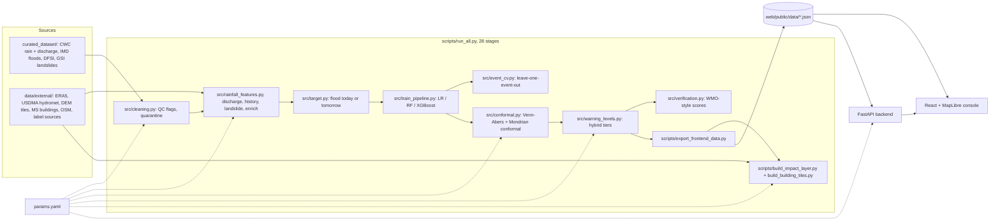

# PRAHAR architecture (as built, October 2026)

This page describes the system that exists now. The target design is in `PRAHAR_MASTER_PLAN.md` §5.

## Components

| Layer | Code | Notes |
|---|---|---|
| Configuration | `params.yaml`, `src/params.py`, `src/config.py`, `src/model_config.py` | every modelling, QC, tier, impact and API constant in one YAML |
| Raw data | `curated_dataset/` + `MANIFEST.sha256` | one copy; hashes are line-ending neutral and checked by tests and the audit |
| Cleaning and QC | `src/cleaning.py` | error code 511.5, cap 150 mm/h, faulty-gauge quarantine, discharge cap |
| Features | `src/rainfall_features.py`, `src/online_features.py`, `src/enrich_features.py`, `src/spatial.py`, `src/flood_features.py`, `src/terrain.py` | past-only features; the O(1) online path is proven equal to batch by a test |
| Models | `src/train_pipeline.py`, `src/tune_models.py` | LR, RF, XGBoost (deployed); 23 features (Exp G) |
| Uncertainty | `src/conformal.py`, `src/robustness.py`, `src/calibration_study.py` | IVAP + Mondrian; RQ4 study in `results/v3/` |
| Warnings | `src/warning_levels.py`, `src/tier_tuning.py`, `src/hysteresis_study.py` | hybrid = max(ML tier, IMD rain tier) with the trigger recorded |
| Verification | `src/verification.py`, `src/external_validation.py`, `src/event_cv.py` | strict district-day CSI, bootstrap CIs, honest lead time |
| Impact | `scripts/build_impact_layer.py`, `scripts/build_building_tiles.py`, `scripts/audit_impact.py` | official setback zones × hazard tier |
| API | `backend/app.py`, `backend/inference.py` | ETag/304 blobs, O(1) `/predict`, CORS allow-list, token-protected admin |
| Web | `web/` (React 19, Vite 8, Tailwind 4, MapLibre 6, Recharts 3) | static mode (JSON files) or API mode (Vite proxy `/api`) |
| Quality gates | `tests/` (51), `scripts/audit_pipeline.py`, `.github/workflows/ci.yml` | data contracts, labels, terrain, behaviour, API, security |

## Request path for `/predict`
1. The engine is loaded once at startup (lifespan). It holds the model, the Venn-Abers grid (400 points), sorted conformal scores, and the last 1,440 h per station.
2. Each request does an O(1) feature update, then one XGBoost predict, a table-lookup calibration, binary-search conformal p-values and the hybrid tier.
3. Measured p95 is 17 ms (`results/latency/benchmarks.csv`).

## Decisions
See `docs/adr/README.md`.
